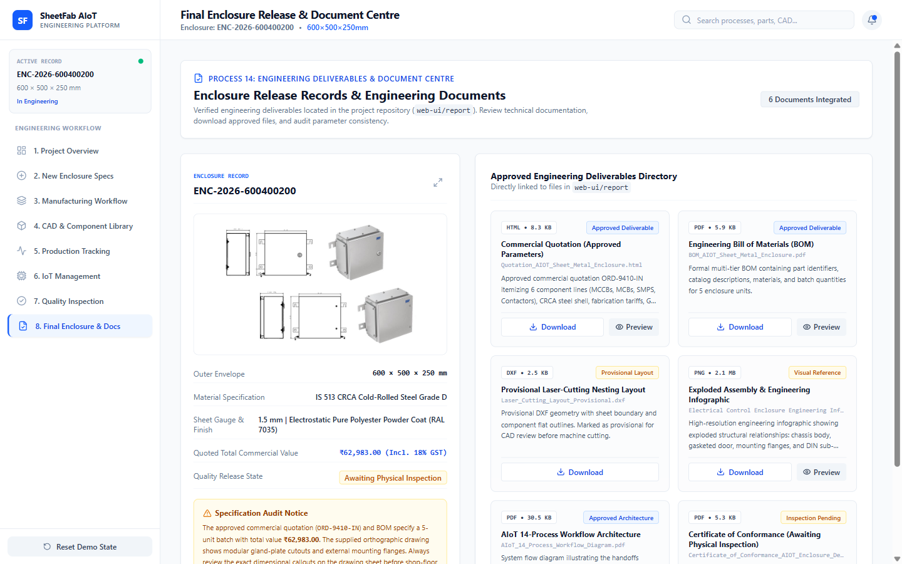

# Engineering Deliverable: Exploded Assembly Drawing

## 📄 File Profile
- **Exact Filename**: `Electrical Control Enclosure Engineering Infographic.png`
- **Location in Project**: `web-ui/report/Electrical Control Enclosure Engineering Infographic.png`
- **Static Web Path**: `/report/Electrical Control Enclosure Engineering Infographic.png`
- **File Format**: Portable Network Graphics (PNG, High Resolution $1920 \times 1080$)
- **Relevant Engineering Process**: **Process 04 (Final 3D CAD Enclosure Design)**

---

## 🎯 Purpose & Scope
This engineering graphic provides an exploded visual assembly breakdown of the complete electrical control enclosure. It illustrates the spatial relationships between the exterior CRCA sheet-metal shell, internal galvanized backplate, horizontal DIN rails, PVC wire management ducts, switchgear layout, front door panel, polyurethane sealing gasket, and door earth grounding strap.

---

## 📸 Assembly Hero View & Deliverable Preview

The image is rendered directly in the **Final Enclosure & Document Centre** as the central enclosure hero visual and in the document preview modal:

---

## 📑 Illustrated Assembly Sub-Systems

1. **Sheet-Metal Structural Shell**:
   - Deep-formed rear enclosure body with welded corner flanges.
   - Punched bottom cutout for removable gland plate.
   - Internal M6 threaded weld studs for backplate stand-off mounting.
2. **Backplate & Component Chassis**:
   - 2.0 mm zinc-passivated galvanized mounting chassis.
   - 3 rows of DIN rails with slotted wire duct channels along perimeters.
3. **Switchgear & Power Train**:
   - Top Rail: 100A MCCB main disconnect + 16A auxiliary branch MCBs.
   - Middle Rail: 24V DC 10A industrial SMPS + control contactor & overload relay.
   - Bottom Rail: High-density screw terminal blocks for incoming/outgoing field cables.
4. **Door & Protection Interfaces**:
   - Continuous polyurethane foam perimeter gasket guaranteeing IP66 ingress protection.
   - Concealed $130^\circ$ lift-off hinges.
   - Braided copper door grounding bond cable ensuring continuous electrical earth bonding complying with IEC 61439-1.

---

## 💾 In-App Preview & Download Actions
- **In-App Modal Preview**: Clicking `Preview` opens the high-resolution image viewer with instant zoom and pan controls.
- **Direct Download**: Clicking `Download` downloads the raw PNG file for inclusion in shop-floor assembly manuals.

---

## 🔗 Related Pages
- [[Screen Documentation/Final Enclosure Document Centre|Final Enclosure & Document Centre]]
- [[Screen Documentation/CAD and Component Library|CAD & Component Library]]
- [[Engineering Deliverables/Bill of Materials|Bill of Materials Deliverable]]
