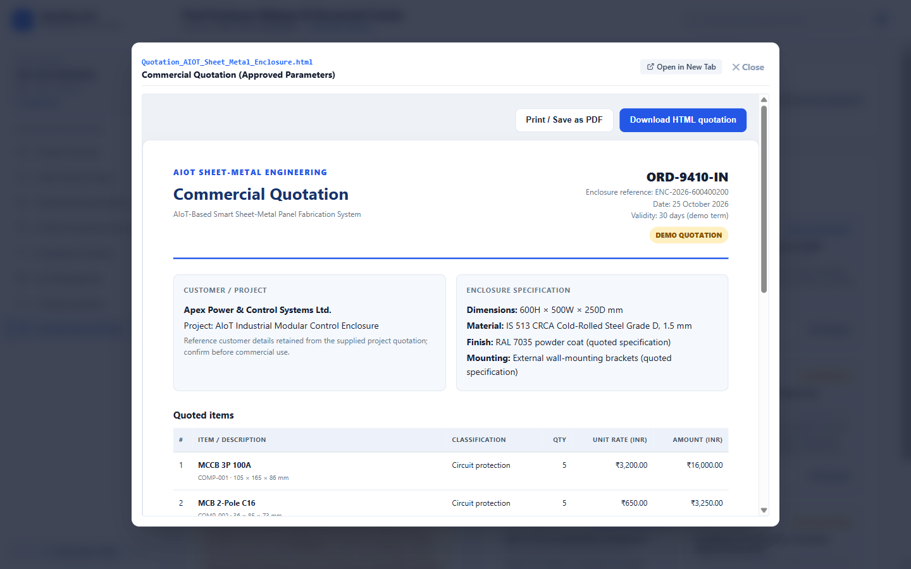

# Engineering Deliverable: Commercial Quotation

## 📄 File Profile
- **Exact Filename**: `Quotation_AIOT_Sheet_Metal_Enclosure.html`
- **Location in Project**: `web-ui/report/Quotation_AIOT_Sheet_Metal_Enclosure.html`
- **Static Web Path**: `/report/Quotation_AIOT_Sheet_Metal_Enclosure.html`
- **File Format**: HTML / CSS (Standalone responsive document)
- **Relevant Engineering Process**: **Process 05 (CAD-to-Manufacturing Documentation, BOM & Quotation)**

---

## 🎯 Purpose & Scope
This commercial document formalizes the production quotation for manufacturing a batch of five (5) custom industrial sheet-metal enclosures. It details unit costs, raw material indexes, CNC machining charges, surface treatment fees, and electrical switchgear accessories with standard Indian Goods and Services Tax (GST).

---

## 📸 Deliverable Card & In-App Preview

### 1. Document Centre Card
Displayed in the **Final Enclosure & Document Centre** as Card 1.

### 2. In-App Preview Modal

---

## 📑 Key Commercial Data & Line Items

| Item No. | Description | Qty | Unit Base Price (₹) | Total Base Price (₹) |
|:---:|---|:---:|:---:|:---:|
| **1** | Custom Sheet Metal Enclosure Shell ($600 \times 500 \times 250 \text{ mm}$, IS 513 CRCA Grade D 1.5mm) | 5 | ₹5,850.00 | ₹29,250.00 |
| **2** | Laser Cutting & CNC Press-Brake Forming Operations | 5 | ₹1,420.00 | ₹7,100.00 |
| **3** | Powder Coating Surface Treatment (RAL 7035, $70\ \mu\text{m}$) | 5 | ₹985.00 | ₹4,925.00 |
| **4** | Internal DIN Rails (35x7.5mm) & Slotted Wire Ducts (40x60mm) | 5 | ₹620.00 | ₹3,100.00 |
| **5** | Enclosure Switchgear Pack (100A MCCB, C16 MCB, 24V SMPS, Contactor) | 5 | ₹1,800.00 | ₹9,000.00 |
| **—** | **Net Subtotal (Before Tax)** | — | — | **₹53,375.00** |
| **—** | **Integrated GST (IGST @ 18.0%)** | — | — | **₹9,608.00** |
| **—** | **Final Commercial Order Value** | — | — | **₹62,983.00** |

---

## 🔍 Engineering Verification & Data Consistency
- **Dimensional Verification**: Enclosure measurements in the quotation ($600 \times 500 \times 250 \text{ mm}$) exactly match the 3D CAD master model and nesting DXF flat patterns.
- **Batch Consistency**: All totals reflect a five-unit fabrication run ($5 \times \text{Unit Cost}$), resolving historical confusion between single-unit costing and batch production totals.
- **Availability**: Accessible for direct in-browser interactive preview via `<iframe>` and HTML download.

---

## 🔗 Related Pages
- [[Screen Documentation/Final Enclosure Document Centre|Final Enclosure & Document Centre]]
- [[Engineering Deliverables/Bill of Materials|Bill of Materials Deliverable]]
- [[User Workflows/Engineering Document Download Workflow|Document Download Workflow]]
