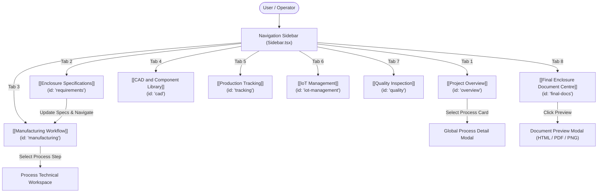

# Navigation and Screen Index

The SheetFab AIoT application employs a clean, single-page application (SPA) tab-based routing model controlled by top-level state in `App.tsx`. 

All 8 primary operational modules are accessible via the persistent left-hand sidebar on desktop viewports and through a sliding modal drawer on mobile viewports.

---

## 📋 Canonical Screen Directory

| Stage / Index | Internal Tab ID | Screen Title | Primary Component | Icon | Focus & Primary Objective |
|:---:|:---|:---|:---|:---:|:---|
| **1** | `overview` | **Project Overview** | `OverviewSection.tsx` | `LayoutDashboard` | Executive dashboard, batch parameters, 14-stage roadmap, and project metadata. |
| **2** | `requirements` | **New Enclosure Specs** | `RequirementsSection.tsx` | `PlusCircle` | Parametric enclosure configurator, material grade selection, live costing, and dimension tuning. |
| **3** | `manufacturing` | **Manufacturing Workflow** | `ManufacturingSection.tsx` | `Layers` | Step-by-step interactive workspace for processes P01 through P14. |
| **4** | `cad` | **CAD & Component Library** | `CADSection.tsx` | `Box` | DIN rail component library, cut-out placement, spatial clearances, and heat dissipation rules. |
| **5** | `tracking` | **Production Tracking** | `TrackingSection.tsx` | `Activity` | Real-time station job progression, barcode scanning simulator, and edge event logs. |
| **6** | `iot-management` | **IoT Management** | `IoTManagementSection.tsx` | `Cpu` | Industrial device registry, connection state monitoring, telemetry schemas, and ISA-95 architecture. |
| **7** | `quality` | **Quality Inspection** | `QualitySection.tsx` | `CheckCircle2` | Camera-based vision inspection, dimensional deviation checks, and pass/fail metrology audits. |
| **8** | `final-docs` | **Final Enclosure & Docs** | `FinalDocsSection.tsx` | `FileCheck` | Engineering release package, discrepancy audit, document previews, and validated downloads. |

---

## 🗺️ Application Navigation Flow

---

## ⚙️ Persistent Navigation Features

### 1. Active Tab Highlighting
The active sidebar item receives prominent visual feedback using:
- Background: `bg-blue-50`
- Text: `text-blue-700 font-bold`
- Icon Color: `text-blue-600`
- Indicator: A rounded, high-contrast left border pill.

### 2. Live Parameter Badges in Sidebar
Directly below the main navigation items, the sidebar displays live enclosure dimensions synchronized with the global record:
- **Dimensions**: E.g., `600 × 500 × 250 mm`
- **Material**: E.g., `IS 513 CRCA Grade D (1.5mm)`
- **Finish**: E.g., `RAL 7035 Powder Coat`
- **Cost Estimate**: Dynamically re-calculated base cost.

### 3. Quick Demo Reset Action
A discrete `Reset Demo Parameters` button in the sidebar footer resets all customized parameters in `localStorage` back to approved baseline values:
- Height: 600 mm, Width: 500 mm, Depth: 250 mm, Thickness: 1.5 mm, Material: IS 513 CRCA Grade D.

---

## 🔗 Related Pages

- [[Website Overview]]
- [[UI Design System]]
- [[User Workflows/Navigation Workflow|Navigation Workflow]]
- [[Technical Reference/Routes and Components|Routes and Components Reference]]
