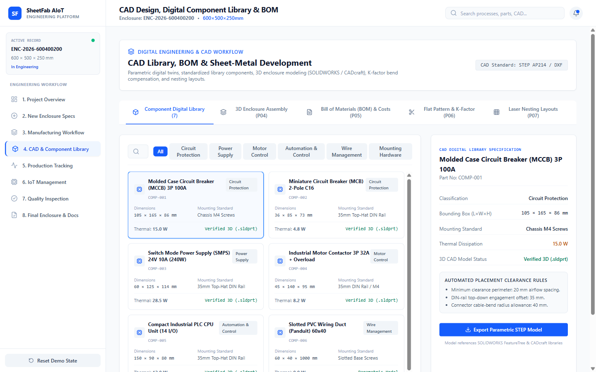

# Screen Documentation — 4. CAD & Component Library

## 🎯 Purpose
The **CAD & Component Library** screen catalogs all standard DIN-rail, backplate, and door-mounted components used in the AIoT enclosure. It enforces industrial layout rules, computes electrical clearance boundaries, and calculates aggregate heat dissipation.

---

## 📸 Screen Capture

---

## 🧭 Navigation & Access
- **Sidebar Label**: `4. CAD & Component Library`
- **Internal Tab ID**: `'cad'`

---

## 📐 Layout & UI Structure

The screen is organized into three primary operational blocks:

### 1. Component Library Catalog & Filter Bar
Allows engineers to browse available components by category:
- `All Categories`
- `Power Distribution & Protection` (MCCB, MCB)
- `Automation & Control` (Contactor, Overload Relay, PLC)
- `Power Supplies` (24V SMPS)
- `Wire Management & Accessories` (Slotted Ducts, DIN Rails, Terminals)

Each catalog card lists:
- Part designation and part number.
- Manufacturer (e.g., Schneider Electric, Phoenix Contact, Mean Well).
- Dimensions ($W \times H \times D$ in mm).
- Heat dissipation rating in Watts ($W$).
- 3D CAD model availability tag (`.STEP / .SLDPRT`).

### 2. Backplate Component Placement Workbench
An interactive visual representation of the enclosure backplate showing:
- 3 standard horizontal DIN rail channels (Top, Middle, Bottom).
- Vertical and horizontal slotted wire duct channels.
- Placed components with dynamic spacing and clearance zones (minimum 30 mm between high-voltage switchgear and low-voltage signal lines).

### 3. Thermal & Layout Audit Summary Panel
- **Total Backplate Area**: Derived from enclosure footprint ($500 \times 600 \text{ mm}$).
- **Usable Component Area Utilization**: E.g., `68.4%` utilized.
- **Aggregate Thermal Dissipation**: Total calculated heat load in Watts (e.g. `48.5 W`), used to specify ventilation fan requirements or passive heat exchange surfaces.
- **Clearance Rule Verification**: Green indicators showing compliance with IS/IEC 61439-1 standards.

---

## 🖱️ User Interactions & State Flow
- **Filtering by Category**: Refines visible cards in the component catalog.
- **Inspecting Component Details**: Displays mounting instructions, terminal screw torque specifications, and wire gauge compatibility.
- **Clearance Validation Check**: Confirms that high-heat units (like the 24V SMPS) are mounted with at least 50 mm vertical clearance for natural convection cooling.

---

## 📊 Data Sources & Boundary Notes
- **Data Source**: Modeled after standard industrial switchgear catalogs and verified project BOM records (`BOM_AIOT_Sheet_Metal_Enclosure.pdf`).
- **CAD Representation**: 2D schematic layout rendering; 3D files are downloaded as standardized `.STEP` files.

---

## 🔗 Related Pages
- [[Screen Documentation/Enclosure Specifications|2. New Enclosure Specs]]
- [[Screen Documentation/Manufacturing Workflow|3. Manufacturing Workflow (P02, P03)]]
- [[Engineering Deliverables/Bill of Materials|Bill of Materials Deliverable]]
