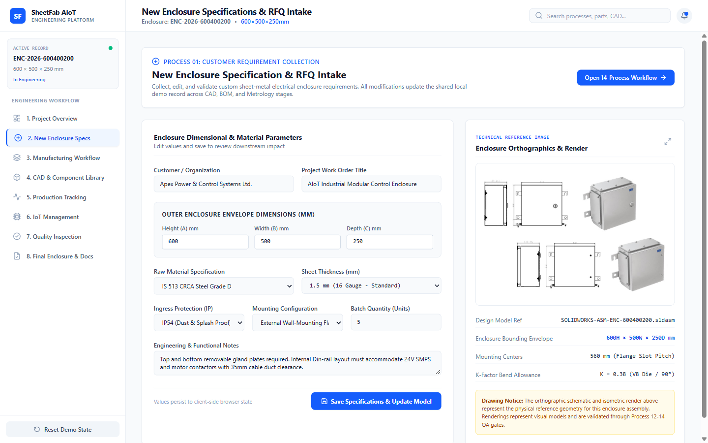

# Screen Documentation — 2. New Enclosure Specs

## 🎯 Purpose
The **New Enclosure Specs** screen provides a parametric design and costing interface where manufacturing engineers configure dimensional boundaries, material specifications, IP ingress protection ratings, door hinge orientations, and production batch sizes. 

Changes dynamically update the live estimated cost, calculate total mass, and synchronize with the persistent application state.

---

## 📸 Screen Capture

---

## 🧭 Navigation & Access
- **Sidebar Label**: `2. New Enclosure Specs`
- **Internal Tab ID**: `'requirements'`
- **Alternative Access**: Via the `Edit Enclosure Specs` button on the Project Overview screen.

---

## 📐 Layout & UI Structure

The screen is arranged in a responsive two-column engineering workbench:

### 1. Left Column: Parametric Configuration Form
Contains dense input controls divided into three logical groups:
- **Spatial Dimensions**:
  - `Height (H)`: Number input in millimeters (Default: `600 mm`).
  - `Width (W)`: Number input in millimeters (Default: `500 mm`).
  - `Depth (D)`: Number input in millimeters (Default: `250 mm`).
  - `Calculated Enclosure Volume`: Dynamic badge displaying `0.075 m³`.
- **Sheet Metal Material & Finish**:
  - `Material Grade`: Dropdown offering `IS 513 CRCA Grade D` (Cold Rolled Close Annealed), `SS 304`, and `Aluminium 5052`.
  - `Sheet Thickness`: Selector for `1.2 mm`, `1.5 mm` (Standard), and `2.0 mm`.
  - `Finish & Powder Coating`: Dropdown for `RAL 7035 Light Grey (60-80 μm)`, `RAL 7032 Pebble Grey`, or `Unfinished Mill Finish`.
- **Enclosure Mechanics & Order Parameters**:
  - `IP Protection Class`: Dropdown (`IP54`, `IP55`, `IP65`, `IP66 Dual Gasket`).
  - `Door Hinge Orientation`: Left-hinged vs Right-hinged toggle.
  - `Batch Quantity`: Number of production units (Default: `5`).

### 2. Right Column: Live Mass & Costing Estimator
- **Calculated Surface Area & Weight**: Dynamic mass calculator based on sheet density ($7.85 \text{ g/cm}^3$ for CRCA) and surface area formulas.
- **Parametric Cost Breakdown Table**:
  - Raw Material Sheet Cost (based on current steel index).
  - Laser Cutting & Piercing Time Cost.
  - CNC Bending Setup & Stroke Cost.
  - Powder Coating Surface Treatment Cost.
  - Fasteners, Gaskets, and Assembly Hardware.
- **Estimated Unit Cost & Total Batch Cost**: E.g. Unit Base: `₹10,675.00` | Batch Total (5 Units + 18% GST): `₹62,983.00`.
- **Action Buttons**:
  - `Save & Apply Parameters`: Updates `localStorage` and alerts user.
  - `Proceed to Manufacturing Workflow`: Switches active tab to `manufacturing`.

---

## 🖱️ User Interactions & State Flow
- **Modifying any dimension/thickness**: Immediately recalculates weight, laser cutting path time, and estimated cost without page reload.
- **Saving Parameters**: Calls `onUpdateRecord(updatedValues)` in `App.tsx`, triggering state persistence to `localStorage`.
- **Navigation button**: Directs operator to the 14-stage workflow to verify how parameter changes affect laser nesting and press-brake tooling.

---

## 📊 Data Sources & Boundary Notes
- **Data Source**: Synchronized with `EnclosureRecord` state model.
- **Engineering Note**: Cost calculations reflect parametric heuristic formulas modeled after regional job-shop rates in Coimbatore, Tamil Nadu.

---

## 🔗 Related Pages
- [[Screen Documentation/Project Overview|1. Project Overview]]
- [[Screen Documentation/Manufacturing Workflow|3. Manufacturing Workflow]]
- [[Engineering Deliverables/Quotation|Commercial Quotation Deliverable]]
