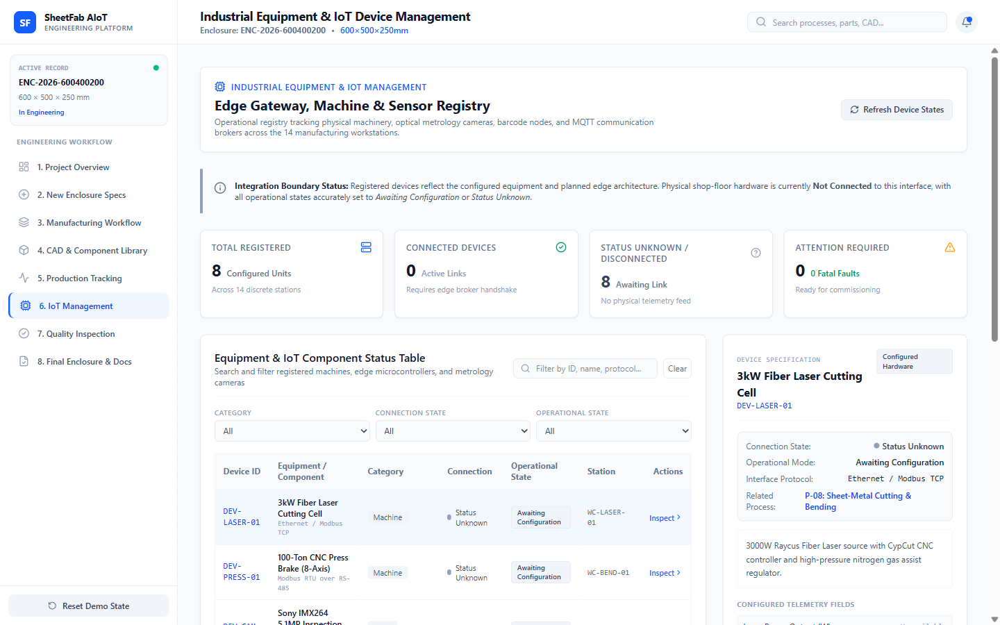

# Screen Documentation — 6. IoT Management

## 🎯 Purpose
The **IoT Management** screen is the dedicated industrial device and equipment monitoring dashboard. It bridges physical plant machinery, microcontroller edge nodes, optical inspection cameras, and edge computing inference servers into a centralized ISA-95 asset hierarchy.

It explicitly documents device connection states, operational conditions, communication protocols, telemetry schemas, and planned broker integration boundaries without fabricating live sensor telemetry.

---

## 📸 Screen Captures

### 1. Main IoT Dashboard & Equipment Status Table


### 2. Device Detail Inspector Panel (DEV-LASER-01 Selected)


---

## 🧭 Navigation & Access
- **Sidebar Label**: `6. IoT Management`
- **Internal Tab ID**: `'iot-management'`
- **Position**: Placed immediately following Production Tracking to clearly delineate job tracking from physical asset telemetry.

---

## 📐 Layout & UI Structure

The screen consists of five primary UI blocks:

### 1. High-Level Device Overview Cards
Derived dynamically from the shared `INITIAL_IOT_DEVICES` model in `src/data/iotDeviceData.ts`:
- **Total Registered Devices**: `8` (Total configured equipment records).
- **Connected Devices**: `0` (Honest status: 0 connected prior to network deployment).
- **Disconnected / Status Unknown**: `8` (All devices awaiting broker handshakes).
- **Attention Required / Faults**: `0` (No active unacknowledged error states).

### 2. Multi-Filter & Search Toolbar
Allows operators to isolate devices using four concurrent filters:
- **Search Bar**: Real-time filtering by device identifier (e.g. `DEV-CAM`) or equipment name.
- **Category Filter**: `All Categories`, `Machine`, `Edge Device`, `Camera`, `Sensor`, `Service`.
- **Connection State Filter**: `All`, `Connected`, `Disconnected`, `Unknown`.
- **Operational State Filter**: `All`, `Running`, `Idle`, `Warning`, `Fault`, `Unavailable`.
- **Reset Filters Button**: Restores default view with one click.
- **Refresh Status Button**: Simulates a manual heartbeat polling query without mutating baseline state.

### 3. Equipment & Component Status Table
Compact, high-density industrial table detailing all 8 documented equipment assets:

| Device ID | Equipment / Component | Category | Connection | Operational State | Station | Protocol / Interface |
|---|---|---|---|---|---|---|
| `DEV-LASER-01` | TRUMPF TruLaser 3030 Fiber Cutter | Machine | Status Unknown | Unavailable | Station 01 (Cutting) | OPC-UA / TCP |
| `DEV-PRESS-01` | Amada HFE-M2 8-Axis CNC Press Brake | Machine | Status Unknown | Unavailable | Station 02 (Bending) | Modbus TCP |
| `DEV-CAM-P12` | Basler ace 2 12MP Telecentric Camera | Camera | Status Unknown | Unavailable | Station 06 (Metrology) | GigE Vision / GenICam |
| `DEV-EDGE-ESP32-01` | Station 03 ESP32-WROOM-32E Gateway | Edge Device | Status Unknown | Unavailable | Station 03 (Welding) | MQTT (Port 1883) |
| `DEV-SRV-MQTT` | EMQX Enterprise MQTT Broker Node | Service | Status Unknown | Unavailable | Central Server | TCP/IP / WebSocket |
| `DEV-SCAN-BARCODE` | Honeywell Granit 1980i Rugged Scanner | Sensor | Status Unknown | Unavailable | Station 01-06 (Mobile) | USB-HID / Bluetooth |
| `DEV-SRV-CV-INFER` | Jetson AGX Orin Metrology Inference Node | Service | Status Unknown | Unavailable | Station 06 (Metrology) | gRPC / REST |
| `DEV-SENS-DFT` | Positector 6000 Powder Coating DFT Gauge | Sensor | Status Unknown | Unavailable | Station 04 (Coating) | Bluetooth Low Energy |

### 4. Interactive Device Detail Inspector (Slide-in / Expandable)
Clicking any table row displays an in-depth asset inspector:
- **Asset Header**: Full machine name, hardware ID, category tag, and ISA-95 hierarchical level.
- **Connection vs. Operational State**: Explains that the asset is declared as *Status Unknown / Offline* because no physical network gateway is actively streaming telemetry.
- **Hardware Profile**: Microcontroller/chipset, firmware version, and physical interface.
- **Telemetry Schema Definitions**: Documents standard JSON payload fields (e.g. `laser_power_kw`, `assist_gas_bar`, `beam_on_hours`, `chiller_temp_c`) expected once connected.
- **Target MQTT / Network Topic**: E.g., `sheetfab/station01/laser/telemetry`.
- **Configuration & Maintenance Audit History**: Lists factory provisioning records and scheduled calibration intervals.

### 5. ISA-95 Industrial Communication Architecture Panel
A compact graphical diagram detailing the proposed shop-floor data flow:
```text
Level 0/1: Field Sensors & Machines (Laser, Press Brake, Basler Cam, DFT Gauge)
   │
   ▼
Level 2: Edge Gateways & Nodes (ESP32-WROOM-32E, Jetson AGX Orin)
   │ (MQTT over TLS / Modbus TCP)
   ▼
Level 2/3: Communication Middleware (EMQX Enterprise MQTT Broker)
   │ (WebSocket / REST API)
   ▼
Level 3: Application Services & CV Metrology (Python OpenCV Engine, Node Service)
   │
   ▼
Level 3/4: SheetFab Monitoring & Production Dashboard (This Interface)
```

---

## 🖱️ User Interactions & State Flow
- **Row Click**: Selects a device and activates the detailed asset inspector panel.
- **Filter Dropdowns**: Filter rows dynamically with instant zero-latency feedback.
- **Data Honesty Banner**: Displays a persistent alert:
  > **Industrial Integration Boundary:** Displayed connection states represent configured equipment profiles. Physical hardware integration is currently awaiting gateway deployment; no live sensor readings are fabricated.

---

## 📊 Data Sources & Boundary Notes
- **Data Source**: Defined in `src/data/iotDeviceData.ts` as a typed, extensible TypeScript interface (`IoTDevice`).
- **Extensibility**: Ready for immediate binding to an EMQX WebSocket client or REST polling endpoint without modifying UI layouts.

---

## 🔗 Related Pages
- [[Screen Documentation/Production Tracking|5. Production Tracking]]
- [[Screen Documentation/Quality Inspection|7. Quality Inspection]]
- [[User Workflows/IoT Monitoring Workflow|IoT Monitoring Workflow]]
- [[Technical Reference/Data and State Model|Data and State Model]]
