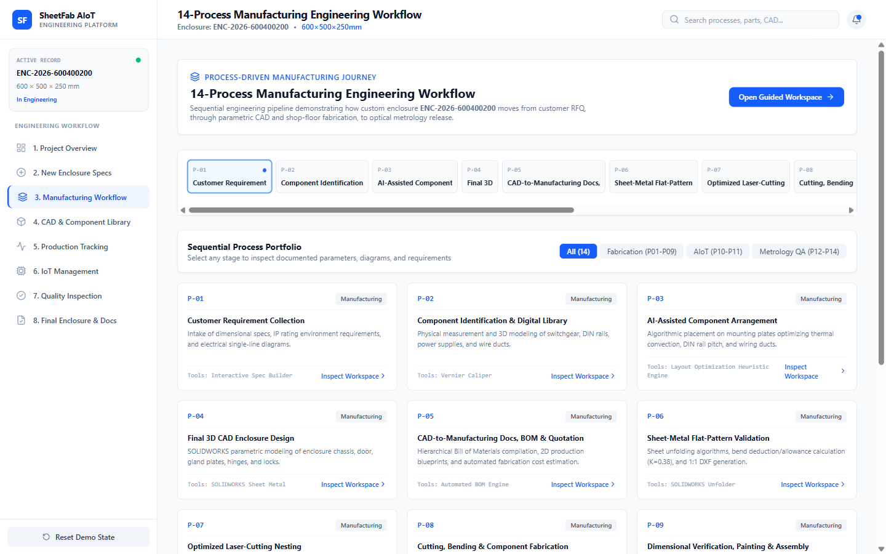

# Screen Documentation — 3. Manufacturing Workflow

## 🎯 Purpose
The **Manufacturing Workflow** screen is the technical core of the platform. It provides complete step-by-step documentation, engineering formulas, input/output specifications, and visual deliverables for all 14 stages of sheet metal fabrication and AIoT deployment.

---

## 📸 Screen Captures

### 1. Main Workflow Index View

### 2. Interactive Process Technical Workspace (Stepper)

---

## 🧭 Navigation & Access
- **Sidebar Label**: `3. Manufacturing Workflow`
- **Internal Tab ID**: `'manufacturing'`
- **Alternative Access**: Clicking `Proceed to Manufacturing Workflow` from the Specifications screen or selecting any process card from the Project Overview screen.

---

## 📐 Layout & UI Structure

The screen contains two complementary operational modes:

### Mode A: 14-Process Catalog & Domain Filter
When browsing the workflow catalog, users can:
- **Filter by Engineering Domain**:
  - `All Processes (14)`
  - `Manufacturing Engineering (P01–P09)`
  - `Digital Engineering & AIoT (P10–P11)`
  - `Inspection & Metrology (P12–P14)`
- **Search by Keyword**: Filter by tool names (e.g., `SOLIDWORKS`, `OpenCV`, `ESP32`) or deliverables.
- **Card Matrix**: Each process card renders:
  - Process ID pill (e.g., `P06 • Flat Pattern Development`).
  - One-line technical summary.
  - Input and Output badges.
  - Software & machinery tags.
  - Action button: `Open Process Workspace`.

### Mode B: Interactive Process Technical Workspace
Clicking any process opens a full-width technical stepper workspace equipped with:
1. **Stepper Header**:
   - Process Number, Title, and Domain Badge.
   - Stepper Navigation: `Previous`, `Next`, and `Exit Workspace` (`X`).
2. **Visual Artifact Panel (Left 5 Columns)**:
   - High-resolution engineering infographic, CAD screenshot, or wiring diagram.
   - `Expand / Lightbox` action button to view full-resolution diagrams without truncation.
3. **Engineering Details Panel (Right 7 Columns)**:
   - **Detailed Technical Overview**: Full procedural explanation.
   - **Inputs & Upstream Dependencies**: What files/parameters must be provided.
   - **Key Deliverables & Tolerances**: Output drawings, DXF files, inspection matrices, and standard tolerances.
   - **Software, Equipment & Tools**: Monospace badges for software packages (AutoCAD, CADcraft, Edge Impulse) and machines (TRUMPF TruLaser 3030, Amada HFE-M2).
   - **Process Metric Checklist**: Verification checkpoints required before proceeding.

---

## 🏭 Complete 14-Process Sequence

| Process ID | Process Title | Domain | Primary Equipment & Software | Key Deliverable |
|---|---|---|---|---|
| **P01** | Customer Requirement Collection | Manufacturing | Web Configurator, Google Forms | Customer Specification Sheet |
| **P02** | Component Identification & Digital Library | Manufacturing | SOLIDWORKS, CAD Library | 3D Step Files, Component Metadata |
| **P03** | AI-Assisted Internal Arrangement | Manufacturing | Python Layout Engine, Claude/GPT | Thermal & Clearance Layout Plan |
| **P04** | Final 3D CAD Enclosure Design | Manufacturing | SOLIDWORKS 2024, Sheet Metal Module | 3D CAD Assembly (.SLDASM, .STEP) |
| **P05** | CAD-to-Manufacturing Docs & BOM | Manufacturing | Excel, ERP Integration, HTML | Commercial Quotation & 14-line BOM |
| **P06** | Flat-Pattern Development & Validation | Manufacturing | SOLIDWORKS Flat Pattern, K-Factor Tables | Unfolded 2D DXF Flat Patterns |
| **P07** | Optimized Laser-Cutting Nesting | Manufacturing | Lantek Expert, TruTops Boost | Nesting Layout DXF & NC G-Code |
| **P08** | Sheet-Metal Cutting & Bending | Manufacturing | TRUMPF TruLaser 3030, Amada Press Brake | Formed Sheet Metal Shell & Door |
| **P09** | Verification, Painting & Assembly | Manufacturing | DFT Gauge, Powder Coating Line | Assembled RAL 7035 Control Panel |
| **P10** | AIoT System Implementation Guide | Digital Systems | ESP32-WROOM-32E, MQTT, EMQX | Edge Gateway & Wiring Schematic |
| **P11** | IoT Job-Tracking Dashboard | Digital Systems | React, Tailwind CSS, MQTT WebSocket | Real-time Station Monitor Dashboard |
| **P12** | Camera-Based Dimensional Inspection | Quality Metrology | Basler 12MP Telecentric Camera | Calibrated Raw High-Res Images |
| **P13** | CV Feature Detection & Metrology | Quality Metrology | Python 3.11, OpenCV 4.9, NumPy | Edge Deviation & Tolerance Map |
| **P14** | Final Enclosure Quality Inspection | Quality Metrology | Metrology Suite, QA Auditor | Certificate of Conformance (CoC) |

---

## 🖱️ User Interactions & State Flow
- **Stepper Navigation**: Clicking `Next` or `Previous` moves linearly through the 14 processes without leaving the workspace.
- **Lightbox Zoom**: Clicking `Expand` launches a high-z-index image viewer modal for inspecting complex technical diagrams.
- **Filtering**: Typing into the search bar or clicking domain buttons dynamically adjusts the visible catalog in real time.

---

## 📊 Data Sources & Boundary Notes
- **Data Source**: Loaded from `PROCESSES_DATA` array in `src/data/projectData.ts`.
- **Engineering Content**: Preserved in full from the verified academic knowledge base and project specifications.

---

## 🔗 Related Pages
- [[Screen Documentation/Enclosure Specifications|2. New Enclosure Specs]]
- [[Screen Documentation/CAD and Component Library|4. CAD & Component Library]]
- [[Engineering Deliverables/14 Process Workflow Diagram|14-Process Workflow Diagram Deliverable]]
- [[User Workflows/Manufacturing Process Workflow|Manufacturing Process Workflow]]
