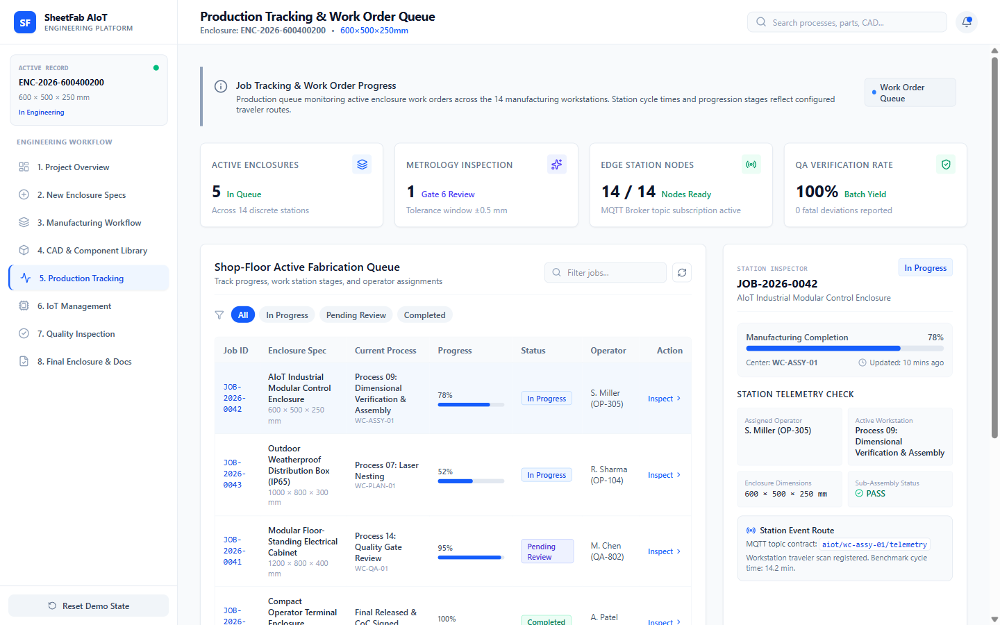

# Screen Documentation — 5. Production Tracking

## 🎯 Purpose
The **Production Tracking** screen monitors shop-floor job progression across manufacturing stations. It models the Manufacturing Execution System (MES) flow, tracking job batches through laser cutting, CNC bending, welding, powder coating, and assembly.

---

## 📸 Screen Capture

---

## 🧭 Navigation & Access
- **Sidebar Label**: `5. Production Tracking`
- **Internal Tab ID**: `'tracking'`

---

## 📐 Layout & UI Structure

The screen is divided into four functional sections:

### 1. Active Job Order & Work Order Header
- Displays active job: `WO-2025-0814-01`.
- Batch size: `5 Enclosures`.
- Part Number: `ENC-605025-CRCA-D`.
- Target Completion Date and Overall Progress Bar (`62% Completed`).

### 2. Station-by-Station Workflow Kanban / Progression Strip
Six sequential shop-floor stations are tracked with status indicators:
1. **Station 01: Fiber Laser Cutting** — Status: `Completed (5/5 Parts)`. Machine: TRUMPF TruLaser 3030.
2. **Station 02: CNC Press Brake Bending** — Status: `Completed (5/5 Parts)`. Machine: Amada HFE-M2.
3. **Station 03: TIG / Spot Welding** — Status: `In Progress (3/5 Units)`. Station Gateway: ESP32 Edge Node.
4. **Station 04: Chemical Pretreatment & Powder Coat** — Status: `Queued`. Batch Oven #2.
5. **Station 05: Electrical Component Integration** — Status: `Awaiting Assembly`.
6. **Station 06: Vision Quality Inspection** — Status: `Awaiting Metrology`.

### 3. Barcode & Work-Order Scanner Simulator
- Input box simulating optical barcode / 2D DataMatrix scanning on the plant floor.
- `Scan Part Barcode` action button validating traveler tickets.
- Validates job travelers (e.g. `TRV-ENC-001-ST03`) and logs station transitions.

### 4. Edge Station Event Log
- Displays station event timestamps, station IDs, operator actions, and status updates.
- Honest boundary notice: **Hardware Interface: Disconnected / Awaiting Physical Gateway Integration**. Clearly informs operators that station transitions represent local application workflow states pending physical MQTT broker connectivity.

---

## 🖱️ User Interactions & State Flow
- **Scanning Traveler Barcode**: Entering a part traveler code updates the current station progress count.
- **Advancing Station**: Operator can click station cards to inspect operator IDs, cycle times, and scrap counts.

---

## 📊 Data Sources & Boundary Notes
- **Data Source**: Local frontend state in `TrackingSection.tsx`.
- **Honesty Compliance**: All prototype-style mock disclaimers were replaced with standard industrial terminology (`Job Tracking`, `Station Monitor`). The interface explicitly clarifies that physical hardware gateways are awaiting network deployment.

---

## 🔗 Related Pages
- [[Screen Documentation/Manufacturing Workflow|3. Manufacturing Workflow (P08, P11)]]
- [[Screen Documentation/IoT Management|6. IoT Management]]
- [[User Workflows/Manufacturing Process Workflow|Manufacturing Process Workflow]]
