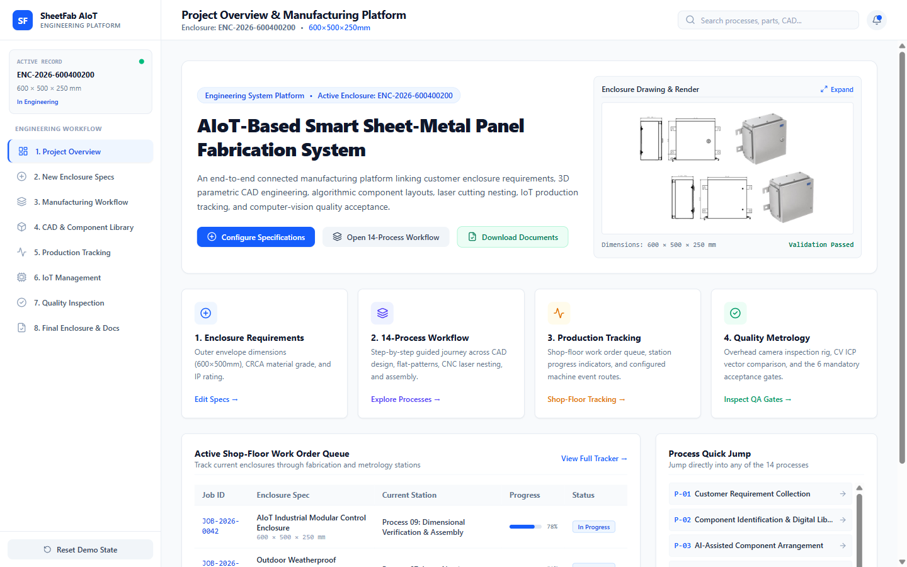

# Screen Documentation — 1. Project Overview

## 🎯 Purpose
The **Project Overview** screen serves as the master engineering summary and project control centre. It provides executive visibility into:
- The active enclosure job order specifications (dimensions, material, finish, batch quantity).
- The end-to-end 14-stage manufacturing roadmap grouped into functional domains.
- Quick navigation pathways to configure specifications, explore the CAD library, or review quality inspection metrics.

---

## 📸 Screen Capture

---

## 🧭 Navigation & Access
- **Sidebar Label**: `1. Project Overview`
- **Internal Tab ID**: `'overview'`
- **Default Landing**: Yes (displayed on first launch).

---

## 📐 Layout & UI Structure

### 1. Executive Summary Banner
- Displays the primary project title: **AIoT-Based Smart Sheet-Metal Panel Fabrication System**.
- Subtitle detailing batch lot ID (`BATCH-2025-08-01`), client identifier, and overall system status (`Active Engineering Order`).
- Direct navigation buttons: `Edit Enclosure Specs` (switches to Tab 2) and `Document Centre` (switches to Tab 8).

### 2. High-Level Parameter Metric Cards
Four prominent KPI cards highlighting the active order configuration:
- **Enclosure Volume & Footprint**: Displays `600 × 500 × 250 mm` (`0.075 m³`).
- **Sheet Metal Specification**: Displays `IS 513 CRCA Grade D` with thickness `1.5 mm`.
- **Target Commercial Estimate**: Displays calculated order cost (e.g., `₹62,983.00` for 5 units).
- **Quality Standard Compliance**: Flags target standard `ISO 2768-m` / `IP66 Enclosure Rating`.

### 3. 14-Stage Workflow Roadmap Matrix
The complete process sequence is rendered in an interactive card grid divided into three standard engineering domains:
1. **Manufacturing Engineering (Processes 01–09)**: Customer Requirements, Digital Library, AI Arrangement, 3D CAD, BOM/Quotation, Flat-Pattern, Laser Nesting, Fabrication, Assembly.
2. **Digital Engineering & AIoT (Processes 10–11)**: AIoT System Architecture, IoT Job-Tracking Dashboard.
3. **Metrology & Quality Assurance (Processes 12–14)**: Camera Dimensional Inspection, CV Feature Detection, Final Enclosure QA.

Each card displays the process number badge (e.g. `P01`), title, domain pill, primary CAD/engineering tool, and a clickable `View Specifications` action.

---

## 🖱️ User Interactions & State Flow
- **Clicking "Edit Enclosure Specs"**: Transitions to the `requirements` tab.
- **Clicking "Review Document Centre"**: Transitions to the `final-docs` tab.
- **Clicking Any Process Card (`View Specifications`)**: Triggers the global modal dialog (`selectedProcessId`) displaying the full engineering input/output specifications, tools, and technical diagram.

---

## 📊 Data Sources & Boundary Notes
- **Data Source**: React props passed down from `enclosureRecord` in `App.tsx` (persisted in `localStorage`) and static process definitions from `data/projectData.ts`.
- **Status Truth**: Reflects currently configured engineering parameters. Does not imply physical fabrication completion.

---

## 🔗 Related Pages
- [[Navigation and Screen Index]]
- [[Screen Documentation/Enclosure Specifications|2. New Enclosure Specs]]
- [[Screen Documentation/Manufacturing Workflow|3. Manufacturing Workflow]]
- [[Engineering Deliverables/Quotation|Commercial Quotation Deliverable]]
