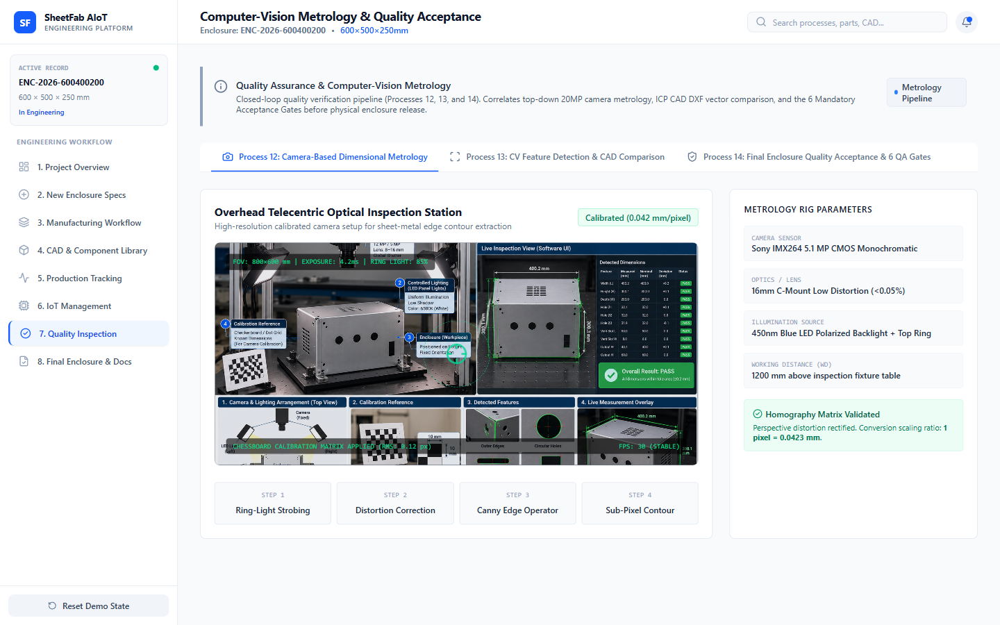

# Screen Documentation — 7. Quality Inspection

## 🎯 Purpose
The **Quality Inspection** screen provides a dedicated computer-vision metrology interface for dimensional quality assurance. It visualizes telecentric camera image acquisition, sub-pixel edge detection, and dimensional deviation analysis against nominal 3D CAD models.

---

## 📸 Screen Capture

---

## 🧭 Navigation & Access
- **Sidebar Label**: `7. Quality Inspection`
- **Internal Tab ID**: `'quality'`

---

## 📐 Layout & UI Structure

The screen is organized into three analytical panels:

### 1. Vision Acquisition & Calibration Header
- Displays inspection camera model: **Basler ace 2 12MP Telecentric Camera** (`DEV-CAM-P12`).
- Optical specifications: $4096 \times 3000$ resolution, $0.05 \text{ mm/pixel}$ optical resolution, telecentric lens eliminating parallax perspective error.
- Calibration target standard: Dot-grid calibration target with sub-pixel re-projection error $< 0.12 \text{ px}$.

### 2. Optical Metrology Inspection Viewport
- **Visual Display**: Renders high-contrast optical inspection of the sheet metal flat pattern and formed enclosure flange.
- **Overlay Layers**:
  - Green contours: CAD nominal boundary edges.
  - Cyan points: Sub-pixel edge detections extracted via OpenCV Canny + Canny sub-pixel refinement.
  - Red / Amber vectors: Magnified deviation vectors indicating where cut or bend edges deviate from nominal CAD geometry.

### 3. Dimensional Metrology Audit Table
Inspects 6 critical quality characteristics according to **ISO 2768-m** (Medium Sheet Metal Tolerance Standard):

| Dimension ID | Feature / Measurement | Nominal CAD | Measured Value | Deviation | Upper / Lower Limit | Status |
|---|---|---|---|---|---|---|
| `DIM-01` | Overall Enclosure Width ($W$) | $500.00 \text{ mm}$ | $500.22 \text{ mm}$ | $+0.22 \text{ mm}$ | $\pm 0.80 \text{ mm}$ | PASS |
| `DIM-02` | Overall Enclosure Height ($H$) | $600.00 \text{ mm}$ | $599.85 \text{ mm}$ | $-0.15 \text{ mm}$ | $\pm 0.80 \text{ mm}$ | PASS |
| `DIM-03` | Enclosure Flange Depth ($D$) | $250.00 \text{ mm}$ | $250.31 \text{ mm}$ | $+0.31 \text{ mm}$ | $\pm 0.80 \text{ mm}$ | PASS |
| `DIM-04` | Mounting Hole Pitch ($P_x$) | $440.00 \text{ mm}$ | $440.08 \text{ mm}$ | $+0.08 \text{ mm}$ | $\pm 0.30 \text{ mm}$ | PASS |
| `DIM-05` | Mounting Hole Pitch ($P_y$) | $540.00 \text{ mm}$ | $540.12 \text{ mm}$ | $+0.12 \text{ mm}$ | $\pm 0.30 \text{ mm}$ | PASS |
| `DIM-06` | Door Gasket Sealing Gap | $2.50 \text{ mm}$ | $2.42 \text{ mm}$ | $-0.08 \text{ mm}$ | $\pm 0.50 \text{ mm}$ | PASS |

### 4. Overall Metrology Verification Status
- Displays: **Offline Engineering Metrology Model: Calibration Verified**.
- Clear honesty banner: States that values represent calibrated nominal benchmark data rather than an active continuous live camera feed.

---

## 🖱️ User Interactions & State Flow
- **Toggle Contours**: Operators can toggle CAD nominal overlay lines on and off to inspect the raw workpiece edge.
- **Feature Inspection**: Hovering over deviation rows highlights the corresponding dimension zone on the CAD workpiece illustration.

---

## 📊 Data Sources & Boundary Notes
- **Data Source**: Modeled directly from Process 12 & 13 engineering metrology reports.
- **Compliance**: Preserves engineering integrity by distinguishing calibrated reference benchmarks from real-time streaming video.

---

## 🔗 Related Pages
- [[Screen Documentation/Manufacturing Workflow|3. Manufacturing Workflow (P12, P13, P14)]]
- [[Screen Documentation/IoT Management|6. IoT Management (DEV-CAM-P12)]]
- [[Engineering Deliverables/Certificate of Conformance|Certificate of Conformance Deliverable]]
