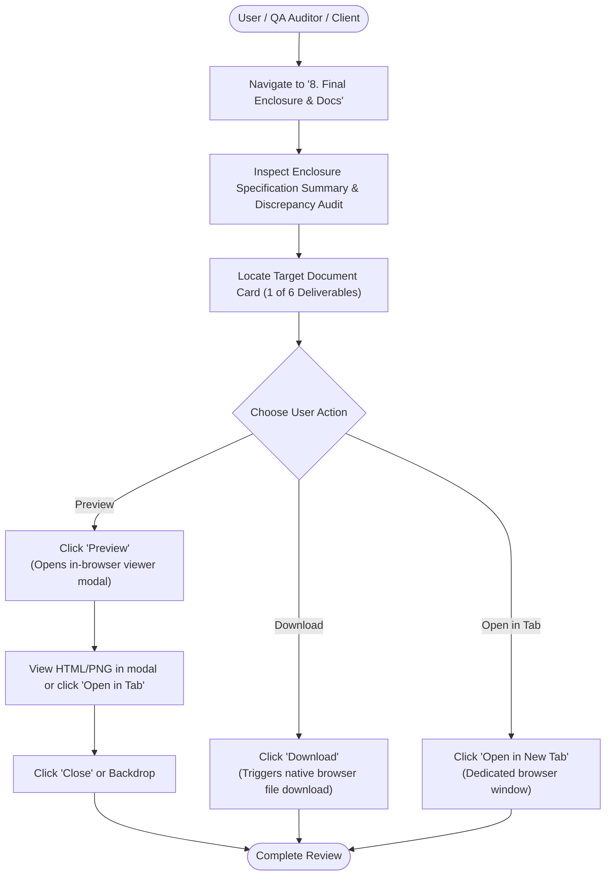

# Engineering Document Download Workflow — Accessing Real Deliverables

The SheetFab AIoT platform hosts a verified repository of engineering deliverables in the **Final Enclosure & Document Centre**. Every document card connects directly to an authentic deliverable located in `web-ui/public/report/`.

---

## 🧭 Step-by-Step Operator Procedure

---

## 📑 Deliverable Matrix & Supported Actions

| Deliverable Name | File in `public/report/` | Format | Primary Engineering Use | Supported In-App Actions |
|---|---|---|---|---|
| **Commercial Quotation** | `Quotation_AIOT_Sheet_Metal_Enclosure.html` | HTML | Approved cost quotation for batch of 5 units (₹62,983.00 incl. GST) | **Preview (Modal iframe)**, **Open in Tab**, **Download** |
| **Bill of Materials (BOM)** | `BOM_AIOT_Sheet_Metal_Enclosure.pdf` | PDF | Complete 14-item component schedule (CRCA sheet, DIN rails, MCCB, SMPS) | **Open in Dedicated Tab**, **Download** |
| **Laser-Cutting Layout** | `Laser_Cutting_Layout_Provisional.dxf` | DXF | 2D CAD nesting geometry for CNC laser piercing & cutting | **Download DXF** (Open in AutoCAD / DraftSight) |
| **Exploded Assembly View** | `Electrical Control Enclosure Engineering Infographic.png` | PNG | Visual assembly schematic showing internal DIN rails, ducting & chassis | **Preview (Modal Image Zoom)**, **Open in Tab**, **Download** |
| **14-Process Workflow** | `AIoT_14_Process_Workflow_Diagram.pdf` | PDF | Comprehensive engineering flowchart across P01 through P14 | **Open in Dedicated Tab**, **Download** |
| **Certificate of Conformance** | `Certificate_of_Conformance_AIOT_Enclosure_Demo.pdf` | PDF | Provisional QA compliance certificate (Status: Inspection Pending) | **Open in Dedicated Tab**, **Download** |

---

## 🔍 Validation & Technical Safeguards

1. **Direct File Path Verification**:
   - The application serves files directly via standard static URLs: E.g., `/report/Quotation_AIOT_Sheet_Metal_Enclosure.html`.
   - Never uses dummy JavaScript alerts or broken placeholder URLs.
2. **Preview Fallback Architecture**:
   - Web-friendly formats (HTML, PNG) render seamlessly within the interactive in-app modal.
   - Heavy vector/PDF files offer direct browser tab viewing to take advantage of native browser PDF rendering engines (PDF.js, Chrome PDF viewer).
3. **Data Consistency Audit**:
   - The interface performs an active check verifying that the commercial quotation total of **₹62,983.00** corresponds with the batch size of 5 units and standard enclosure footprint of $600 \times 500 \times 250 \text{ mm}$.

---

## 🔗 Related Pages
- [[Screen Documentation/Final Enclosure Document Centre|Final Enclosure & Document Centre Screen]]
- [[Engineering Deliverables/Quotation|Quotation Deliverable Details]]
- [[Engineering Deliverables/Bill of Materials|Bill of Materials Deliverable Details]]
- [[Engineering Deliverables/Laser Cutting Layout|Laser Cutting Layout Deliverable Details]]
