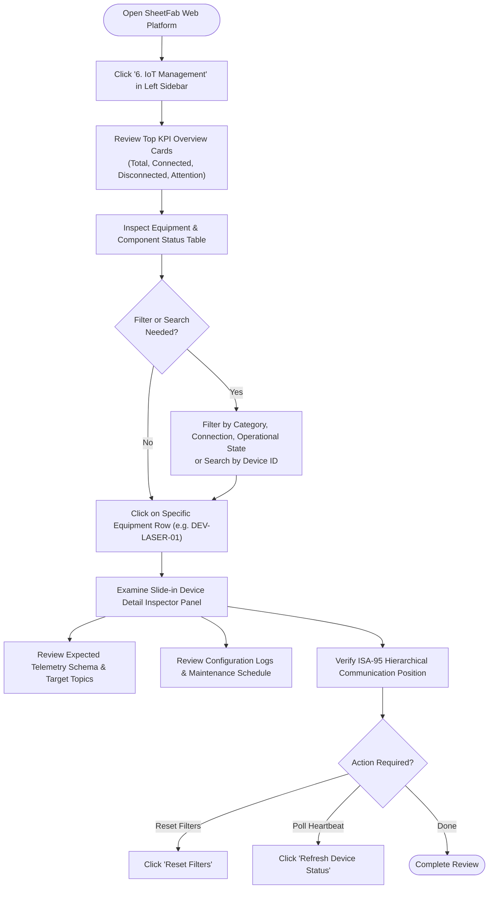

# IoT Monitoring Workflow — Industrial Asset Surveillance

This document describes how manufacturing plant supervisors, maintenance engineers, and digital systems technicians utilize the **IoT Management** screen within the SheetFab AIoT platform to monitor machine tools, edge gateways, sensors, and computer-vision services.

---

## 🧭 Step-by-Step Operator Procedure

---

## 🔍 Detailed Operational Steps

### Step 1: Accessing the IoT Management Screen
- Click **6. IoT Management** in the persistent left-hand navigation sidebar (or the mobile slide-over drawer).
- The dashboard automatically renders the shared device registry containing all 8 registered industrial devices.

### Step 2: Evaluating High-Level Shop-Floor Status
Inspect the 4 high-level KPI cards at the top of the viewport:
1. **Total Registered Devices**: Indicates the full inventory of configured machinery, sensors, and servers (Value: `8`).
2. **Connected Devices**: Shows devices with an active, verified network heartbeat (Value: `0` prior to gateway deployment).
3. **Disconnected / Status Unknown**: Displays devices that are currently offline or awaiting broker configuration (Value: `8`).
4. **Attention Required / Faults**: Flags any machine tripping an emergency e-stop or critical alarm (Value: `0`).

### Step 3: Searching & Filtering Equipment
To rapidly locate a specific device on a busy shop floor:
- **Search Query**: Type partial strings such as `LASER`, `PRESS`, `CAM`, or `ESP32` into the search box.
- **Category Dropdown**: Narrow the table to specific hardware types:
  - `Machine` (TRUMPF Laser, Amada Press Brake).
  - `Edge Device` (ESP32 Gateway).
  - `Camera` (Basler Telecentric Inspection Camera).
  - `Sensor` (Barcode Scanner, DFT Paint Gauge).
  - `Service` (EMQX MQTT Broker, Jetson AGX Orin CV Inference).
- **Connection & Operational Filters**: Filter by connection integrity (`Connected`, `Disconnected`, `Unknown`) or operational state (`Running`, `Idle`, `Warning`, `Fault`, `Unavailable`).

### Step 4: Inspecting Asset Details & Telemetry Schemas
Clicking on any row in the table (e.g., `DEV-LASER-01`) activates the **Device Detail Inspector Panel**:
1. **Connection & Operational State Audit**: Verify that the interface reports *Status Unknown / Unavailable* with clear rationale (awaiting physical plant gateway integration).
2. **Telemetry Schema Definitions**: Review the exact JSON telemetry keys that the machine will broadcast once connected (e.g., `laser_power_kw`, `assist_gas_bar`, `beam_on_hours`).
3. **Target MQTT Topic**: Identify the broker topic for IT/OT network routing (e.g., `sheetfab/station01/laser/telemetry`).
4. **ISA-95 Level Verification**: Confirm the asset's position within the Purdue enterprise hierarchy (Level 1 field machine, Level 2 edge gateway, or Level 3 application service).

---

## ⚠️ Data Integrity & Boundary Policy

When demonstrating or operating the SheetFab IoT dashboard:
- **Never claim live connection**: Devices marked as *Status Unknown* must not be described as running live equipment.
- **No simulated sensor fluctuations**: The dashboard deliberately avoids random number generators or fake waveform oscillations to preserve engineering documentation standards.

---

## 🔗 Related Pages
- [[Screen Documentation/IoT Management|IoT Management Screen Documentation]]
- [[Screen Documentation/Production Tracking|Production Tracking]]
- [[Technical Reference/Data and State Model|Data and State Model]]
