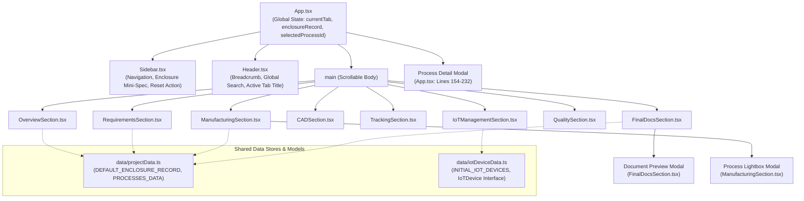
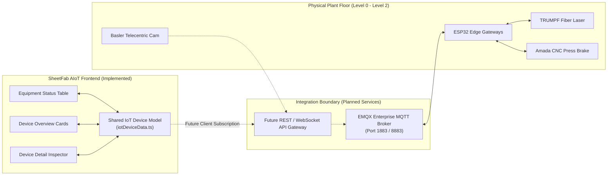

# Website Architecture — SheetFab AIoT Platform

This document describes the software structure, component tree, state management patterns, and system integration boundaries of the SheetFab AIoT frontend application (`web-ui`).

---

## 🏗️ Technology Stack & Dependencies

```text
React 19.0.0 (Core Component Runtime)
├── TypeScript 5.8.2 (Type Safety & Domain Model Definitions)
├── Vite 6.2.0 (Modern ESBuild & HMR Development Server)
├── Tailwind CSS 4.0.0 (Atomic Styling Engine & Layout Utilities)
└── Lucide React 1.16.0 (Consistent Industrial & Technical Vector Icons)
```

The application is completely self-contained on the client side. It runs without an external Node/Python backend server, persisting user edits and session state locally.

---

## 🌲 Component Hierarchy & Data Flow

The component architecture is strictly hierarchical, driven by top-level coordination in `App.tsx`:



---

## 💾 State Management & Persistence

The application employs a dual-tier state strategy:

### 1. Persistent Enclosure Specification (`EnclosureRecord`)
- Stored under `localStorage` key: `'aiot_sheetfab_enclosure_record'`.
- Initialized from `DEFAULT_ENCLOSURE_RECORD` if no storage key exists.
- Propagates downwards to `RequirementsSection`, `OverviewSection`, `FinalDocsSection`, and `Sidebar`.
- Modifications made in `RequirementsSection` (e.g. dimension adjustments, material changes) trigger automatic reactive updates across all dependent screens.

### 2. Transient In-Memory State
- Active tab selection (`currentTab`).
- Search filtering terms (`searchQuery`).
- Selected process inspector modal ID (`selectedProcessId`).
- IoT device filters (`categoryFilter`, `connectionFilter`, `operationalFilter`).
- Selected IoT device detail inspector (`selectedDevice`).

---

## 📡 Industrial IoT & System Integration Boundaries

The application is architected with clear boundaries separating implemented UI models from physical hardware:



### Data Honesty Principle
The current frontend intentionally declares all field hardware as **Not Connected** or **Status Unknown**. It does not fabricate live sensor waveforms, animate pseudo-timestamps, or simulate false MQTT message receipts, ensuring engineering documentation integrity.

---

## 🔗 Related Pages

- [[UI Design System]]
- [[Navigation and Screen Index]]
- [[Technical Reference/Data and State Model|Data and State Model]]
- [[Technical Reference/Routes and Components|Routes and Components Reference]]
- [[Technical Reference/Known Limitations|Known Limitations]]
