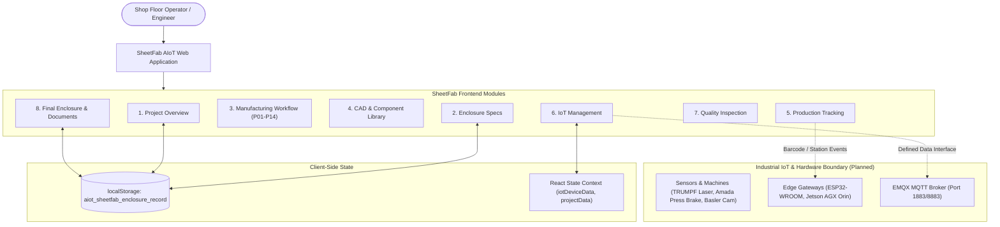

# Website Overview — SheetFab AIoT Platform

The **SheetFab AIoT Smart Sheet-Metal Fabrication Platform** (`web-ui`) is a specialized industrial web application designed to bridge computer-aided engineering (CAD), manufacturing execution systems (MES), industrial IoT device tracking, and computer-vision metrology into a single, cohesive operator interface.

---

## 🎯 Purpose & Scope

The application serves as the primary digital touchpoint for sheet-metal manufacturing engineers, plant supervisors, quality assurance inspectors, and commercial estimators. It coordinates:

1. **Parametric Enclosure Customization**: Ingesting customer spatial dimensions (Height, Width, Depth), material grades, IP ingress protection ratings, and door hinge orientations.
2. **Manufacturing Process Transparency**: Providing deep technical documentation and step-by-step guidance for all 14 stages of sheet metal enclosure realization.
3. **Internal Component Arrangement**: Managing DIN rails, wire ducts, circuit breakers (MCCB/MCB), power supplies, and thermal clearance boundaries.
4. **Shop-Floor Job Tracking**: Tracking fabrication lots through cutting, CNC bending, welding, powder coating, and final assembly stations.
5. **Industrial IoT Monitoring**: Registering and inspecting machine tools, micro-controllers (ESP32), telecentric cameras, and edge computing nodes across the shop floor.
6. **Optical Metrology Inspection**: Evaluating fabricated parts against CAD nominal models using OpenCV-based contour and edge detection.
7. **Engineering Document Release**: Hosting, validating, previewing, and dispensing verified project deliverables (Quotations, BOMs, DXF cut patterns, and quality records).

---

## 🏗️ Operational Boundary & Technical Profile

| Characteristic | Specification / Current Implementation |
|---|---|
| **Frontend Framework** | React 19.0.0 + TypeScript 5.8.2 |
| **Bundler & Build Tool** | Vite 6.2.0 |
| **Styling Architecture** | Tailwind CSS 4.0.0 (Vanilla CSS utility classes, light theme) |
| **Icons Library** | Lucide React (`lucide-react`) |
| **State Management** | React hooks (`useState`, `useEffect`) + `localStorage` persistence |
| **Physical Hardware Status** | Frontend Interface with defined boundaries. Real hardware integration is **Awaiting Gateway/Broker Connection**. |
| **Backend / Database** | None currently connected. Application operates autonomously in offline/mock-data mode. |
| **Repository Path** | `d:\Study\IOT Design and Deployment\iot project\web-ui` |
| **Static Deliverables Path** | `d:\Study\IOT Design and Deployment\iot project\web-ui\public\report` |

---

## 📐 High-Level Architecture Diagram

---

## 🔗 Related Documents

- [[Navigation and Screen Index]]
- [[UI Design System]]
- [[Website Architecture]]
- [[Screen Documentation/Project Overview|Project Overview Screen]]
- [[Screen Documentation/IoT Management|IoT Management Screen]]
- [[Technical Reference/Known Limitations|Known Limitations]]
