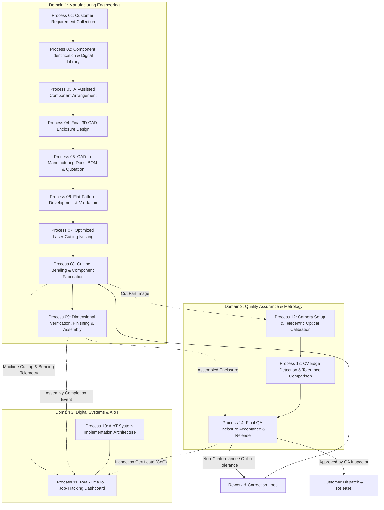

# Master Architectural & Engineering Diagrams Index

This directory provides the authoritative, validated standalone Mermaid diagram definitions modeling the platform.

---

## 1. Diagram Catalog

### [Overall Manufacturing & Quality Workflow (`overall-workflow.mmd`)](overall-workflow.mmd)
Models the linear manufacturing sequence from Process 01 through Process 09, digital IoT telemetry streaming into Process 11, optical inspection in Processes 12–13, and the final quality release gate in Process 14 with rework feedback loops.

---

### [Digital System Architecture (`system-architecture.mmd`)](system-architecture.mmd)
Illustrates the 5-layer software and physical topology: Physical Machinery $\to$ Edge Gateways $\to$ MQTT Broker $\to$ FastAPI Backend / PostgreSQL / MinIO $\to$ Celery AI Services $\to$ Angular Role-Based Portals.

---

### [Inspection Pipeline Architecture (`inspection-pipeline.mmd`)](inspection-pipeline.mmd)
Details the optical metrology handoff: 20MP raw frame acquisition $\to$ sub-pixel edge detection $\to$ ICP CAD DXF alignment $\to$ tolerance evaluation $\to$ inspector sign-off and Certificate of Conformance issuance.
