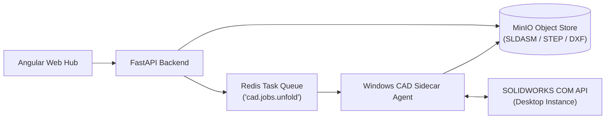

# CAD Software Integration Matrix & File Exchange Protocols

This specification defines the engineering roles, file exchange standards, automation feasibility, and architectural boundaries for the three CAD applications utilized in the platform: **SOLIDWORKS**, **AutoCAD**, and **CADcraft**.

---

## 1. Comparative CAD Integration Matrix

| Engineering Dimension | SOLIDWORKS | AutoCAD | CADcraft |
|---|---|---|---|
| **Primary Workflow Role** | 3D Parametric Mechanical Modeling, Enclosure Sheet-Metal Features, Bend Deductions, Assembly Fit | 2D General Arrangement (GA) Blueprints, Electrical Wiring Schematics, Panel Layout Drawings | Lightweight Open-Source 2D Drafting, Shop-Floor DXF/DWG Review, Secondary Geometry Checks |
| **Native File Formats** | `.sldprt` (Part), `.sldasm` (Assembly), `.slddrw` (Drawing) | `.dwg` (Drawing Database), `.dxf` (Drawing Exchange Format) | Native open `.dxf` / `.dwg` parsing (Rust-based engine) |
| **Neutral Exchange Formats** | STEP (AP214/AP242), IGES, DXF (Flat Pattern) | DXF, PDF, DWF | DXF, SVG, PDF |
| **Integration Architecture** | Asynchronous Desktop Agent (Windows COM API) | File-based Import / Export / CLI Scripts | CLI Headless Script / Native Rust Library Service |
| **Web Browser Feasibility** | **File-Based Only**: Web browser cannot directly drive desktop COM APIs. Files must be staged via web portal and processed by a local CAD sidecar service. | **File-Based / Headless CLI**: Scripts export DXF/PDF on local stations. | **Direct Service Integration**: Rust-based headless binary can be containerized and run directly within Linux backend microservices. |
| **Automation Feasibility** | High via SOLIDWORKS API (C# / Python comtypes): automated sheet unfolding, DXF export, design table updates. | Medium via AutoLISP / ObjectARX / DXF parsers. | High for 2D parsing via command-line interface or Rust FFI bindings. |
| **Licensing Constraints** | Commercial proprietary node-locked or floating network license (requires dedicated Windows CAD workstation). | Commercial proprietary subscription license (Autodesk). | Free, Open Source (Apache / MIT permissive licensing). |
| **Verification Status** | **Verified in Workspace**: Extensively documented in Processes 2, 3, 4, 6. | **External Engineering Standard**: Standard industry GA drawing format; integration currently file-based. | **External Research Identified**: High-performance 2D CADD engine in Rust (sibling to 3D SolidCraft); proposed as open DXF parser. |

---

## 2. SOLIDWORKS Integration Architecture: The CAD Sidecar Pattern

Because the primary web application runs as a distributed cloud/container service, direct control of the desktop SOLIDWORKS COM API from a browser is technically infeasible.

### Proposed Architecture: Asynchronous Local CAD Sidecar
1. **Model Upload**: The Design Engineer saves the native `.sldasm` and parts to the local workspace and uploads the assembly archive via the Web Portal.
2. **CAD Agent Worker**: A lightweight Windows background service (`cad-sidecar-agent.py`) running on the engineer's CAD workstation polls the backend task queue.
3. **Automated Batch Processing**:
   - The sidecar launches an invisible background SOLIDWORKS session via COM (`win32com.client` or `comtypes`).
   - Opens the model, verifies sheet-metal parameters ($K=0.38, R=1.5\text{ mm}$).
   - Executes unfolding macro to generate 1:1 DXF flat patterns for all sheet parts.
   - Extracts bounding box dimensions and exports a neutral STEP file for web visualization.
4. **Result Publication**: The sidecar uploads the generated DXFs and metadata back to the central object store (MinIO) and marks the CAD task complete.

---

## 3. CADcraft Integration: Headless 2D Geometry Service

### Role & Feasibility
CADcraft is an open-source 2D drafting engine written in Rust that provides AutoCAD-compatible command-line execution and native DXF handling.
- **Microservice Containerization**: Unlike SOLIDWORKS, CADcraft can be compiled as a standalone Linux binary and deployed inside a Docker container alongside FastAPI.
- **Headless DXF Verification**: Can be invoked via CLI to validate DXF polylines, detect open loops, verify zero elevation, and sanitize geometry before ingestion by the laser nesting optimizer.
- **Decision to Investigate**: Formal evaluation of CADcraft CLI vs. Python `ezdxf` for production DXF geometry validation is documented in [ADR-003](../../decisions/index.md).
