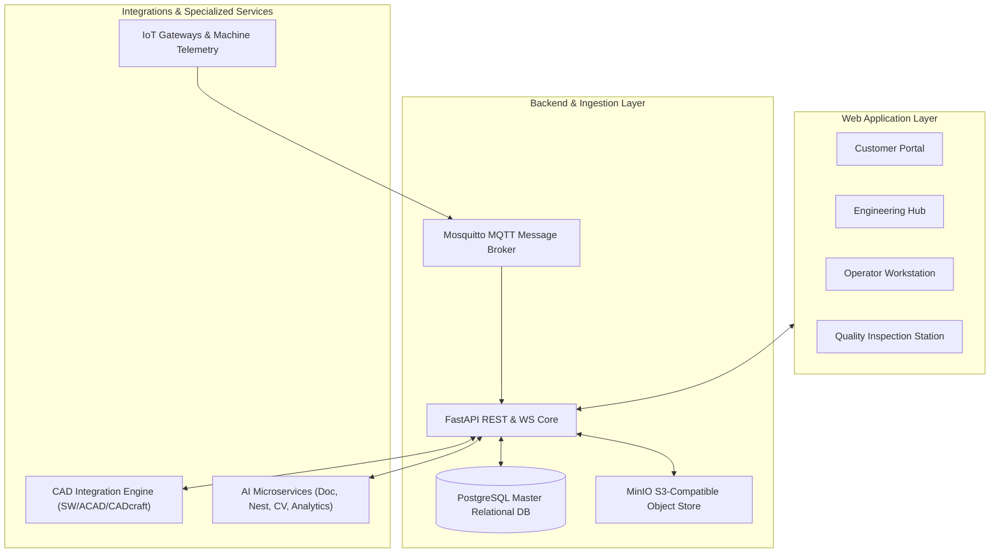

# Domain 2: Digital Systems & AIoT

The **Digital Systems & AIoT** domain defines the overarching software architecture, multi-role web applications, cloud/edge message brokers, artificial intelligence microservices, CAD integration protocols, and relational data schemas.

---

## 1. Domain Architectural Structure

---

## 2. Authoritative Process Reports (Processes 10 and 11)

- **[Process 10: AIoT System Implementation Guide](processes/process-10-aiot-implementation.md)**
  - Comprehensive 6-layer architectural specification, microservice boundaries, PostgreSQL schemas, and 7-phase implementation roadmap.
- **[Process 11: IoT Job-Tracking Dashboard](processes/process-11-job-tracking-dashboard.md)**
  - Real-time shop-floor visualization, Kanban boards, machine telemetry monitoring, and immutable event audit logs.

---

## 3. Specialized Digital System Areas

### 📐 [Architecture & Data Flow](architecture/system-architecture.md)
Detailed component boundaries, information custody rules, security perimeters, and the end-to-end [Data Flow Pipeline](architecture/data-flow.md).

### 🌐 [Multi-Role Web Application](web-application/index.md)
Screen layouts, interaction patterns, user stories, and role-based permissions (Customer, Engineer, Operator, Quality Inspector, Administrator).

### 🤖 [AI Capability Catalogue](ai-engineering/index.md)
Formal specification of AI services (document extraction, nesting optimization, computer-vision assistance, and production forecasting) with strict Human-in-the-Loop (HITL) gates.

### 📡 [IoT & Machine Telemetry Integration](iot-integration/index.md)
Edge gateway specifications, MQTT topic taxonomies, sensor hardware interfaces, heartbeat watchdogs, and offline buffering.

### 💻 [CAD Integration Catalogue](cad-integration/index.md)
Rigorous integration matrices for **SOLIDWORKS**, **AutoCAD**, and **CADcraft**, detailing native file formats, API feasibility, and file-based exchange boundaries.

### 🗄️ [Data Models & API Contracts](data-models/index.md)
Full PostgreSQL database entity definitions (DDL), JSON event contracts, and RESTful API endpoint specifications.
