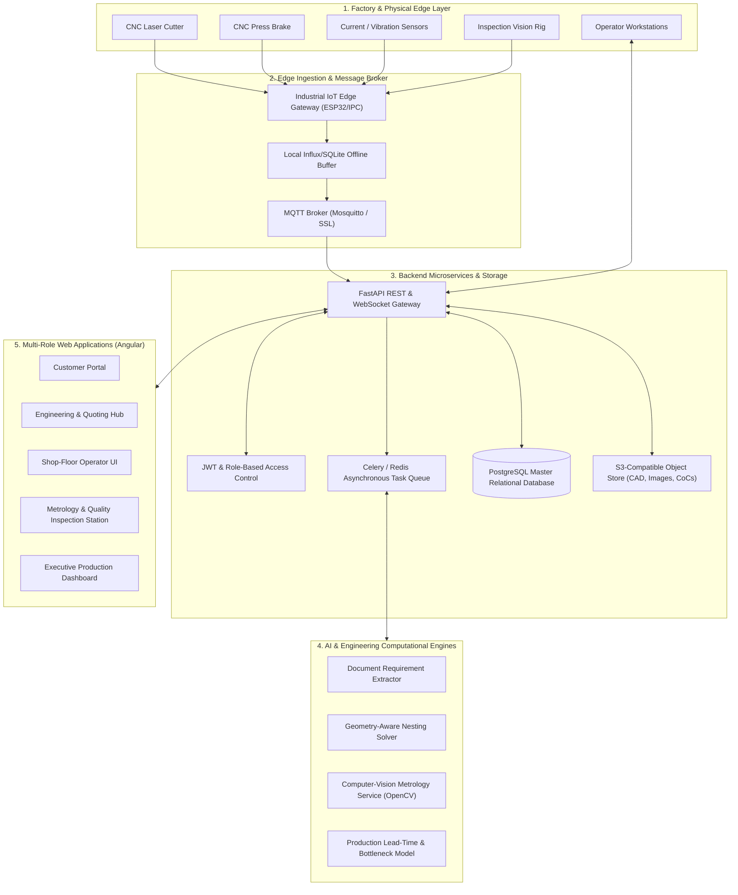
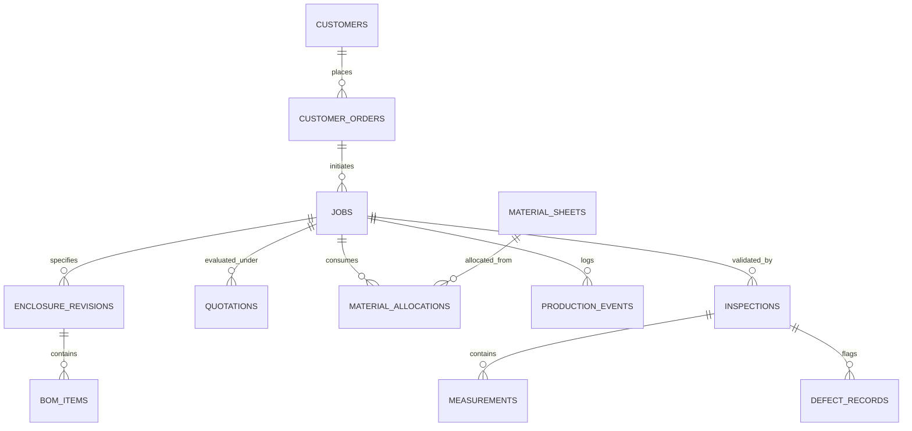

# Process 10: AIoT System Implementation Guide

> [!NOTE]
> **Implementation Scope & Architectural Role**:
> This document serves as the master blueprint for developing the digital software platform and IoT edge communications layer. It is an engineering implementation specification, establishing system boundaries, microservices, data ownership, and progressive deployment milestones.

---

## 1. System Topology & Architectural Blueprint

The AIoT platform connects physical sheet-metal equipment, edge sensors, inspection cameras, human operators, and web users into a unified event-driven ecosystem.



---

## 2. Visual Architecture & Digital Dashboard Reference


*Figure 10.1: Conceptual system architecture linking industrial fabrication machinery, edge gateways, cloud services, and role-based portals.*


*Figure 10.2: Cross-domain interaction flow connecting customer specification intake, AI layout optimization, SOLIDWORKS modeling, and shop-floor tracking.*

---

## 3. Recommended Technology Stack & Architecture Rationales

| Architectural Tier | Selected Technology | Technical Rationale & Alternatives Considered |
|---|---|---|
| **Frontend Framework** | **Angular** (TypeScript) | Enterprise-grade strict typing, modular dependency injection, built-in routing, and high testability for complex multi-role industrial workflows. |
| **Backend REST API** | **FastAPI (Python 3.11+)** | High-performance asynchronous execution, native Pydantic data validation, automatic OpenAPI doc generation, and seamless integration with Python ML/CV libraries (OpenCV, NumPy). |
| **Relational Database** | **PostgreSQL 16** | ACID compliance, robust foreign key relationships, advanced JSONB support for flexible telemetry/CAD properties, and relational integrity. |
| **Message Broker** | **Eclipse Mosquitto (MQTT 5.0)** | Ultra-lightweight protocol optimized for unreliable shop-floor networks, low memory footprint, QoS levels (0, 1, 2), and topic-based access control. |
| **Task Queue & Worker** | **Celery + Redis** | Offloads long-running computational workloads (nesting heuristics, high-resolution OpenCV image analysis, PDF quote rendering) from the HTTP request cycle. |
| **Object Storage** | **MinIO / AWS S3** | S3-compliant distributed storage for immutable raw inspection images, revision-controlled SOLIDWORKS/STEP models, DXF cut files, and PDF certificates. |
| **Containerization** | **Docker Compose** | Reproducible multi-container local and staging deployments isolating database, broker, backend API, worker, and frontend services. |

---

## 4. Multi-Role Web Application Modules

The unified web application isolates responsibilities across five distinct security roles:

### 4.1 Customer Portal
- Submit enclosure requests, dimensional limits, and environment class (IP54/IP65).
- Upload electrical single-line diagrams (SLD) and vendor equipment datasheets.
- Review cost quotations, approve revisions, and view authorized high-level delivery milestones.

### 4.2 Engineering & Quoting Workspace
- Manage the Digital Component Library and verify 3D CAD models.
- Upload and version SOLIDWORKS assembly models, part drawings, and DXF flat patterns.
- Review AI-suggested internal layouts; approve final manufacturing documentation.
- Calculate and release commercial quotations linking BOM lines, machine runtime, and metal tonnage.

### 4.3 Shop-Floor Operator Workstation
- Touch-friendly, high-contrast UI positioned at laser and press-brake stations.
- Scan traveler barcode to activate Job ID and view work instructions.
- Log operation start, cycle completion, scrap count, and drop-sheet remnant dimensions.

### 4.4 Quality Metrology & Inspection Workstation
- Calibrate telecentric vision cameras using fiducial calibration plates.
- Trigger optical feature detection and overlay edge deviations against DXF nominal contours.
- Log physical vernier/micrometer measurements and issue signed Certificates of Conformance (CoC).

### 4.5 Production Management & Analytics Dashboard
- Comprehensive real-time tracking of active jobs, work center queues, and bottlenecks.
- Material yield tracking, scrap rates, machine OEE indicators, and inspection first-pass yield.

---

## 5. Core Data Architecture & Relational Entities

Every manufacturing record is anchored to an immutable `job_id` and revision-controlled `enclosure_revision_id`.



### Relational Integrity Principles
1. **Immutable Event Sourcing**: Status transitions (`CUTTING_COMPLETED`, `BENDING_COMPLETED`, `ASSEMBLY_COMPLETED`) are appended to `production_events` as an audit log; historical records are never overwritten.
2. **Epistemic Domain Decoupling**: A job reaching `ASSEMBLY_COMPLETED` does **not** update `job_status` to `ACCEPTED`. Only an authorized record in `inspections` with `disposition = 'RELEASED'` updates the release state.
3. **Revision Binding**: All measurements, BOM items, and cut events strictly reference `enclosure_revisions.revision_id` to guarantee traceability back to approved engineering blueprints.

---

## 6. Real-Time Telemetry & Event Ingestion Pipeline

### Edge Telemetry Contract
Edge gateways publish JSON payloads over MQTT to `factory/workcenter/{workcenter_id}/events`:
```json
{
  "event_id": "evt-7f8e3d2a-89bc-4321",
  "job_id": "JOB-2026-0042",
  "workcenter_id": "WC-LASER-01",
  "event_type": "CUTTING_COMPLETED",
  "timestamp": "2026-10-25T14:32:10.125Z",
  "operator_id": "OP-842",
  "produced_quantity": 1,
  "scrap_quantity": 0,
  "machine_telemetry": {
    "laser_power_watts": 3000,
    "assist_gas_pressure_bar": 12.5,
    "cutting_duration_seconds": 184.2,
    "assist_gas_type": "N2"
  },
  "signature": "hmac-sha256-signature-token"
}
```

### Ingestion & Idempotency Rules
1. **Cryptographic Validation**: The backend validates the HMAC signature using pre-shared gateway keys.
2. **Deduplication**: `event_id` is cached in Redis for 48 hours; duplicate deliveries (QoS 1 retries) are logged and discarded without corrupting job counts.
3. **State Machine Enforcement**: Transitions must satisfy valid graph paths (e.g., `CUTTING_COMPLETED` cannot precede `MATERIAL_ALLOCATED`).

---

## 7. AI Microservices Capability Catalogue

| AI Service | Problem Solved | Input Data | Output Contract | Verification & Governance |
|---|---|---|---|---|
| **Requirement Extractor** | Automates manual transcription of PDF specifications and drawing title blocks. | PDF documents, scanned images, customer text. | Structured JSON (`dimensions`, `IP_rating`, `material`, `thickness`). | **Mandatory Human-in-the-Loop**: CAD engineer must review and approve fields before CAD design begins. |
| **Nesting Heuristic Optimizer** | Minimizes material scrap and optimizes remnant reuse across multi-order batches. | DXF flat patterns, stock sheet inventory, remnant geometry. | Multi-part nesting layout, cut sequence, utilization efficiency ($\eta$). | Algorithmic geometric collision verification; production planner approves final nesting layout. |
| **Optical Metrology Assistant** | Eliminates manual caliper logging and detects dimensional deviations across parts. | Calibrated 20MP inspection camera frames, reference DXF nominal vectors. | Feature coordinates (holes, slots, perimeter), deviation ($\Delta x, \Delta y$), tolerance flags. | Inspector verifies flagged deviations against ISO 2768-m; AI predictions cannot grant final release. |
| **Lead-Time Estimator** | Predicts shop-floor delays and bottlenecks. | Historical machine event logs, job queuing data. | Estimated delivery timestamp, bottleneck probability. | Advisory metric for production managers; no automated rescheduling without human confirmation. |

---

## 8. Progressive Implementation Roadmap

```
Phase 1: Foundational Prototype (Weeks 1–4)
├── PostgreSQL schema & FastAPI REST skeleton
├── Multi-role authentication (JWT + RBAC)
└── Angular Customer Portal & Engineering Hub

Phase 2: CAD, BOM & Quoting Engine (Weeks 5–8)
├── Digital Component Library CRUD
├── Hierarchical BOM & deterministic costing engine
└── Revision-controlled CAD file upload (MinIO)

Phase 3: Shop-Floor Tracking & IoT Simulator (Weeks 9–12)
├── Mosquitto MQTT broker & ingestion worker
├── IoT simulation script generating shop-floor events
└── Real-time Angular Job-Tracking Dashboard

Phase 4: Optical Metrology & Quality Engine (Weeks 13–16)
├── OpenCV telecentric camera calibration pipeline
├── Sub-pixel edge detection & DXF overlay service
└── Quality Inspection portal & CoC PDF generation

Phase 5: Physical Hardware & AI Service Hardening (Weeks 17+)
├── Connect physical ESP32 gateway to machine sensors
├── Deploy AI requirement extraction microservice
└── Production hardening, SSL, automated backups, and security audit
```

---

## 9. Definition of Done (v1.0 Milestone)

1. A customer order successfully generates an immutable `job_id` and initializes a tracking record.
2. An approved SOLIDWORKS revision links directly to the production BOM and flat-pattern DXFs.
3. The shop-floor dashboard renders live status changes driven by simulated/real MQTT payloads.
4. Optical inspection flags simulated out-of-tolerance cutouts, initiating a traceable rework queue.
5. Quality release requires explicit inspector authorization, generating a cryptographically verifiable Certificate of Conformance.
