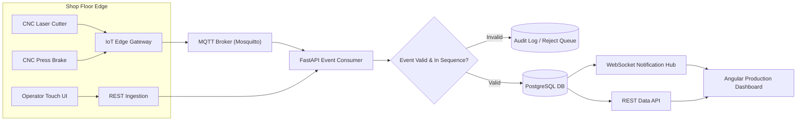

# Process 11: IoT Job-Tracking Dashboard

The **IoT Job-Tracking Dashboard** is the central operational interface for monitoring the real-time execution of sheet-metal fabrication jobs across laser cutting, press brake bending, finishing, assembly, and inspection.

---

## 1. Visual Dashboard Overview


*Figure 11.1: Production management dashboard illustrating active jobs, station utilization cards, throughput metrics, and real-time event timelines.*

---

## 2. System Architecture & Event Synchronization

The dashboard utilizes a hybrid push/pull communication architecture:
- **WebSocket Streaming**: For instantaneous shop-floor event propagation (job status changes, machine alarms).
- **RESTful Endpoints**: For paginated tabular queries, historical event logs, and report exports.



---

## 3. UI Modules & Dashboard Components

### 3.1 Active Job Board (Kanban / Tabular)
Displays all active jobs in the workshop grouped by stage:
- `ORDER_RELEASED`
- `MATERIAL_ALLOCATED`
- `LASER_CUTTING`
- `PRESS_BRAKE_BENDING`
- `ASSEMBLY_FINISHING`
- `QUALITY_METROLOGY`
- `DISPATCH_READY`

### 3.2 Machine Status & Telemetry Cards
Displays operational health for connected equipment:
- **Status Indicators**: `RUNNING` (Green), `IDLE` (Amber), `ALARM / FAULT` (Red), `OFFLINE` (Grey).
- **Telemetry Indicators**: Assist gas pressure (bar), laser head temperature (°C), cumulative beam-on hours, hydraulic pump pressure.
- **Data Freshness Watchdog**: If a machine fails to publish a heartbeat within 60 seconds, the UI transitions status to `STALE_TELEMETRY` rather than assuming normal idle state.

### 3.3 Event Audit Timeline
Provides an immutable chronological record for the selected Job ID:
```
[14:15:02] JOB-2026-0042: Material allocated: Sheet #SH-CRCA-15-0842 (Operator: OP-104)
[14:22:18] JOB-2026-0042: Laser cutting initiated (Machine: Laser-01, Program: NEST-42-A)
[14:38:45] JOB-2026-0042: Laser cutting completed (Machine: Laser-01, Cut Time: 16.4m)
[15:10:12] JOB-2026-0042: Press brake bending completed (Machine: Brake-02, Operator: OP-210)
[15:45:30] JOB-2026-0042: Complete assembly finished (Workbay: ASSY-01, Operator: OP-305)
[16:05:15] JOB-2026-0042: Staged for optical metrology inspection (Cell: QA-METROLOGY)
```

---

## 4. Operational Boundaries & Data Guardrails

> [!WARNING]
> **Decoupled Quality Release**:
> The dashboard visualizes manufacturing velocity and machine events. It **never** infers quality compliance from machine completion. Even if a laser cutter reports 100% program completion, the parts kit remains in an unverified state until inspected under [Process 12](../../quality-inspection/processes/process-12-camera-dimensional-inspection.md) and [Process 14](../../quality-inspection/processes/process-14-final-quality-inspection.md).
