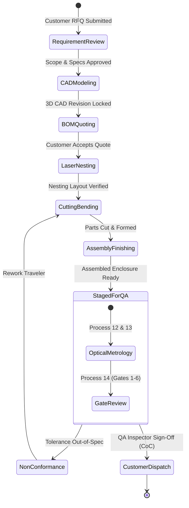

# Obsidian Vault Plugins Test Suite & Validation Notes

This note validates the eight installed Obsidian community plugins using real metadata, tables, tasks, and diagrams from the AIoT Sheet-Metal Fabrication Platform.

---

## 1. Dataview Plugin Test

Below are live Dataview queries querying real frontmatter metadata across the vault:

### A. Authoritative Process Reports Overview
```dataview
TABLE process_number AS "Process #", domain AS "Domain", status AS "Status", timestamp AS "Last Updated"
FROM "manufacturing/processes" OR "digital-systems/processes" OR "quality-inspection/processes"
WHERE type = "Process"
SORT process_number ASC
```

### B. Architecture Decision Records (ADRs) Summary
```dataview
TABLE description AS "Decision Summary", domain AS "Scope", status AS "Status"
FROM "decisions"
WHERE type = "Decision"
SORT file.name ASC
```

---

## 2. Tasks Plugin Test

The following tasks validate the `obsidian-tasks-plugin` using standard Obsidian task syntax:

- [ ] Complete laser cutting parameter validation on 1.5mm CRCA steel 📅 2026-11-05 🏷️ #manufacturing #laser
- [ ] Calibrate 20MP optical metrology rig using dot-grid reference plate `CALIB-2026-Q4-01` 📅 2026-11-10 🏷️ #quality #calibration
- [ ] Review SOLIDWORKS CAD sidecar COM worker memory footprint under batch runs 📅 2026-11-15 🏷️ #cad #sidecar
- [x] Structure workspace into 3 domains (Manufacturing, Digital Systems, QA) according to OKF ✅ 2026-10-25
- [x] Configure local Git repository and commit baseline engineering documentation ✅ 2026-10-25

### Tasks Query Block
```tasks
not done
path includes documentation-audit
sort by due
```

---

## 3. Advanced Tables Plugin Test

The table below is formatted using the `table-editor-obsidian` pipe syntax, supporting in-line tab navigation, automatic column re-alignment, and formula calculations:

| Work Center ID | Machine Name | Operational State | Ingress Gas Pressure (bar) | Shift Output (Parts) |
|---|---|:---:|:---:|---:|
| `WC-LASER-01` | CNC Fiber Laser 3kW | `RUNNING` | 14.5 | 48 |
| `WC-BRAKE-01` | CNC Press Brake 100T | `IDLE` | N/A | 32 |
| `WC-ASSY-01` | Mechanical Assembly Bay | `RUNNING` | N/A | 12 |
| `WC-QA-01` | 20MP Optical Metrology | `RUNNING` | N/A | 45 |

---

## 4. Mermaid Canvas & Native Mermaid Test

Native Markdown and the `mermaid-canvas` editor render the following interactive state diagram modeling the sheet-metal job state machine:



---

## 5. Excalidraw Plugin Test

The embedded drawing below links to the native Excalidraw vector graphic created in `diagrams/`:

![[diagrams/aiot-architecture-overview.excalidraw.md]]

---

## 6. Juggl & Built-In Graph View Test

This document cross-links to the root indexes to ensure the node resolves seamlessly in both Obsidian Graph View and the Juggl interactive graph:
- Master Index: [[index]]
- Manufacturing Domain: [[manufacturing/index|Domain 1: Manufacturing]]
- Digital Systems: [[digital-systems/index|Domain 2: Digital Systems]]
- Quality Metrology: [[quality-inspection/index|Domain 3: Quality Metrology]]
- Architecture Decisions: [[decisions/index|ADR Register]]
