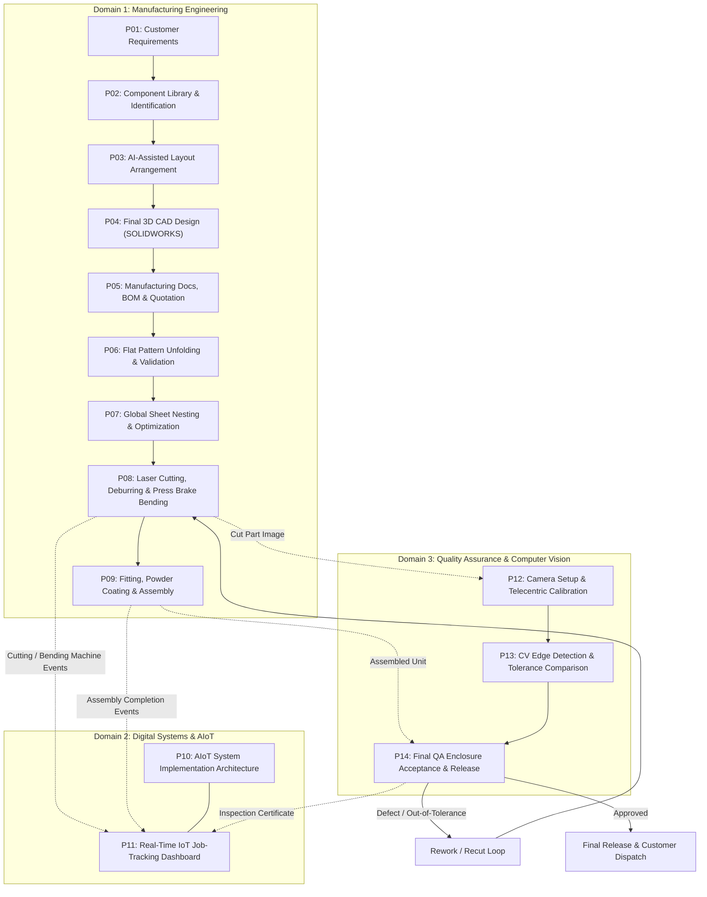

# AIoT-Based Smart Sheet-Metal Panel Fabrication System

Welcome to the **Open Knowledge Format (OKF)** and **LLM Wiki** engineering knowledge base for the AIoT-Based Smart Sheet-Metal Panel Fabrication Platform.

This knowledge base connects the end-to-end lifecycle of an industrial sheet-metal electrical enclosure—from initial customer requirements and CAD engineering through automated nesting, shop-floor cutting and bending, real-time IoT event tracking, and closed-loop computer-vision quality inspection.

> [!IMPORTANT]
> **Implementation Status Notice**:
> Processes 1 through 14 represent fully developed and verified engineering domain workflows. The overarching web application, IoT event ingestion broker, AI microservices, and automated CAD bidirectional integrations represent a **planned engineering platform** designed to operationalize these workflows. All software architectures, schemas, and API contracts documented herein serve as developer-ready implementation baselines.

---

## 1. Executive Summary & Problem Statement

### The Industrial Problem
Sheet-metal fabrication environments frequently operate across disconnected functional silos:
1. **Design & Commercial Fragmentation**: Customer requirement documents, CAD models (SOLIDWORKS/AutoCAD/CADcraft), manual Bill of Materials (BOM), and quotation estimates often drift out of sync.
2. **Manufacturing Opacity**: Job routing, laser-cutting sheet utilization, press brake bend operations, and intermediate assembly statuses lack continuous shop-floor visibility.
3. **Quality Latency & Decoupled Acceptance**: Manual dimensional verification and surface inspections occur late in the fabrication sequence without digital traceability back to approved engineering tolerances.

### The AIoT Solution
The **AIoT-Based Smart Sheet-Metal Panel Fabrication System** bridges physical shop-floor machinery and digital engineering through:
- A unified **Customer and Engineering Web Application** managing role-based workflows, CAD revisions, BOMs, and quotes.
- **AI-Assisted Engineering**: Extracting specifications, validating component arrangements against thermal/clearance rules, and optimizing nesting efficiency.
- **IoT-Enabled Production Tracking**: Ingesting real-time machine telemetry, sensor feeds, and operator station events into a shared event stream.
- **Computer-Vision Quality Assurance**: Automated dimensional inspection, feature edge detection, and CAD tolerance verification directly linked to job release records.

---

## 2. Knowledge Base Architecture (OKF & LLM Wiki)

This knowledge base is structured according to the **Open Knowledge Format (OKF)** guidelines and **LLM Wiki** principles:
- **Every document is self-contained**: Features standardized YAML frontmatter, typed classifications (`Process`, `Architecture`, `Component`, `Integration`, `DataModel`, `InspectionMethod`, `Decision`).
- **Portable and Obsidian-Ready**: Operates seamlessly in standard Markdown, Obsidian vaults, and AI agent contexts without proprietary lock-in.
- **Progressive Disclosure**: Hierarchical navigation from root indexes down to domain architectures and low-level engineering data models.
- **Explicit Epistemic Boundaries**: Strictly differentiates documented facts, proposed specifications, external research, and unresolved engineering questions.

### Domain Organization
```
project-root/
├── index.md                               # This master navigation index
├── README.md                              # Repository overview and setup guide
├── glossary.md                            # Comprehensive engineering & software terminology
│
├── manufacturing/                         # Domain 1: Manufacturing Engineering
│   ├── index.md                           # Manufacturing domain index
│   ├── processes/                         # Authoritative Processes 1–9
│   ├── components/index.md                # Digital component library master reference
│   ├── cad-design/index.md                # 3D CAD models, flat patterns & blueprint standards
│   └── manufacturing-data/index.md        # BOM, quoting logic, nesting & shop parameters
│
├── digital-systems/                       # Domain 2: Digital Systems & AIoT
│   ├── index.md                           # Digital systems domain index
│   ├── processes/                         # Authoritative Processes 10–11
│   ├── architecture/                      # System topology, data flows & ownership boundaries
│   ├── web-application/index.md           # Multi-role portals, UI workflows & specifications
│   ├── ai-engineering/index.md            # AI capability catalogue & human-in-the-loop safeguards
│   ├── iot-integration/index.md           # Telemetry, event models, protocols & broker design
│   ├── cad-integration/index.md           # SOLIDWORKS, AutoCAD & CADcraft integration matrices
│   └── data-models/index.md               # Core database schemas, event payloads & API specs
│
├── quality-inspection/                    # Domain 3: Inspection & Quality Assurance
│   ├── index.md                           # Quality assurance domain index
│   ├── processes/                         # Authoritative Processes 12–14
│   ├── inspection-criteria.md             # Dimensional tolerances & release standards
│   └── inspection-data-flow.md            # Vision pipeline, calibration & review workflows
│
├── diagrams/                              # Master Mermaid architectural diagrams
├── assets/images/                         # Domain-categorized visual evidence
├── decisions/                             # Architecture Decision Records (ADR)
└── documentation-audit/                   # Traceability inventories & validation reports
```

---

## 3. The 14 Canonical Processes

The 14 processes form the definitive spine of the engineering workflow:

| # | Canonical Process Title | Domain | Authoritative Documentation Link |
|---|-------------------------|--------|----------------------------------|
| **01** | Customer Requirement Collection | Manufacturing | [Process 01](file:///d:/Study/IOT%20Design%20and%20Deployment/iot%20project/manufacturing/processes/process-01-customer-requirements.md) |
| **02** | Component Identification, Measurement and Digital Library | Manufacturing | [Process 02](file:///d:/Study/IOT%20Design%20and%20Deployment/iot%20project/manufacturing/processes/process-02-component-identification-library.md) |
| **03** | AI-Assisted Internal Component Arrangement | Manufacturing | [Process 03](file:///d:/Study/IOT%20Design%20and%20Deployment/iot%20project/manufacturing/processes/process-03-ai-assisted-arrangement.md) |
| **04** | Final 3D CAD Enclosure Design | Manufacturing | [Process 04](file:///d:/Study/IOT%20Design%20and%20Deployment/iot%20project/manufacturing/processes/process-04-final-cad-design.md) |
| **05** | CAD-to-Manufacturing Documentation, BOM and Quotation | Manufacturing | [Process 05](file:///d:/Study/IOT%20Design%20and%20Deployment/iot%20project/manufacturing/processes/process-05-manufacturing-documentation.md) |
| **06** | Sheet-Metal Flat-Pattern Development and Validation | Manufacturing | [Process 06](file:///d:/Study/IOT%20Design%20and%20Deployment/iot%20project/manufacturing/processes/process-06-flat-pattern-validation.md) |
| **07** | Optimized Laser-Cutting Nesting | Manufacturing | [Process 07](file:///d:/Study/IOT%20Design%20and%20Deployment/iot%20project/manufacturing/processes/process-07-laser-nesting.md) |
| **08** | Sheet-Metal Cutting, Bending and Component Fabrication | Manufacturing | [Process 08](file:///d:/Study/IOT%20Design%20and%20Deployment/iot%20project/manufacturing/processes/process-08-cutting-bending-fabrication.md) |
| **09** | Dimensional Verification, Painting and Complete Enclosure Assembly | Manufacturing | [Process 09](file:///d:/Study/IOT%20Design%20and%20Deployment/iot%20project/manufacturing/processes/process-09-finishing-assembly.md) |
| **10** | AIoT System Implementation Guide | Digital Systems | [Process 10](file:///d:/Study/IOT%20Design%20and%20Deployment/iot%20project/digital-systems/processes/process-10-aiot-implementation.md) |
| **11** | IoT Job-Tracking Dashboard | Digital Systems | [Process 11](file:///d:/Study/IOT%20Design%20and%20Deployment/iot%20project/digital-systems/processes/process-11-job-tracking-dashboard.md) |
| **12** | Camera-Based Dimensional Inspection | Quality Inspection | [Process 12](file:///d:/Study/IOT%20Design%20and%20Deployment/iot%20project/quality-inspection/processes/process-12-camera-dimensional-inspection.md) |
| **13** | Computer-Vision Feature Detection and Dimension Comparison | Quality Inspection | [Process 13](file:///d:/Study/IOT%20Design%20and%20Deployment/iot%20project/quality-inspection/processes/process-13-computer-vision-analysis.md) |
| **14** | Final Fabricated Enclosure and Quality Inspection | Quality Inspection | [Process 14](file:///d:/Study/IOT%20Design%20and%20Deployment/iot%20project/quality-inspection/processes/process-14-final-quality-inspection.md) |

---

## 4. Master End-to-End Workflow



---

## 5. Domain Directory Quick Links

### 🏭 [Domain 1: Manufacturing Engineering](file:///d:/Study/IOT%20Design%20and%20Deployment/iot%20project/manufacturing/index.md)
Contains the primary physical engineering reports (Processes 1 to 9), component catalog standards, 3D sheet-metal modeling rules, bend deduction formulas, nesting parameters, and assembly checklists.

### 💻 [Domain 2: Digital Systems & AIoT](file:///d:/Study/IOT%20Design%20and%20Deployment/iot%20project/digital-systems/index.md)
Defines the software architecture (Processes 10 and 11), multi-role web portals, the AI capability catalog, IoT messaging infrastructure (MQTT/REST), CAD integration protocols, and database entity models.

### 🔬 [Domain 3: Inspection & Quality Assurance](file:///d:/Study/IOT%20Design%20and%20Deployment/iot%20project/quality-inspection/index.md)
Covers optical metrology, camera calibration rigs, edge detection algorithms, CAD tolerance comparison engines, and final quality sign-off gates (Processes 12 to 14).

### 🏛️ [Architecture Decision Records (ADRs)](file:///d:/Study/IOT%20Design%20and%20Deployment/iot%20project/decisions/index.md)
Documented engineering and software architecture decisions, trade-offs, and technology choices.

### 🔍 [Documentation Audit & Traceability](file:///d:/Study/IOT%20Design%20and%20Deployment/iot%20project/documentation-audit/file-inventory.md)
Source file inventories, asset registries, link verification matrices, and open engineering questions.

---

## 6. Guidance for Future AI Agents & Developers

When contributing to or extending this codebase:
1. **Maintain OKF Compliance**: Ensure all new files possess valid YAML frontmatter matching the schema defined in [glossary.md](file:///d:/Study/IOT%20Design%20and%20Deployment/iot%20project/glossary.md).
2. **Preserve Epistemic Rigor**: Do not state that an API or IoT pipeline is implemented when it is currently a proposed architecture.
3. **Respect Information Ownership**: Follow the information boundary rules defined in [system-architecture.md](file:///d:/Study/IOT%20Design%20and%20Deployment/iot%20project/digital-systems/architecture/system-architecture.md). Manufacturing status must never be conflated with quality acceptance.
4. **No Ad-Hoc Images**: Place all new visual assets in `assets/images/<domain>/` and register them in [image-inventory.md](file:///d:/Study/IOT%20Design%20and%20Deployment/iot%20project/documentation-audit/image-inventory.md).
