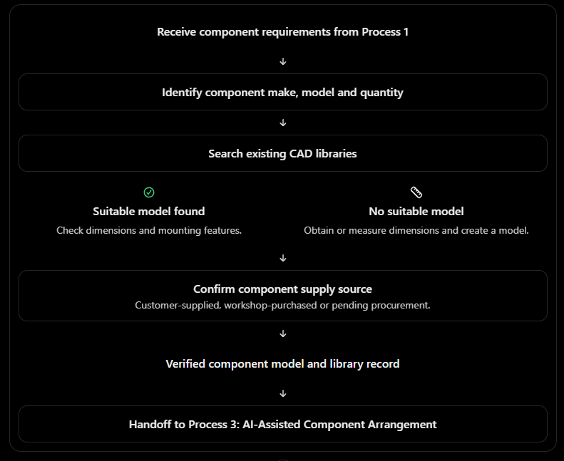
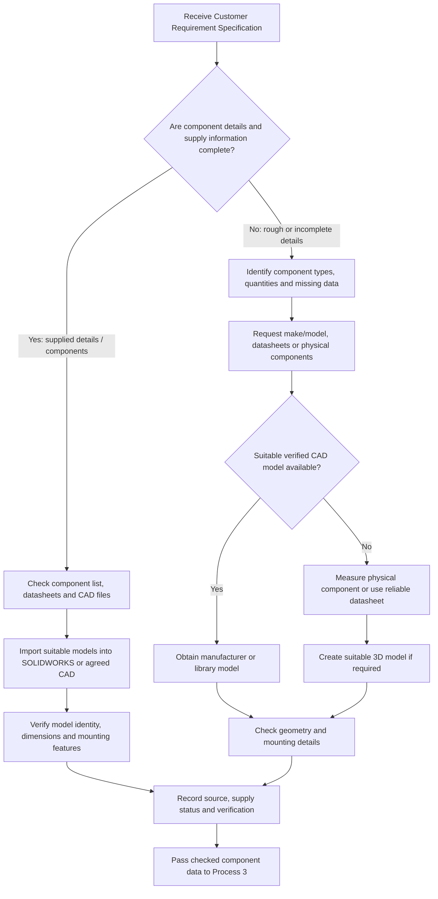
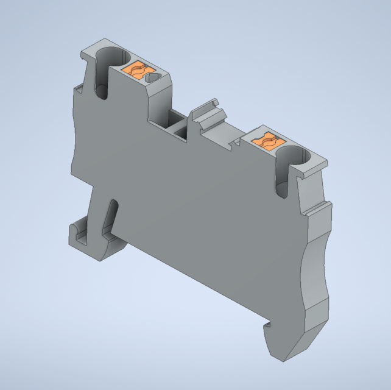
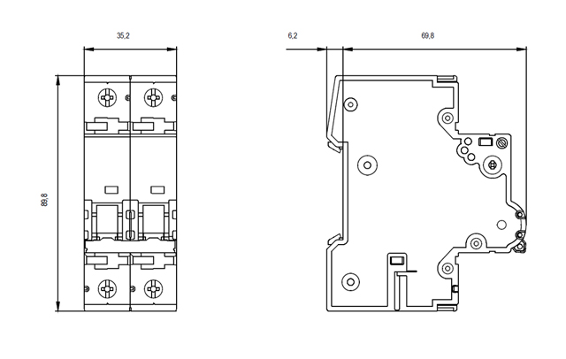
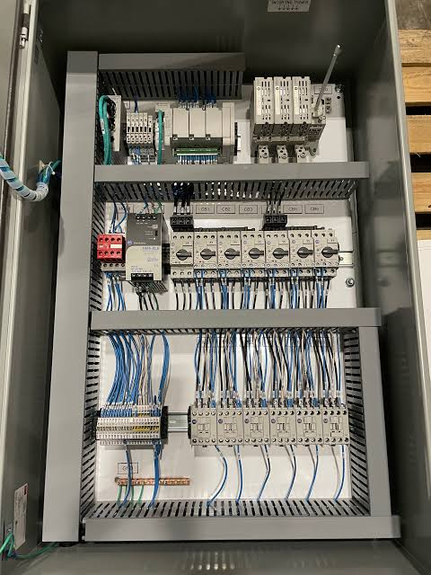
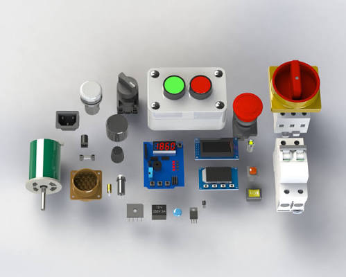
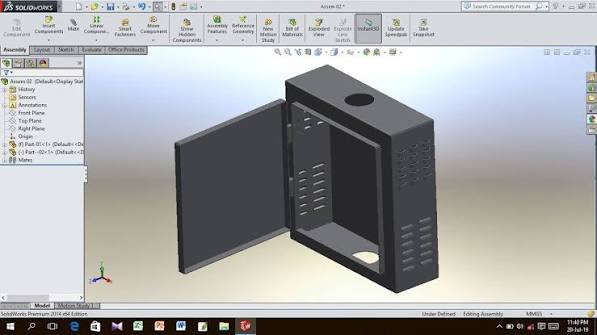

# Process 2 — Component Identification, Measurement and Digital Library

> [!abstract] Purpose
> Prepare the component information and CAD geometry required for enclosure design. The workflow depends on how complete the customer's information is. If the customer supplies components and reliable technical details, import and verify those details/models instead of repeating unnecessary sourcing and measurement. If the customer gives only rough requirements, identify missing details and obtain or measure the components before design.

## 1. Position in the project

**Input:** Customer Requirement Specification from [Process 01: Customer Requirements](process-01-customer-requirements.md).

**Output:** Job-linked component data, verified dimensions and mounting details, suitable CAD model references, and clear verification status.

**Next:** [Process 03: AI Arrangement](process-03-ai-assisted-arrangement.md).



*Reference image for the component identification and digital-library workflow. The Mermaid flowchart below includes both customer-information paths.*

## 2. Process overview



## 3. Two paths through Process 2

### Path A — Customer supplies components and complete details

Use this path when the customer provides actual components and/or exact make/model information, dimensions, mounting information, datasheets and usable CAD files.

1. Receive the component list and customer files.
2. Match each physical item or part number to its documentation and CAD model.
3. Import the appropriate model into SOLIDWORKS or the agreed CAD environment.
4. Verify the model identity/revision and check key dimensions and mounting features against the supplied information.
5. Record the component and CAD references in the job record.
6. Mark the information as verified only after the checks are completed.
7. Pass the checked component models to Process 3.

**Important:** This path avoids unnecessary sourcing and manual measurement when the supplied information is complete and reliable. It does not remove the need to verify model identity, dimensions or mounting compatibility.

### Path B — Customer provides rough or incomplete details

Use this path when the customer gives a general list, such as “three switches, two circuit breakers, terminal blocks and wiring ducts,” but does not provide exact models, dimensions or mounting information.

1. Identify each component type and required quantity from Process 1.
2. List missing details, including manufacturer/model, dimensions, mounting type, cut-out requirements and clearances.
3. Request datasheets, part numbers, identified photographs or physical components.
4. Search manufacturer CAD libraries, available SOLIDWORKS resources and the workshop's verified digital component library.
5. If a suitable model exists, obtain it and verify it against the component documentation.
6. If no suitable model exists, measure the physical component or use a reliable manufacturer datasheet.
7. Create a suitable 3D CAD model in SOLIDWORKS if required.
8. Record the data source, verification status and unresolved details.
9. Pass verified component geometry to Process 3.

Do not infer exact dimensions from an ordinary photograph. If reliable dimensions or the correct model cannot be obtained, keep the item pending and request clarification.

## 4. Component supply source

Supply source is separate from CAD-model availability. A component can have a CAD model before it is purchased, and a customer may supply some components while the workshop purchases others.

| Supply status | Required action |
|---|---|
| Customer-supplied component | Record receipt/availability and verify it against the part number or datasheet. Measure only if required information is missing or needs confirmation. |
| Workshop to purchase | Record required make/model and quantity. Check suitable model/specifications before procurement and update status when ordered or received. |
| Customer will confirm | Keep the item pending and request the exact model/specification. |
| Existing workshop stock | Confirm the stock item matches the required model and revision before assigning it to the job. |

Procurement tracking may connect to inventory or purchasing features. It is not necessary to purchase a component just to create or verify its CAD model.

## 5. Component data to record

| Field | Description |
|---|---|
| Component ID | Unique identifier in the job or digital library |
| Name and type | Switch, circuit breaker, terminal block, wiring duct, relay, etc. |
| Manufacturer and model | Exact identification, when available |
| Quantity | Quantity required for the job |
| Overall dimensions | Width, height and depth, with units |
| Mounting method | DIN rail, screw mounting, panel mounting or another method |
| Mounting geometry | Hole pattern, rail footprint and relevant coordinates |
| Panel cut-out | Opening size and location, where relevant |
| Clearance needs | Terminal access, wire bending, access, heat dissipation and operation as applicable |
| CAD file/reference | Native model or supported exchange format and file location |
| Data source | Manufacturer datasheet, verified measurement, customer file or existing library record |
| Supply source/status | Customer-supplied, workshop stock, to purchase or pending |
| Verification status | Pending, verified or rejected |
| Revision/date | Model/data version and last verification date |

Populate the fields relevant to each component. Critical missing information must remain visibly pending rather than being guessed.

## 6. SOLIDWORKS and digital-library strategy

### Preferred order

1. **Reuse a correct existing 3D model** from the manufacturer's library, an available SOLIDWORKS library or the workshop's verified component library.
2. **Check model identity and dimensions** against the exact part number, datasheet or physical item.
3. **Create a new model only when necessary**, using verified dimensions and mounting features.
4. **Save and index the verified model** so future jobs can reuse it.

A library may contain electrical symbols or 2D footprints without a complete, accurate 3D model. Confirm that the model contains the geometry needed for mechanical enclosure design. A simplified envelope model may be sufficient for layout if it preserves overall size, mounting footprint, panel cut-out and required clearances. Use a more detailed model when the design requires it.

### Suggested folder structure

```text
Component_Library/
├── Switches/
├── Circuit_Breakers/
├── Terminal_Blocks/
├── Relays_and_Contactors/
├── Wiring_Ducts/
├── DIN_Rails_and_Mounting/
└── Other_Components/
```

Use a consistent part-number and revision naming convention. Avoid duplicate models for the same component; link jobs to a shared, verified library item wherever practical.

## 7. Verification checklist before handoff

- [ ] Correct manufacturer and part number, if supplied.
- [ ] Correct model version or revision.
- [ ] Overall dimensions checked against a datasheet or physical item.
- [ ] Mounting holes, DIN-rail fit, panel cut-outs and attachment features checked.
- [ ] Connector/terminal access and wiring clearances considered.
- [ ] Units are consistent, preferably millimetres for enclosure work.
- [ ] Data source and verification status recorded.
- [ ] Missing or conflicting critical data flagged for clarification.

Process 2 verifies component geometry. It does **not** decide the final arrangement of all components; that is the purpose of Process 3, subject to engineering and electrical requirements.

## 8. Image placeholders for Obsidian

Use your own workshop photographs, CAD screenshots, or suitable manufacturer reference images. Save each image in the specified folder or change the embed path to match your vault.

### Image 1 — SOLIDWORKS electrical component CAD models



Show reusable 3D models of switches, circuit breakers, terminal blocks and mounting rails.

### Image 2 — Measuring a physical component

> [!NOTE]
> *Visual Reference: Physical vernier measurement of customer-supplied components is illustrated in [Electrical Panel Component Dimension Guide](../../assets/images/components/Electrical%20Panel%20Component%20Dimension%20Guide.png).*

Show a technician measuring a physical component with a digital caliper. This illustrates Path B when dimensions or models are missing.

### Image 3 — Manufacturer datasheet or CAD model



Show a manufacturer's dimensioned drawing or CAD preview for the exact component being modelled.

### Image 4 — Customer-supplied components



Show the components received from the customer or a representative set arranged on a workbench.

### Image 5 — Digital component library



Show component models organized by type and manufacturer/model.

### Image 6 — Imported model verification



Show a 3D model with key dimensions or mounting features being checked.

> [!tip] Image setup
> Create an `images` folder in your Obsidian vault and save images using the exact names shown above. Obsidian embeds do not fetch images from the internet; the image files must exist at the referenced paths. If you do not yet have an image, keep the placeholder until you add one.

## 9. Output of Process 2

The output is a **job-linked, verified component data set** containing:

- Component list and quantities.
- Existing or newly created 3D CAD model references.
- Verified dimensions and mounting details.
- Data source, revision and verification status.
- Supply source and procurement status where relevant.
- Unresolved details requiring customer or engineer action.

## 10. Handoff to Process 3

**Next process:** [Process 03: AI Arrangement](process-03-ai-assisted-arrangement.md)

Process 3 receives the enclosure requirements from Process 1 and the checked component geometry from Process 2. It proposes a suitable arrangement inside the enclosure while considering available space, mounting, access, wiring and relevant design constraints. The arrangement must be reviewed and approved before the design is finalized.

## Summary

Process 2 follows one of two paths:

- **Complete customer details/components supplied:** import the relevant data and CAD models, verify them, and record the library references.
- **Rough or incomplete details:** identify missing information, obtain or measure components, create/import models, and verify them.

Both paths produce reusable, traceable component data for Process 3. Avoid repeating measurement or procurement unnecessarily, but never skip verification of critical geometry.
