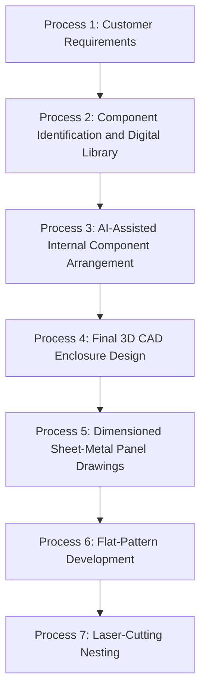
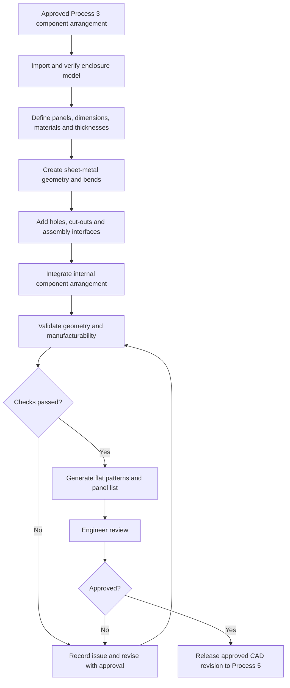

# Process 4 — Final 3D CAD Enclosure Design

> [!abstract] Purpose
> Convert the approved internal component arrangement from Process 3 into a complete, validated, manufacturing-ready 3D CAD enclosure design. The model defines the sheet-metal body, door, covers, base plate, mounting plate, holes, cut-outs, bends, hinges, locks, cable entries, and assembly interfaces. The approved model becomes the basis for Process 5 — Dimensioned Sheet-Metal Panel Drawings.

## 1. Position in the overall workflow

**Input from Process 3:** approved component locations, orientations, mounting references, access clearances, wiring space, and CAD assembly.

**Output to Process 5:** approved 3D enclosure assembly and individual panel models with verified dimensions, material, thickness, bend features, cut-outs, and revision information.

## 2. What Process 4 does

Process 4 finalizes the enclosure's physical geometry. It is not just a visual 3D rendering. The model should represent how the enclosure will be made and assembled.

The design typically includes:
- Main body or shell.
- Front door and any removable covers.
- Top and bottom panels.
- Base plate and internal mounting plate.
- Side panels, brackets, and supports where required.
- Holes, slots, component cut-outs, cable entries, and ventilation openings.
- Bends, flanges, corner reliefs, and joining features.
- Hinges, locks, fasteners, mounting rails, and other hardware interfaces.

The exact part breakdown depends on the enclosure design and manufacturing method, such as a folded body, welded body, or screw-assembled panels.

## 3. Inputs required

| Input | Required information | Purpose |
|---|---|---|
| Customer requirements | Overall size, quantity, mounting, environment, finish, and use | Defines the design intent |
| Existing enclosure | Native CAD model or dimensioned drawing, structural features, revision | Provides the starting geometry |
| Approved Process 3 arrangement | Component placement, orientations, mounting regions, and access envelopes | Ensures the final enclosure accommodates the internal layout |
| Panel breakdown | Body, door, top, bottom, base, mounting plate, and other parts | Defines the individual CAD parts |
| Material and thickness | Material grade and thickness for each part | Controls sheet-metal geometry, weight, cost, and fabrication settings |
| Bending data | Bend angle, radius, bend allowance/deduction method, K-factor where used | Supports accurate developed geometry |
| Hardware and joining | Hinges, locks, screws, rivets, welds, seals, rails, and brackets | Makes assembly interfaces manufacturable |
| Shop capabilities | Laser-cutting limits, available press-brake tooling, minimum feature rules, stock availability | Checks production feasibility |

### Customer input branches

**When the customer supplies a complete drawing/specification:** import or reference it, reuse verified dimensions and geometry, and only ask about missing, ambiguous, or conflicting details. Do not make the customer re-enter information already available and verified.

**When the customer supplies rough requirements:** clarify missing dimensions and manufacturing requirements, establish the panel breakdown, and develop the CAD geometry using approved engineering decisions.

## 4. Step-by-step workflow

### Step 1 — Import and verify the starting model

Open the existing enclosure model in SOLIDWORKS or import the supported CAD file. If only 2D drawings exist, reconstruct the 3D geometry from the drawing views and dimensions, while flagging ambiguous information.

Verify:
- Overall and internal dimensions.
- Door, body, mounting plate, and structural features.
- Existing holes, cut-outs, bends, and flanges.
- Material, thickness, and revision information.
- Model integrity and missing geometry.

**Output:** a verified starting model.

### Step 2 — Establish the enclosure panel structure

Identify the individual sheet-metal parts. A typical design may include a body, door, top and bottom covers, base plate, mounting plate, side panels, and brackets.

Create a part list that associates each component with a part identifier, quantity, material, thickness, and CAD revision. Avoid duplicating a panel if the supplied design already contains a verified equivalent.

**Output:** a defined enclosure assembly structure and panel list.

### Step 3 — Define dimensions, material, and thickness

Assign the correct dimensions and sheet-metal properties to each part. Keep these concepts distinct:

- **Outer dimensions:** finished enclosure's external width, height, and depth.
- **Internal dimensions:** available volume after accounting for sheet thickness, bends, flanges, and internal structures.
- **Panel dimensions:** dimensions associated with an individual finished panel.
- **Flat dimensions:** developed sheet dimensions before bending.
- **Drawing dimensions:** controlled dimensions used to manufacture and inspect the part.

Illustrative values based on the project's earlier enclosure details:

| Part | Example dimensions | Example thickness |
|---|---:|---:|
| Main body | 706 × 400 mm | 1.0 mm |
| Top and bottom panels | 205 × 300 mm | 1.0 mm |
| Door | 310 × 420 mm | 1.2 mm |
| Base plate | 250 × 350 mm | 1.6 mm |

> [!warning] Example values only
> These values are examples, not a released manufacturing specification. Confirm the final dimensions, material grade, orientation, and thickness from the approved customer drawing and engineering design. Different panels may use different thicknesses.

### Step 4 — Create the sheet-metal geometry

Use the appropriate SOLIDWORKS sheet-metal tools to create or update features such as:
- Base flange and edge flange.
- Sketched bends.
- Hem or seam features where specified.
- Corner and bend reliefs.
- Tabs, slots, and joining features where part of the design.
- Sheet-metal conversion for suitable imported geometry.

Set or verify the thickness, bend radius, bend angle, bend allowance or deduction method, and K-factor where applicable. These values must reflect the material, tooling, and workshop process.

**Why it matters:** bending changes the relationship between the flat sheet dimensions and the final part dimensions. Incorrect bend parameters can produce an inaccurate flat pattern.

### Step 5 — Add holes, slots, and cut-outs

Add the features required for components and assembly, such as:
- Switch, indicator, display, and handle cut-outs.
- Component mounting holes.
- Hinge and lock openings.
- Cable-gland holes and cable-entry slots.
- Ventilation openings.
- Fastener holes and mounting slots.
- Earthing/grounding connection points where specified.

Locate features from verified component mounting drawings, manufacturer data, customer drawings, and approved engineering requirements.

For door-mounted devices, check both the front cut-out and the component's rear projection. The door must open and close without striking internal components.

### Step 6 — Integrate the Process 3 component arrangement

Bring the approved internal component assembly into the enclosure CAD model. Verify that:
- Components align with mounting regions.
- Door-mounted components align with the required cut-outs.
- Mounting plates and rails fit.
- Wiring ducts and cable-entry routes remain usable.
- Required hand/tool access and maintenance envelopes remain clear.
- Components do not collide with bends, flanges, hinges, locks, or covers.
- Door motion and assembly access remain possible.

If a conflict appears, do not silently move a fixed component or change a customer dimension. Record the conflict, revise the design with approval, and repeat the relevant Process 3 checks.

### Step 7 — Add hardware and assembly interfaces

Model or reference the hardware and interfaces required to build the enclosure:
- Hinges, locks, latches, and door supports.
- Screws, nuts, rivets, and threaded features.
- Mounting rails and brackets.
- Joining flanges and weld interfaces.
- Door stops, seals, and cable-entry accessories.
- Earthing points where required.

The joining method changes the geometry and assembly process. For example, a welded body may require different edge preparation than a screw-assembled body. Ensure the model reflects the intended manufacturing method.

### Step 8 — Validate geometry and manufacturability

**Geometric checks**
- Overall and panel dimensions.
- Component/enclosure collisions.
- Hole and cut-out positions.
- Door swing and mechanical movement.
- Panel alignment and assembly interfaces.

**Sheet-metal checks**
- Correct material and thickness.
- Valid bends and reliefs.
- Flange lengths and bend geometry within approved rules.
- No unintended self-intersections or invalid features.
- Successful flat-pattern generation for applicable parts.

**Manufacturing checks**
- Features are compatible with the intended laser-cutting process.
- Holes and slots suit the available process and tooling.
- Material and thickness are available or approved.
- Bend dimensions suit the press-brake tooling and process.
- Joining features and assembly sequence are practical.

A model may be geometrically valid but still difficult or impossible to manufacture. CAD validity and manufacturing feasibility must both be considered.

### Step 9 — Generate and verify flat patterns

Create the flat-pattern configuration for each applicable sheet-metal part. Verify:
- The flat pattern generates successfully.
- Required holes and cut-outs are present.
- Bend lines and directions are represented as needed.
- Developed geometry reflects the chosen material and bend parameters.
- The flat pattern belongs to the correct part and revision.

Detailed flat-pattern development and verification belongs to **Process 6**. Process 4 prepares the model so that development can be performed reliably; it should not assume that every unfolded model is automatically correct.

### Step 10 — Prepare the assembly and bill of materials

Prepare:
- Final enclosure assembly.
- Individual sheet-metal part models.
- Part identifiers and quantities.
- Material and thickness for every part.
- Hardware and accessory list.
- CAD references and revision details.
- Validation results and outstanding issues.

These data support drawings, material estimation, quotation, production planning, and job traceability.

### Step 11 — Engineer review and approval

Present the 3D model, panel list, validation results, and unresolved issues for engineering review.

Confirm that:
- Dimensions match the approved requirements.
- Material grades and thicknesses are correct.
- The Process 3 arrangement remains valid.
- Sheet-metal features and assembly interfaces are appropriate.
- Flat patterns can be generated.
- Manufacturing constraints have been considered.
- Critical issues are resolved or explicitly held from release.

Record the approved revision. Any later geometry change should be revision-controlled and the affected checks repeated.

## 5. How AI and automation are used

| Technology | Role | Limit |
|---|---|---|
| AI / language model | Interprets requirements, summarizes specifications, flags missing information, suggests modeling steps | Does not independently guarantee exact geometry or certify compliance |
| Drawing/vision processing | Extracts candidate dimensions and features from customer drawings | Extracted values must be checked against the source drawing and verified data |
| SOLIDWORKS CAD | Creates parts, assemblies, sheet-metal features, and flat patterns | Valid geometry alone does not prove the design is safe or manufacturable |
| CAD API / automation | Automates repeatable modeling, parameter updates, checks, and exports where supported | Must handle failures, unsupported features, and model changes |
| Rule-validation layer | Applies approved design and manufacturing rules | Must not guess missing engineering values |
| IIoT/job system | Links approved revisions to manufacturing status and later inspection records | Does not replace CAD or engineering validation |
| Engineer | Resolves ambiguity, reviews exceptions, and approves release | Final approval remains a human engineering responsibility |

**Recommended design principle:** AI assists with interpretation and repetitive work; CAD geometry and explicit rules perform checks; qualified engineering review approves the release.

## 6. What if the customer provides a complete drawing?

1. Import or reference the supplied drawing and CAD model.
2. Read dimensions, material, thickness, holes, cut-outs, bends, and revision details.
3. Check for inconsistencies between the drawing, model, and Process 3 component arrangement.
4. Reuse verified geometry wherever possible.
5. Ask only about missing, ambiguous, or conflicting information.
6. Update the model only where required and authorized.
7. Run the applicable validation checks and obtain approval.

For rough requirements, the system first clarifies missing information and develops the geometry. Both paths end with an approved 3D CAD enclosure design.

## 7. How IIoT connects to Process 4

IIoT is not responsible for drawing the enclosure, but the wider system can connect the CAD result to manufacturing:
- Associate the approved CAD revision with the production job.
- Provide the panel list and material/thickness information to downstream processes.
- Track whether a design is approved, revised, or on hold.
- Link fabrication and inspection results to the relevant design revision.
- Use reliable historical production data to identify recurring design or rework issues.

Historical information can inform recommendations, but a past design should not be copied blindly to a different enclosure.

## 8. Outputs of Process 4

1. Final 3D enclosure assembly.
2. Individual sheet-metal part models.
3. Verified material and thickness assignments.
4. Hole, slot, and cut-out geometry.
5. Bend features and parameters.
6. Generated flat-pattern configurations for applicable parts.
7. Panel list or bill of materials.
8. CAD validation and manufacturability report.
9. Record of assumptions, missing data, and unresolved issues.
10. Approved CAD revision for Process 5 and downstream manufacturing.

## 9. Success criteria

Process 4 is complete when:
- The model reflects the approved customer requirements.
- Panel dimensions, materials, and thicknesses are verified.
- Required cut-outs, bends, flanges, and joining features are modeled.
- The approved Process 3 component layout still fits and remains accessible.
- Applicable collision and manufacturability checks pass.
- Flat patterns can be generated for relevant sheet-metal parts.
- The panel list and revision information are recorded.
- Engineering review is complete and the model is approved for Process 5.

## 10. Remaining processes

The overall workflow currently contains **14 processes**. After Process 4, **10 processes remain**:

5. Dimensioned Sheet-Metal Panel Drawings.
6. Sheet-Metal Flat-Pattern Development.
7. Optimized Laser-Cutting Nesting.
8. Cutting and Bending.
9. Automated Fabrication Quotation Dashboard.
10. AIoT System Architecture.
11. IoT Job-Tracking Dashboard.
12. Camera-Based Dimensional Inspection.
13. Computer-Vision Feature Detection and Dimension Comparison.
14. Final Fabricated Enclosure and Quality Inspection.

## 11. Process 4 flowchart

## 12. Related Obsidian notes

- [[Process_1_Customer_Requirement_Collection]]
- [[Process_2_Component_Measurement_and_Digital_Library]]
- [[Process_3_AI_Assisted_Component_Arrangement]]
- [[Process_5_Dimensioned_Sheet_Metal_Panel_Drawings]]

---

> [!note] Engineering note
> This note documents the proposed workflow. Final electrical, mechanical, thermal, and regulatory requirements must be verified for the actual enclosure and components by qualified personnel before fabrication or use.

## Image references

Images above are embedded with external URLs and are not stored in this Markdown file. External hosts can restrict embedding or change URLs. If an image does not render in Obsidian, open its URL in a browser and replace it with a stable, publicly accessible direct image URL. The images are illustrative references only; use verified project CAD and drawings for exact dimensions and design decisions.

## Visual Design Reference

*Figure 4.1: Approved SOLIDWORKS 3D enclosure blueprint sheet showing orthogonal views, dimensions, and door/chassis arrangement.*
