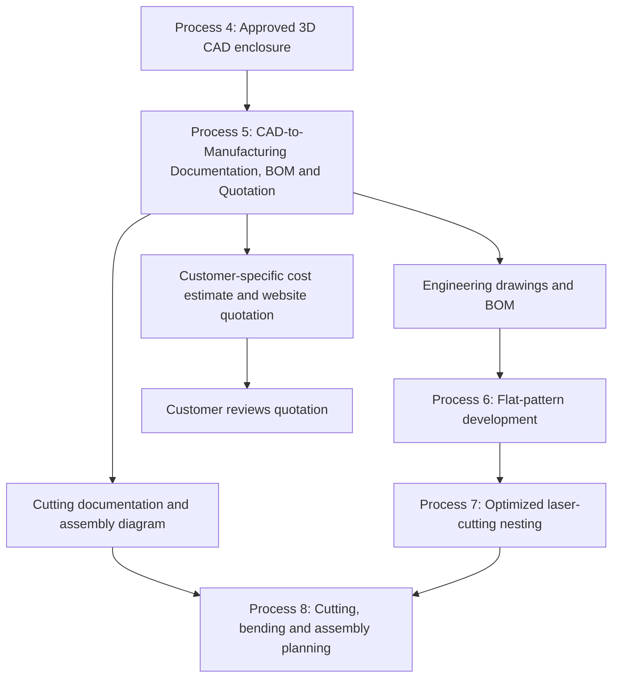
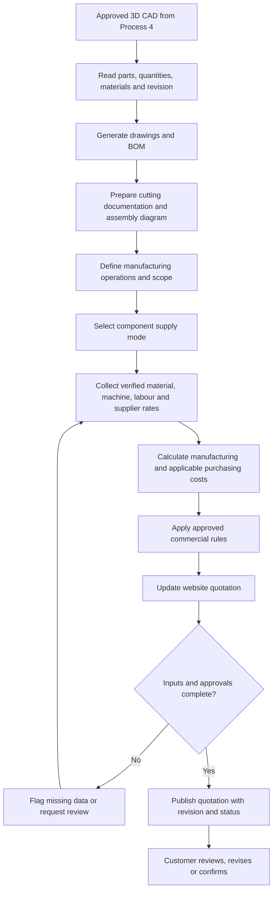

# Process 5 — CAD-to-Manufacturing Documentation, BOM and Quotation

> [!abstract] Process purpose
> Convert the approved 3D CAD enclosure design from Process 4 into a coordinated manufacturing documentation package and a customer-specific quotation. Generate engineering drawings, a Bill of Materials (BOM), laser-cutting documentation, assembly diagrams/instructions, and a transparent cost breakdown. The quotation must change according to who supplies the components and the customer's required manufacturing scope.

## 1. Position in the overall workflow

**Input:** approved 3D assembly and part models, verified material/thickness values, component arrangement, customer requirements, and company pricing data.

**Output:** a revision-controlled manufacturing documentation package and a customer-specific quotation that can be reviewed on the website.

> [!note] Scope boundary
> Process 5 coordinates and presents the manufacturing documents and quotation. Detailed flat-pattern development and validation belong to Process 6; material-sheet nesting and leftover-sheet optimization belong to Process 7. Process 5 may display or link to their validated outputs, but should not treat a preliminary diagram as a production-ready cutting plan.

## 2. Overall process summary

The system should:
1. Read the approved CAD assembly and identify each manufactured part.
2. Generate dimensioned drawings from the approved CAD geometry.
3. Create the BOM for the selected quantity.
4. Prepare cutting documentation and links to validated flat patterns/nesting outputs.
5. Generate an assembly diagram and relevant instructions.
6. Identify who supplies the electrical/mechanical components.
7. Calculate manufacturing and purchasing costs without double-counting.
8. Display an itemized estimate and quotation on the customer website.
9. Record quotation status, revision, assumptions, and approval.

The same approved design and part information should feed these outputs. Avoid retyping the same dimensions and quantities separately into multiple documents.

## 3. Inputs required

| Input | Details | Why it matters |
|---|---|---|
| Approved 3D CAD model | Assembly, individual parts, configurations, and revision | Source of geometry and part identity |
| Customer input route | Rough requirements or complete drawing/specification | Determines what must be collected or verified |
| Enclosure specification | Dimensions, material grade, thickness per panel, finish, quantity | Drives manufacturing and material requirements |
| Component supply choice | Customer supplies all, company supplies all, or partial supply | Controls whether component purchasing costs are included |
| Component list | Part number, quantity, specification, supplier price where company supplies it | Supports BOM and procurement estimate |
| Manufacturing scope | Cutting, bending, welding, finishing, assembly, packaging, delivery, or other services | Defines what the quote includes |
| Validated flat patterns | Approved developed profiles and part identifiers | Required for reliable cutting preparation |
| Nesting/stock information | Material grade, thickness, stock-sheet size, usable leftovers, nesting yield | Supports realistic material usage and scrap costing |
| Machine and labour rates | Setup, cutting, bending, welding, assembly, finishing, and other applicable rates | Supports cost estimation |
| Commercial rules | Overhead allocation, margin, discounts, tax treatment, validity period | Converts estimated cost into a customer quotation |
| Revision and job data | Customer/job ID, drawing revision, quantity, status | Ensures traceability and prevents outdated quotes |

If the customer provides a complete drawing and specification, reuse verified information and ask only for missing, ambiguous, or conflicting details. Do not force the customer to re-enter dimensions already available in the supplied documents.

## 4. Customer types and quotation rules

The website must distinguish the supply responsibility for components. This selection changes the quotation.

### Type A — Customer supplies the components

The customer provides the electrical/mechanical components. The company quotes only for the agreed enclosure manufacturing services and other explicitly included charges.

Usually include, as applicable:
- Sheet-metal material for the enclosure.
- Laser cutting and other cutting operations.
- Bending.
- Welding or joining.
- Surface finishing.
- Assembly labour, if included in the agreed scope.
- Packaging, delivery, overheads, margin, and applicable taxes according to company policy.

**Exclude component purchase prices** for items the customer supplies. If the company still has to install customer-provided components, include installation/assembly labour only if that service is in scope.

### Type B — Company purchases the components

The company procures the required components and manufactures the enclosure.

Include, as applicable:
- Enclosure material and fabrication.
- Component purchase cost based on verified prices.
- Procurement charges, if separately charged.
- Assembly/installation labour.
- Finishing, packaging, delivery, overheads, margin, and taxes according to company policy.

### Type C — Partial component supply

The customer supplies some components and the company purchases the rest. Mark the source of each BOM item as **customer-supplied**, **company-purchased**, or **not applicable**. Only company-purchased items contribute to the component procurement subtotal.

> [!important] Avoid double-counting
> Do not include a component's purchase cost when it is customer-supplied. Do not charge procurement twice if it is already included in another overhead or service rate. The quotation must state what is included and excluded.

## 5. Step-by-step workflow

### Step 1 — Read the approved CAD assembly

Load the released Process 4 assembly and associated part models. Extract or reference:
- Part names and IDs.
- Quantities per enclosure.
- Material grade and thickness.
- Dimensions and relevant geometry.
- Assembly relationships.
- Revision and configuration information.

Check that the model revision is approved and that no critical design issue remains unresolved. If the CAD model changes, affected drawings, BOM lines, cutting data, assembly documents, and quotes must be updated or marked as superseded.

**Output:** a structured design/part dataset for documentation and costing.

### Step 2 — Generate dimensioned engineering drawings

Generate suitable views for each part: front, top, side, isometric, section, and detail views as needed. Drawings should communicate the information required to manufacture and inspect the parts, including:
- Overall and feature dimensions.
- Hole, slot, and cut-out sizes and positions.
- Bend and flange details.
- Material and thickness.
- Tolerances and datums where required.
- Surface finish and manufacturing notes where specified.
- Part ID, drawing number, revision, units, and scale.

Use the approved CAD model as the source of geometry. Do not guess dimensions from screenshots or invent missing tolerances. Ambiguities must be flagged for clarification or engineering review.

**Output:** dimensioned drawing sheets and approved drawing files in the formats required by the workshop.

### Step 3 — Generate the Bill of Materials (BOM)

The BOM lists the parts, materials, hardware, and components required to manufacture the requested quantity.

Typical fields:
- Item number.
- Part number and description.
- Quantity per enclosure.
- Total quantity for the job.
- Material grade and thickness.
- Part dimensions or stock specification, where relevant.
- Component source: customer-supplied or company-purchased.
- Unit price and subtotal when pricing is available.
- CAD/drawing revision and notes.

Example BOM structure (illustrative only):

| Item | Description | Qty per enclosure | Supply source |
|---|---|---:|---|
| 1 | Main body panel | 1 | Company manufactures |
| 2 | Door panel | 1 | Company manufactures |
| 3 | Top panel | 1 | Company manufactures |
| 4 | Bottom panel | 1 | Company manufactures |
| 5 | Base plate | 1 | Company manufactures |
| 6 | Hinges and locks | As specified | Customer or company |
| 7 | Electrical components | As specified | Customer or company |
| 8 | Fasteners and mounting hardware | As specified | Customer or company |

This is only a structure example; the actual BOM must come from the approved design and customer scope. The BOM should distinguish **fabricated parts** from **purchased items** and from **customer-supplied items**.

**Output:** BOM for one enclosure and total BOM for the requested production quantity.

### Step 4 — Prepare laser-cutting documentation

The system prepares the information needed for cutting, including:
- Identified panel profiles.
- Material grade and thickness.
- Part quantities.
- Part labels/IDs.
- Validated flat-pattern references.
- Nesting diagram and stock-sheet assignment when available.
- Cutting-file references in the format accepted by the workshop.

For many workflows, a verified DXF profile is used for 2D laser cutting. The exact file format and layer conventions depend on the machine/CAM software. Exporting a DXF does not automatically prove that it is ready to cut: units, scale, duplicate lines, open contours, layers, and profile validity must be checked.

**Process boundary:** Process 6 validates flat-pattern development. Process 7 arranges profiles on available stock sheets and optimizes material use, including suitable usable leftovers and different material thicknesses. Process 5 should use the approved outputs from those processes and present the resulting cutting diagram/documents.

**Output:** cutting documentation linked to the correct panel revision and, where available, validated nesting output.

### Step 5 — Generate the assembly diagram and instructions

Generate an assembly view, exploded view, or illustrated sequence that shows how the enclosure is put together.

It may identify:
- Main body and individual panels.
- Door, hinges, and locks.
- Mounting plate, rails, brackets, and hardware.
- Electrical/mechanical components when installation is in scope.
- Fastener types and quantities.
- Assembly order and relevant references.

Instructions should be specific enough to help the intended worker, but must not invent joining methods or torque values. Use the approved CAD assembly, engineering instructions, and manufacturer data.

If electrical components are customer-supplied, clarify whether the company is responsible only for enclosure fabrication or also for installing/wiring those components.

**Output:** assembly diagram and scope-appropriate assembly instructions.

### Step 6 — Establish the manufacturing route and operations

Identify the operations required for the enclosure, for example:
1. Material preparation.
2. Laser cutting or other approved cutting.
3. Deburring and edge treatment.
4. Bending.
5. Welding or fastening.
6. Surface finishing.
7. Enclosure assembly.
8. Component installation, if included.
9. Final inspection and packaging.

Not every enclosure needs every operation. The route must match the actual design and agreed manufacturing scope. Estimate setup and processing time for each applicable operation using the company's process data.

**Output:** operation list used for costing and production planning.

### Step 7 — Collect cost inputs

Use current, approved business data rather than invented prices.

**Material data**
- Material grade and thickness.
- Stock-sheet dimensions and price.
- Quantity required for the job.
- Validated nesting utilization.
- Reusable offcuts/leftovers where the shop's costing policy permits.
- Scrap treatment and material yield.

**Machine and labour data**
- Setup time and setup charge.
- Laser-cutting time or approved machine rate.
- Number and complexity of bends.
- Welding/joining time.
- Assembly and installation labour.
- Finishing costs.
- Other process charges.

**Purchased component data**
- Part number and specification.
- Supplier price and price date.
- Quantity required.
- Procurement charges, if applicable.
- Availability or lead-time assumptions when relevant.

**Commercial data**
- Overheads.
- Approved margin/markup method.
- Discounts, if applicable.
- Tax treatment.
- Packaging/delivery.
- Quote validity and lead time.

If a price or time estimate is missing, flag it and mark the quotation provisional. Do not silently substitute a made-up rate.

### Step 8 — Calculate the manufacturing cost

A practical cost model separates the categories so the company can audit the calculation.

**Manufacturing cost before margin and tax:**

\[
\begin{aligned}
C_{\text{manufacturing}} ={}&
C_{\text{material}} + C_{\text{cutting}}\\
&+ C_{\text{bending}} + C_{\text{joining}}\\
&+ C_{\text{finishing}} + C_{\text{assembly}}\\
&+ C_{\text{overheads}} + C_{\text{other included services}}
\end{aligned}
\]

Add component purchasing only for items the company supplies:

\[
C_{\text{job base}} =
C_{\text{manufacturing}} +
C_{\text{company-purchased components}} +
C_{\text{applicable procurement}}
\]

Apply margin, discounts, and taxes using the company's approved pricing policy. For example, the system may calculate a markup on cost or use a defined gross-margin formula; these methods are not interchangeable, so the business must choose and document one.

For a quantity greater than one, separate one-time setup costs from per-unit costs. Calculate the job total based on the actual production plan rather than blindly multiplying every cost by quantity.

**Avoid material double-counting:** if the material cost is based on whole stock sheets purchased, account for usable leftovers and scrap consistently. If it is based on consumed material, define how scrap and reusable offcuts are charged.

### Step 9 — Generate the customer-specific quotation

Create a clear quotation that includes:
- Quotation number and revision.
- Customer and job reference.
- Enclosure description and approved design revision.
- Quantity.
- Component supply mode.
- Manufacturing scope.
- Unit price and total price.
- Cost breakdown, where appropriate.
- Component purchasing subtotal only when applicable.
- Taxes and other charges.
- Exclusions and customer responsibilities.
- Estimated lead time and quotation validity.
- Assumptions, unresolved details, and approval status.

The quotation should clearly state whether electrical components, wiring, installation, finishing, delivery, and taxes are included. Do not imply that the company supplies or installs components unless that is part of the agreed scope.

### Step 10 — Update the quotation on the website

The website should recalculate the quotation when relevant, validated inputs change.

Customer-facing workflow:
1. Customer chooses rough requirements or uploads a complete drawing/specification.
2. System fills in verified details and asks only for missing information.
3. Customer selects who supplies components: customer, company, or partial supply.
4. Customer specifies quantity, finish, and required services.
5. System validates the inputs and creates/updates the design and BOM data.
6. Costing engine calculates the estimate using current company rates.
7. Website displays the unit price, job total, included services, and itemized charges.
8. Customer can revise the request, save/download the quotation, or request formal confirmation.

The website should show **Estimated** when required inputs or rates are not yet confirmed. A formal quotation should be issued only after the required checks and approvals.

## 6. Website quotation preview — example interaction

The following is a sample calculation structure, not a real supplier quotation or market-price claim.

For a simple prototype, let:
- \(M\) = sheet-material cost.
- \(F\) = fabrication cost.
- \(S\) = finishing cost.
- \(P\) = company-purchased component cost.
- \(r\) = approved margin/markup parameter.
- \(t\) = applicable tax rate.

For customer-supplied components, \(P=0\) in the quote for component purchasing. For company-supplied components, use the verified procurement subtotal.

An illustrative prototype may calculate:

\[
C_{\text{base}} = M+F+S+P
\]

If the business explicitly chooses a markup-on-cost model:

\[
C_{\text{before tax}} = C_{\text{base}}\left(1+\frac{r}{100}\right)
\]

\[
C_{\text{unit}} = C_{\text{before tax}}\left(1+\frac{t}{100}\right)
\]

\[
C_{\text{job}} = C_{\text{unit}}\times Q
\]

where \(Q\) is the requested quantity. This simplified example does not automatically account for setup-cost allocation, quantity discounts, different tax treatments, or detailed material-nesting economics; the production costing rules must do so.

### Required behavior by customer type

| Selected mode | Component purchasing subtotal | Quotation scope |
|---|---|---|
| Customer supplies all components | Excluded | Enclosure manufacturing and other agreed services |
| Company supplies all components | Included using verified prices | Manufacturing plus supplied components and agreed services |
| Partial supply | Only company-purchased items included | Manufacturing plus only the components/services the company supplies |

## 7. AI, CAD, and costing responsibilities

| System component | Responsibility |
|---|---|
| AI / language model | Interpret customer requests, summarize drawing requirements, flag missing information, explain the quote |
| CAD automation | Extract part identity and geometry references; generate drawing and assembly-documentation tasks where supported |
| BOM service | Maintain quantities, part IDs, materials, and supply-source status |
| Flat-pattern and nesting services | Provide validated developed profiles, nesting layouts, material usage, and scrap estimates |
| Costing engine | Calculate costs from approved prices, machine rates, labour times, quantities, and pricing rules |
| Website | Collect requirements, display the updated quote, and allow review or revision |
| Engineer / estimator | Approve technical assumptions, cost inputs, exceptions, and formal quotation release |
| IIoT/job-tracking system | Link approved design and quote revisions to manufacturing status and later inspection records |

AI should not invent supplier prices, machine rates, dimensions, or required manufacturing time. Use validated inputs and deterministic calculation logic for the actual quote.

## 8. How IIoT supports Process 5

IIoT does not replace CAD documentation or the costing engine. It can connect the manufacturing package to the shop-floor workflow:
- Associate the released drawing and BOM revisions with a job.
- Track quote, approval, and production status.
- Provide machine availability or actual machine-time data where integrated.
- Record actual material use, rework, and production time for later cost analysis.
- Link inspection outcomes to the manufactured job and design revision.

Actual production data can improve future estimates, but historical values should be reviewed for relevance before being used as costing inputs.

## 9. Expected outputs

At completion, Process 5 should provide:

1. Dimensioned engineering drawings for the required panels.
2. BOM for one enclosure and the requested quantity.
3. Component source classification: customer-supplied, company-purchased, or not applicable.
4. Cutting-document references and validated nesting output when available.
5. Assembly diagram and scope-appropriate instructions.
6. Manufacturing route/operation list.
7. Itemized manufacturing cost breakdown.
8. Customer-specific quotation with unit price and total price.
9. Website quotation view with estimated/approved status.
10. Revision-controlled links between CAD, drawings, BOM, cutting data, assembly documents, and quote.

## 10. Validation and completion criteria

Process 5 is complete when:
- Documents refer to the correct approved CAD revision.
- Every required manufactured part is represented in the drawing/BOM package.
- Material grade, thickness, quantity, and component supply source are verified.
- Cutting documents refer to validated profiles and correct material/thickness.
- Assembly documents match the approved design and scope.
- Costs use verified prices, rates, and business rules.
- Customer-supplied components are not charged as company purchases.
- Company-purchased components are included only when applicable.
- Setup costs, stock-sheet costs, scrap, and reusable leftovers are handled consistently.
- Unit price, quantity total, taxes, inclusions, exclusions, and quotation status are clear.
- Required technical and commercial approvals are recorded.

## 11. Process 5 flowchart

## 12. Related Obsidian notes

- [[Process_3_AI_Assisted_Component_Arrangement]]
- [[Process_4_Final_3D_CAD_Enclosure_Design]]
- [[Process_6_Sheet_Metal_Flat_Pattern_Development]]
- [[Process_7_Optimized_Laser_Cutting_Nesting]]

---

> [!note] Engineering and commercial note
> This note defines the proposed workflow, not a released engineering design or actual supplier quotation. Technical values, manufacturing rates, supplier prices, tax treatment, and business pricing rules must be verified before a formal quotation or manufacturing release.

## 13. Image placeholders — add your own images

These are placeholders only. Replace each placeholder with a local image you save and add to your Obsidian vault. No external image URLs are embedded in this note.

### Image 1 — Approved 3D CAD enclosure model

**[IMAGE PLACEHOLDER: Insert a screenshot of the approved 3D enclosure assembly from SOLIDWORKS.]**

Suggested filename: `process-5-3d-cad-enclosure.png`

### Image 2 — Dimensioned engineering drawing

**[IMAGE PLACEHOLDER: Insert a dimensioned panel drawing showing orthographic views, holes, cut-outs, bends, and title block.]**

Suggested filename: `process-5-dimensioned-drawing.png`

### Image 3 — Bill of Materials (BOM)

**[IMAGE PLACEHOLDER: Insert a BOM table showing part number, description, quantity, material, thickness, and supply source.]**

Suggested filename: `process-5-bom.png`

### Image 4 — Laser-cutting diagram / nesting layout

**[IMAGE PLACEHOLDER: Insert a laser-cutting nesting layout showing sheet stock, arranged panel profiles, material grade, and thickness.]**

Suggested filename: `process-5-laser-cutting-nesting.png`

### Image 5 — Exploded assembly diagram

**[IMAGE PLACEHOLDER: Insert an exploded CAD assembly view showing the body, door, panels, hinges, locks, mounting plate, and hardware.]**

Suggested filename: `process-5-assembly-diagram.png`

### Image 6 — Customer-specific quotation website

**[IMAGE PLACEHOLDER: Insert a screenshot of the quotation interface showing customer-supplied versus company-supplied components, cost inputs, unit price, and job total.]**

Suggested filename: `process-5-quotation-dashboard.png`

### Image 7 — Manufacturing cost breakdown

**[IMAGE PLACEHOLDER: Insert a cost summary chart or table for material, cutting, bending, finishing, assembly, purchased components, overheads, margin, and taxes.]**

Suggested filename: `process-5-cost-breakdown.png`

---

**Next process:** [[Process_6_Sheet_Metal_Flat_Pattern_Development]]

## Visual Quotation & Costing Reference

*Figure 5.1: Consolidated quotation dashboard integrating material costs, cutting length, bend hits, and component pricing.*
