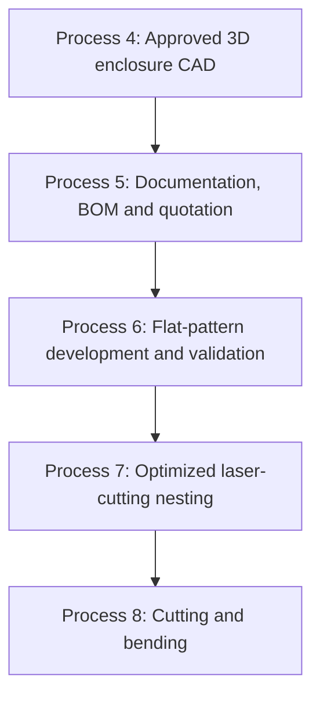
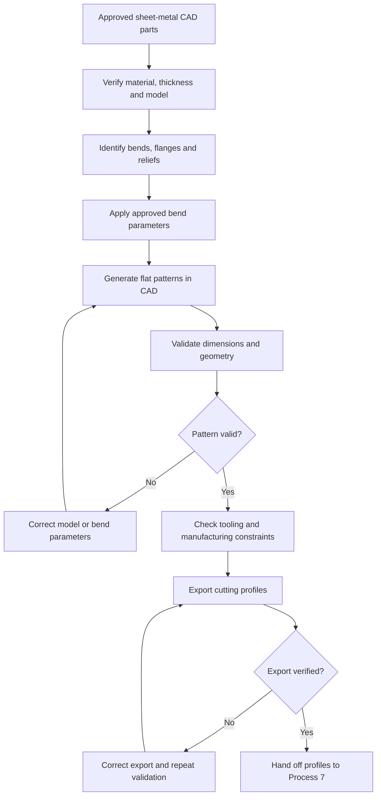

# Process 6 — Sheet-Metal Flat-Pattern Development and Validation

> [!abstract] Purpose
> Convert each approved 3D sheet-metal part into an accurate unfolded 2D flat pattern, verify the developed geometry and bend parameters, and export validated profiles for Process 7 — Optimized Laser-Cutting Nesting.

## 1. Position in the manufacturing workflow

- **Process 4** defines the final 3D enclosure and its sheet-metal parts.
- **Process 5** organizes engineering drawings, BOM, assembly diagrams, cutting documentation, and customer-specific quotation.
- **Process 6** unfolds each applicable sheet-metal part and validates its 2D profile.
- **Process 7** selects suitable stock sheets and nests the validated profiles to reduce material waste.
- **Process 8** cuts and bends the parts using the released manufacturing data.

**Key distinction:** a flat pattern describes one part's unfolded shape. A nesting layout arranges multiple validated part profiles on stock sheet material.

## 2. What is flat-pattern development?

A finished sheet-metal part may have flanges and bends that make it three-dimensional. Before the sheet can be cut and formed, the system needs to calculate the corresponding flat profile.

For example, a panel with two folded side flanges may look like a channel after bending. Before bending, it starts as a developed 2D shape that includes the main panel, the flange regions, and the correct allowance through each bend.

The developed profile must account for:
- The final part geometry.
- Sheet thickness and material.
- Bend angles and inside radii.
- The selected bend allowance, bend deduction, K-factor, or bend-table method.
- Holes, slots, cut-outs, and relief features.
- Manufacturing and tooling constraints.

Do not assume that the flat dimensions are simply the sum of the finished outside dimensions. The geometry through each bend affects the developed length.

## 3. Inputs required

| Input | What is needed | Why it matters |
|---|---|---|
| Approved 3D CAD part | Sheet-metal model and revision | Defines the finished geometry |
| BOM / panel list | Part IDs and quantities | Identifies the parts requiring development |
| Material grade | Specified metal grade | Helps select appropriate bend data |
| Sheet thickness | Verified thickness for each part | Required for bend calculations |
| Bend angle and radius | Required geometry for each bend | Defines the formed part |
| Bend calculation method | Approved K-factor, bend allowance/deduction, or bend table | Calculates developed lengths |
| Flange dimensions | Finished flange sizes and positions | Defines the final geometry |
| Relief geometry | Corner and bend reliefs, tabs, slots, and related features | Helps avoid interference |
| Manufacturing method | Press-brake and tooling information where available | Supports feasibility checks |
| Revision and drawing data | Approved model revision and associated documentation | Prevents using outdated geometry |

Different panels can use different thicknesses and material grades. For example, a 1.0 mm body, 1.2 mm door, and 1.6 mm base plate must retain their own verified properties and appropriate bend settings.

## 4. Full step-by-step workflow

### Step 1 — Identify and classify the sheet-metal parts

Read the approved CAD assembly and the panel list from Process 5. Classify each part, for example:
- Flat plate with no bends.
- Single-bend panel.
- Multiple-bend panel.
- Folded body panel.
- Door or cover.
- Bracket or mounting support.

A flat plate may need only a validated 2D profile. A folded body may require several bend features and reliefs.

**Output:** list of parts requiring flat-pattern generation.

### Step 2 — Verify the 3D model

Check that each model is suitable for sheet-metal development:
- Thickness is defined correctly.
- Material information is assigned.
- Bend features are recognized.
- Flanges and bends form valid geometry.
- There are no unintended intersections or invalid features.
- The model matches the approved revision.

If an imported solid is not recognized as sheet metal, it may need conversion using SOLIDWORKS sheet-metal tools. This can require identifying a base face, thickness, bend edges, and other parameters. Do not silently treat an uncertain conversion as verified.

**Output:** valid sheet-metal model ready for unfolding.

### Step 3 — Identify bends, flanges, and reliefs

Identify every bend and its relationship to neighbouring panel sections. Record, where applicable:
- Bend angle and direction.
- Inside bend radius.
- Material thickness.
- Flange length and position.
- Corner relief and bend relief.
- Any tooling or forming restrictions.

Correct bend direction matters. An incorrectly interpreted bend can produce a flat profile that does not form the intended part.

### Step 4 — Calculate bend allowance

Bending compresses material near the inside surface and stretches it near the outside surface. A neutral layer is used in bend calculations to estimate the developed length.

A common theoretical bend-allowance formula is:

\[
BA=\theta(R+Kt)
\]

Where:
- \(BA\) = bend allowance.
- \(\theta\) = bend angle in radians.
- \(R\) = inside bend radius.
- \(K\) = K-factor.
- \(t\) = sheet thickness.

For a 90-degree bend, \(\theta=\pi/2\).

The K-factor describes the neutral layer's position relative to sheet thickness. It is not universal; its appropriate value depends on the material, thickness, radius, and forming conditions.

SOLIDWORKS may use a K-factor, bend allowance, bend deduction, or bend table, depending on the selected settings.

> [!warning] Use approved bend data
> Use verified workshop bend tables or approved SOLIDWORKS settings for the actual material and press-brake process wherever available. Theoretical calculations alone do not guarantee the final manufactured dimension.

### Step 5 — Generate the flat pattern in SOLIDWORKS

Use the sheet-metal flat-pattern functionality to generate the unfolded configuration of each applicable part.

The pattern should contain the relevant:
- Outer cutting profile.
- Holes, slots, and mounting cut-outs.
- Flange and relief geometry.
- Bend locations and directions, where required.
- Developed dimensions.

Keep the flat pattern associated with the original 3D part and its revision. If the 3D model changes, update and revalidate the flat pattern.

**Output:** candidate flat pattern for each part.

### Step 6 — Verify developed dimensions

Compare the flat pattern with the approved CAD model and engineering requirements. Check:
- Overall flat width and height.
- Flange lengths and bend positions.
- Hole and cut-out locations.
- Bend allowance or deduction settings.
- Material thickness.
- Part orientation and revision.
- Missing or invalid geometry.

A finished enclosure dimension is not necessarily the flat-pattern dimension. For example, an enclosure width of 706 mm does not automatically mean its unfolded body profile is 706 mm wide; flanges and bend development affect the result.

### Step 7 — Check reliefs, corners, and bend interference

Check for:
- Intersecting adjacent flanges.
- Missing or unsuitable corner reliefs.
- Holes or slots placed too close to bend regions.
- Interference between tabs and adjoining features.
- Invalid or overlapping flat geometry.
- Potential problems with the planned bend sequence.

Some failures require changes to the 3D CAD model. If the model is corrected, regenerate and revalidate the affected flat pattern and associated drawing.

### Step 8 — Check tooling and manufacturing feasibility

Where reliable shop data is available, check:
- Minimum practical flange lengths.
- Bend radius compatibility.
- Material and thickness limits.
- Tool access and part positioning.
- Possible punch, die, or machine interference.
- Feasibility of the bending sequence.

The limits depend on the actual press brake, tooling, material, and workshop process. Flag uncertain cases for manufacturing review rather than guessing machine limits.

### Step 9 — Export the flat profiles

Export each validated profile in the format required by the workshop.

| Format | Typical use |
|---|---|
| DXF | 2D profile transfer to compatible laser-cutting CAM software |
| DWG | 2D CAD exchange in supported workflows |
| SLDPRT | Native SOLIDWORKS part, including sheet-metal features and configurations |
| PDF | Readable flat-pattern drawing or manufacturing reference |

The correct format depends on the CAD/CAM workflow. Associate every file with its part ID, material, thickness, quantity, units, and revision.

### Step 10 — Validate exported cutting geometry

Before handing files to Process 7, check:
- Units and scale.
- Duplicate or overlapping lines.
- Open contours where closed contours are required.
- Missing holes or cut-outs.
- Incorrect or incomplete profiles.
- Bend lines accidentally included as cutting contours.
- Correct part identifiers and revisions.
- Material and thickness information.

CAM systems may require different layers for cutting, engraving, and bend references. Follow the actual workshop export conventions.

**Output:** validated flat profiles suitable for nesting.

### Step 11 — Handoff to Process 7

The handoff package should include:
- Validated flat-pattern files.
- Part IDs and quantities.
- Material grades and thicknesses.
- Revision and validation status.
- Stock-sheet requirements, where known.
- Grain-direction or orientation restrictions, where applicable.
- Relevant manufacturing notes.

Process 7 uses these inputs to select compatible stock sheets and arrange the profiles, including consideration of usable leftover material.

Different material grades and thicknesses must be treated as separate stock requirements when they are not interchangeable.

## 5. How AI and automation fit into Process 6

| Technology | Responsibility |
|---|---|
| AI assistant | Identifies missing inputs, summarizes part data, explains validation failures, and guides the workflow |
| SOLIDWORKS sheet-metal tools | Generate flat patterns from 3D sheet-metal parts |
| CAD API / automation | Automates supported operations, property extraction, pattern generation, and export |
| Bend calculation method | Applies approved bend allowance, bend deduction, K-factor, or bend-table data |
| Geometry validator | Checks dimensions, contours, holes, and exported profiles |
| Manufacturing rule checks | Check tooling constraints when sufficient reliable data exists |
| Engineer/manufacturing specialist | Reviews exceptions and approves uncertain or critical cases |

AI must not invent a K-factor, bend radius, or tooling limit and mark it as verified. Actual engineering and manufacturing data must drive the result.

## 6. How IIoT supports this process

IIoT helps with production traceability and feedback, but it does not replace CAD calculations.

Possible functions:
- Link each flat-pattern revision to the production job.
- Track whether a pattern is pending, validated, or rejected.
- Associate the profile with its nesting job.
- Record actual material use and rework.
- Compare manufacturing results with the intended geometry.
- Use reliable production history to improve future estimates.

Machine status and production data may inform the workflow, but flat-pattern geometry must still be validated independently.

## 7. Expected outputs

At the end of Process 6, the system should provide:
1. Validated flat patterns for applicable sheet-metal parts.
2. Developed dimensions and bend information.
3. Correct material and thickness assignments.
4. Verified holes, slots, cut-outs, and relief geometry.
5. Exported cutting profiles in the required format.
6. Validation results and a list of unresolved issues.
7. Part IDs, quantities, and revision references.
8. A handoff package for Process 7 — Optimized Laser-Cutting Nesting.

## 8. Completion criteria

Process 6 is complete when:
- Every applicable sheet-metal part has a valid flat pattern.
- Material thickness and bend parameters are verified.
- Developed geometry matches the approved finished-part design.
- Holes, slots, cut-outs, and reliefs are correct.
- Relevant manufacturing constraints have been checked.
- Exported profiles have the correct units, scale, and geometry.
- Each profile is linked to the correct part and revision.
- Profiles are ready for nesting, or unresolved issues are explicitly flagged.

## 9. Remaining processes

The workflow currently contains 14 processes. After Process 6, **8 processes remain**:

7. Optimized Laser-Cutting Nesting.
8. Cutting and Bending.
9. Automated Fabrication Quotation Dashboard.
10. AIoT System Architecture.
11. IoT Job-Tracking Dashboard.
12. Camera-Based Dimensional Inspection.
13. Computer-Vision Feature Detection and Dimension Comparison.
14. Final Fabricated Enclosure and Quality Inspection.

Quotation functionality is already part of Process 5. A later quotation dashboard can present and integrate that functionality without duplicating the underlying cost calculation.

## 10. Process 6 flowchart

## 11. Image placeholders — add your own images

These are placeholders only. Replace them with images you save into your Obsidian vault. This Markdown file does not use external image URLs and does not contain downloaded images.

### Image 1 — Folded 3D panel and flat pattern

**[IMAGE PLACEHOLDER: Insert a side-by-side comparison of a folded sheet-metal part and its unfolded flat pattern.]**

Suggested filename: `process-6-folded-part-and-flat-pattern.png`

### Image 2 — Bend allowance and bend geometry

**[IMAGE PLACEHOLDER: Insert a technical diagram explaining bend angle, inside radius, sheet thickness, neutral layer, and K-factor.]**

Suggested filename: `process-6-bend-allowance.png`

### Image 3 — Flat pattern with holes and cut-outs

**[IMAGE PLACEHOLDER: Insert a dimensioned flat-pattern drawing showing the outer profile, holes, slots, cut-outs, and bend lines.]**

Suggested filename: `process-6-flat-pattern-features.png`

### Image 4 — SOLIDWORKS flat-pattern workflow

**[IMAGE PLACEHOLDER: Insert a SOLIDWORKS screenshot showing the folded model and the Flat-Pattern configuration.]**

Suggested filename: `process-6-solidworks-flat-pattern.png`

### Image 5 — DXF cutting profile

**[IMAGE PLACEHOLDER: Insert a CAD/CAM screenshot of a validated 2D profile prepared for laser cutting.]**

Suggested filename: `process-6-dxf-cutting-profile.png`

### Image 6 — Flat-pattern validation

**[IMAGE PLACEHOLDER: Insert a validation screenshot or checklist showing profile dimensions, units, contours, and revision status.]**

Suggested filename: `process-6-profile-validation.png`

---

## 12. Related Obsidian notes

- [[Process_4_Final_3D_CAD_Enclosure_Design]]
- [[Process_5_CAD_to_Manufacturing_Documentation_BOM_and_Quotation]]
- [[Process_7_Optimized_Laser_Cutting_Nesting]]

**Next process:** Process 7 — Optimized Laser-Cutting Nesting.

> [!note] Engineering note
> This note describes the proposed workflow. Actual bend parameters, tooling limits, and manufacturing requirements must be verified for the specific material, thickness, equipment, and approved design before fabrication.

## Visual Flat Pattern Reference

*Figure 6.1: Unfolded 1:1 scale flat pattern layouts with bend lines and corner relief geometry ready for DXF export.*
