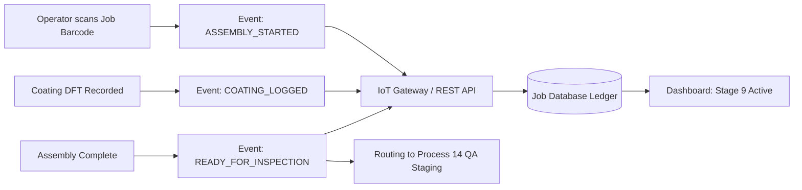
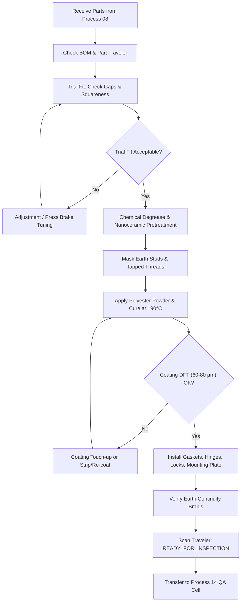

# Process 09: Dimensional Verification, Painting and Complete Enclosure Assembly

## 1. Purpose & Scope

This process receives the cut and bent sheet-metal components from [Process 08: Sheet-Metal Cutting, Bending and Component Fabrication](process-08-cutting-bending-fabrication.md). It encompasses:
1. Receiving and verifying the complete part kit against the Bill of Materials (BOM).
2. Physical dimensional verification and mechanical trial fit of the bare sheet-metal components.
3. Chemical surface pre-treatment (degreasing, phosphating/passivation).
4. Application and thermal curing of protective powder coating or industrial paint.
5. Final mechanical assembly of panels, doors, hinges, locks, gaskets, and mounting plates.
6. Handoff of the fully assembled physical enclosure to the dedicated metrology and quality inspection station ([Process 14: Final Fabricated Enclosure and Quality Inspection](../../quality-inspection/processes/process-14-final-quality-inspection.md)).

> [!IMPORTANT]
> **Domain Boundary Notice**:
> In accordance with the AIoT platform architecture, Process 09 governs the **physical manufacturing assembly and finishing workflow**. The physical assembly status does *not* constitute final quality release. Acceptance and certification are performed under [Process 14](../../quality-inspection/processes/process-14-final-quality-inspection.md), while digital telemetry is logged to [Process 11: IoT Job-Tracking Dashboard](../../digital-systems/processes/process-11-job-tracking-dashboard.md).

---

## 2. Visual Overview

*Figure 9.1: Complete general arrangement (GA) engineering diagram showing assembled chassis, door swing geometry, DIN-rail mounting plates, and gland plate interfaces.*

---

## 3. Required Inputs

- **Fabricated Sheet-Metal Parts Kit** from [Process 08](process-08-cutting-bending-fabrication.md):
  - Enclosure body wrapper / chassis (1 off)
  - Front door panel (1 off)
  - Top & bottom gland cover plates (2 off)
  - Internal mounting sub-plate / backplate (1 off)
  - Internal DIN-rail brackets and stiffener channels (kit)
- **Authoritative Engineering Documentation** from [Process 05: CAD-to-Manufacturing Documentation, BOM and Quotation](process-05-manufacturing-documentation.md):
  - Approved Assembly Drawing (Revision Controlled)
  - Production Bill of Materials (BOM) specifying hardware grades and torque limits
  - Coating Specification: RAL 7035 light grey, textured thermoset polyester powder coat, 60–80 µm dry film thickness (DFT)
- **Work Order & Routing Card**:
  - Active `Job ID` and barcode tracking traveler

---

## 4. Main Workflow Steps

### Step 1 — Receive and Identify Fabricated Part Kit
Upon receiving the parts kit from the press brake work center:
1. Scan the traveler barcode to record `PARTS_RECEIVED` at the Assembly Station.
2. Cross-check all fabricated piece parts against the BOM.
3. Verify that part marking / laser etch tags match the routing sheet.
4. Quarantine any kits with missing, dented, or deformed parts.

### Step 2 — Component Verification Prior to Fit-Up
Perform manual caliper and squareness verification on bare formed components:
- Flange heights and bend angles (verify 90° ± 0.5°).
- Diagonal squareness across enclosure corner welds/bends ($|D_1 - D_2| \le 1.0\text{ mm}$).
- Hole pitch and alignment for door hinge cutouts and gland plate studs.

### Step 3 — Mechanical Trial Fit
Before committing parts to chemical finishing:
1. Temporarily clamp or screw the chassis, door, gland plates, and mounting plate into position.
2. Confirm nominal perimeter door gap ($2.0\text{ mm} \pm 0.5\text{ mm}$ all around).
3. Verify that internal DIN-rail mounting brackets align with pre-punched chassis lance/stud locations without mechanical distortion.
4. Disassemble the dry-fit structure for pre-treatment.

### Step 4 — Surface Preparation & Pre-Treatment
Sheet-metal surfaces must be prepared according to industrial powder-coating standards:
1. **Alkaline Degreasing**: Immersion/spray wash to remove cutting oils, coolant residues, and shop dirt.
2. **Water Rinse**: Demineralized water rinse cycle.
3. **Iron/Zinc Phosphating or Zirconium Passivation**: Nanoceramic or phosphate conversion coating to inhibit sub-film corrosion and enhance powder adhesion.
4. **Drying Oven**: Forced hot air dry-off at 110°C–120°C for 10 minutes.
5. **Masking**: Apply high-temperature silicone masking plugs and tape to electrical earthing studs (copper bonding points), internal tapped threads (M4/M5/M6), and precision bearing surfaces.

### Step 5 — Powder Coating Application & Thermal Curing
1. Electrostatic spray application of thermosetting polyester powder coating (RAL 7035).
2. Thermal curing in a convection oven at 180°C–200°C metal temperature for 15–20 minutes.
3. Cool down under clean laminar conditions.
4. Visual and magnetic DFT check: verify dry film thickness is within $70 \pm 10\ \mu\text{m}$. Inspect for runs, pinholes, orange peel, or uncoated corners.

### Step 6 — Final Mechanical Assembly
Assemble the finished parts using the approved assembly procedure:
1. **Chassis & Hardware Installation**: Fasten gland plates with captive zinc-plated M5 screws and nitrile rubber sealing gaskets.
2. **Door & Hinge Mounting**: Install concealed lift-off hinges. Mount the door and adjust hinge shims to ensure smooth, unforced closure.
3. **Locking Mechanism**: Install 3-point quarter-turn cam lock and master handle. Test key rotation and positive latch engagement.
4. **Mounting Plate & Internal Supports**: Fit galvanized internal mounting plate to rear welded studs using vibration-resistant flanged nylon lock nuts.
5. **Earth Bonding**: Remove masking from earth studs; fit standard yellow/green earth continuity braids connecting the door and body to the main earthing terminal.
6. **Perimeter Gasket**: Apply polyurethane continuous foam gasket (FIPFG) or push-on EPDM sponge gasket along the inner door flange.

### Step 7 — Handoff to Quality Assurance
1. Affix physical serial number / QR-code label to the inside of the enclosure door.
2. Scan the traveler barcode to transition the Job ID to `ASSEMBLY_COMPLETED`.
3. Transfer the assembled enclosure to the Quality Inspection & Metrology staging cell ([Process 14](../../quality-inspection/processes/process-14-final-quality-inspection.md)).

---

## 5. Digital System & AIoT Integration Boundaries

Process 09 generates physical state events consumed by the digital tracking infrastructure:

> [!CAUTION]
> **Strict Operational Rule**:
> Moving a job to `READY_FOR_INSPECTION` indicates that the physical assembly sequence is complete. It does **not** grant quality release or customer dispatch approval. Release authority resides strictly with the QA inspector in [Process 14](../../quality-inspection/processes/process-14-final-quality-inspection.md).

---

## 6. Process Outputs

1. **Physical Product**: One complete, painted, assembled sheet-metal electrical enclosure with all doors, hinges, locks, gland plates, gaskets, and mounting sub-plates fitted.
2. **Physical Traveler Update**: Signed and barcode-stamped job traveler routing the unit to QA metrology.
3. **Digital Telemetry Event**: `READY_FOR_INSPECTION` payload logged into the central database with timestamp, operator ID, and coating batch code.

---

## 7. Process Verification Checklist

- [ ] All BOM piece parts received, verified, and free of physical transit damage.
- [ ] Bare-metal trial fit verifies door clearance ($2.0 \pm 0.5\text{ mm}$) and diagonal squareness.
- [ ] Pre-treatment and degreasing completed with earthing studs and threads masked.
- [ ] Powder coating cured at 180°C–200°C; DFT verified within $60\text{--}80\ \mu\text{m}$.
- [ ] Hinges, 3-point cam lock, handles, and seals assembled without finish damage.
- [ ] Ground bonding braids installed with clean electrical metal-to-metal contact.
- [ ] Traveler scanned and enclosure routed to [Process 14 QA Station](../../quality-inspection/processes/process-14-final-quality-inspection.md).

---

## 8. Process Flowchart

