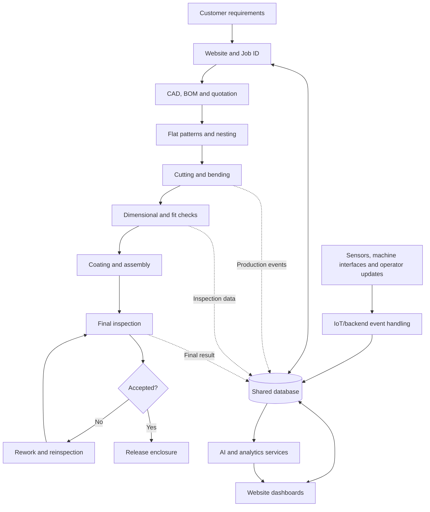

# AIoT-Based Smart Sheet-Metal Panel Fabrication System

## 1. Project overview

The AIoT-Based Smart Sheet-Metal Panel Fabrication System is a proposed solution for connecting the design and manufacturing of electrical sheet-metal enclosures with a website, IoT data collection, and AI-assisted analysis.

The system aims to connect customer requirements, component selection, CAD design, quotation, material planning, cutting, bending, finishing, assembly, and inspection. A shared backend and database maintain job records, while the website lets authorized customers and factory staff view and update relevant information.

AI and IoT are used where they provide practical value. IoT can collect data from supported machine interfaces, sensors, cameras, or operator updates. AI can assist with requirement extraction, nesting decisions, visual defect detection, and production analytics. These capabilities require appropriate validation and should not be treated as automatically accurate.

## 2. Problem statement

Sheet-metal fabrication involves multiple connected activities and many types of information, including customer specifications, CAD drawings, bills of materials, quotations, stock sheets, production status, and inspection results. When these records are managed separately, it can be difficult to track the latest approved design, see current job progress, coordinate material use, and trace quality issues.

**The project aims to develop an integrated AIoT-enabled website and manufacturing data system that improves job visibility, traceability, material-planning support, and quality-record management across the sheet-metal enclosure lifecycle.**

The current scale of these problems should be confirmed by observing the workshop and measuring baseline performance.

## 3. Proposed solution

Create a website and backend that use a shared Job ID to connect order information, approved design revisions, BOM and quotation, material allocations, production events, and inspection records.

- The **website** provides customer, engineering, production, inventory, and quality pages.
- The **backend** validates requests, applies workflow rules, and exposes secure APIs.
- The **database** stores job, material, production, and inspection records.
- The **IoT layer** receives data from suitable machine interfaces or sensors. Simulated events can be used during early development.
- The **AI layer** assists selected tasks such as extracting requirements, evaluating nesting options, flagging visual defects, and analyzing production history.
- **Human approval and engineering rules** remain responsible for design release, machine safety, and quality acceptance.

## 4. Short explanation of each process

### Process 1 — Customer Requirement Collection

Collect the customer's enclosure requirements, such as dimensions, material, thickness, quantity, mounting needs, environment, accessories, and delivery expectations. Identify missing information before design begins.

### Process 2 — Component Identification, Measurement and Digital Library

Identify the electrical components and mounting hardware required inside the enclosure. Record verified dimensions and properties in a reusable digital component library.

### Process 3 — AI-Assisted Internal Component Arrangement

Use component dimensions, clearances, mounting requirements, and enclosure constraints to suggest possible internal layouts. AI can assist with suggestions, but engineering rules and fit checks must validate the arrangement.

### Process 4 — Final 3D CAD Enclosure Design

Create and approve the enclosure's 3D CAD model, including the body, panels, door, mounting plate, holes, bends, and other required features. The approved model becomes the design reference for manufacturing.

### Process 5 — CAD-to-Manufacturing Documentation, BOM and Quotation

Convert the approved design into manufacturing drawings, a Bill of Materials (BOM), assembly information, operation details, and a quotation. Use verified rates and clearly identify customer-supplied versus company-purchased components.

### Process 6 — Sheet-Metal Flat-Pattern Development and Validation

Unfold each approved sheet-metal part into a flat pattern using validated bend settings, material thickness, bend radius, and workshop data. Check the resulting profile before it is passed to nesting.

### Process 7 — Optimized Laser-Cutting Nesting

Arrange compatible flat patterns from current and planned jobs on available full sheets and usable remnants. Compare feasible layouts using material cost, waste, cutting constraints, handling, and due dates.

### Process 8 — Sheet-Metal Cutting, Bending and Component Fabrication

Cut the required blanks and parts, identify and deburr them, bend or form the specified components, and inspect the fabricated parts. Record produced quantities, material use, scrap, and reusable remnants.

### Process 9 — Dimensional Verification, Painting and Complete Enclosure Assembly

Check dimensions and trial-fit all cut and bent parts against the approved drawing. Prepare and coat the parts, assemble them into one complete enclosure, install required hardware, and perform final inspection. The exact coating-versus-joining order must follow the workshop's approved method.

### Process 10 — AIoT System Implementation Guide

Implement the shared software and data architecture connecting the website, backend, database, IoT messaging, and AI services. Start with simulated machine data, then integrate suitable real devices and validated AI capabilities.

### Process 11 — IoT Job-Tracking Dashboard

Build a dashboard showing each job's current manufacturing stage, timestamps, quantities, delays, and available machine status. Combine authenticated IoT events with operator updates so staff can monitor production progress.

### Process 12 — Camera-Based Dimensional Inspection

Capture images using a defined camera setup to assist with inspection of selected dimensions or features. Reliable physical measurement requires calibration, controlled imaging, and validation against known measurements.

### Process 13 — Computer-Vision Feature Detection and Dimension Comparison

Use computer vision to identify specified features, such as holes, edges, or panel boundaries, and compare validated measurements with approved drawing tolerances. Flag potential discrepancies for review rather than allowing an AI prediction alone to approve a part.

### Process 14 — Final Fabricated Enclosure and Quality Inspection

Verify that the complete enclosure meets the approved requirements. Check dimensions, panel alignment, door and hardware operation, finish, completeness, and any specified tests; record acceptance, defects, and rework.

## 5. User stories

Use these as concise examples of what each user needs from the system.

- **Customer:** As a customer, I want to submit enclosure requirements and drawings so the engineering team can review them and prepare a quotation.
- **Design engineer:** As an engineer, I want to manage approved CAD revisions and BOMs so production uses the correct design.
- **Production planner:** As a planner, I want to compare stock sheets and remnants so material can be allocated efficiently.
- **Machine operator:** As an operator, I want to see the assigned job and approved instructions so I can record work against the correct revision.
- **Quality inspector:** As an inspector, I want to record measurements and defects against the Job ID so quality decisions remain traceable.
- **Production manager:** As a manager, I want to see job progress, delays, material use, and rework so I can identify problems.
- **Administrator:** As an administrator, I want role-based access and audit logs so customer and factory records are protected.

## 6. Suggested success measures

Measure the current baseline before claiming improvements.

| Goal | Possible measure |
|---|---|
| Better traceability | Share of jobs with linked design, BOM, production, and inspection records |
| Faster status visibility | Time between a real production event and its appearance on the dashboard |
| Better material planning | Material used, scrap, and usable remnants per job |
| More complete quality records | Share of inspections with all required fields |
| Useful AI inspection | Precision, recall, false positives, and false negatives on labelled test data |
| Better production planning | Difference between estimated and actual completion times |

## 7. Recommended implementation order

1. Build user authentication, customer orders, Job IDs, and database records.
2. Add design references, BOM, quotation, and revision management.
3. Add inventory, production tracking, inspection, and rework records.
4. Build dashboards using backend data.
5. Simulate IoT events and test status updates.
6. Connect one suitable real device or machine interface after safety and compatibility checks.
7. Add one AI feature, test it against representative data, and expand only when its performance is understood.

## 8. Obsidian project index

Use this note as the project home page. Create or rename related notes to match the wiki-link titles below.

- [[Process 1 — Customer Requirement Collection]]
- [[Process 2 — Component Identification, Measurement and Digital Library]]
- [[Process 3 — AI-Assisted Internal Component Arrangement]]
- [[Process 4 — Final 3D CAD Enclosure Design]]
- [[Process 5 — CAD-to-Manufacturing Documentation, BOM and Quotation]]
- [[Process 6 — Sheet-Metal Flat-Pattern Development and Validation]]
- [[Process 7 — Optimized Laser-Cutting Nesting]]
- [[Process 8 — Sheet-Metal Cutting, Bending and Component Fabrication]]
- [[Process 9 — Dimensional Verification, Painting and Complete Enclosure Assembly]]
- [[Process 10 — AIoT System Implementation Guide]]
- [[Process 11 — IoT Job-Tracking Dashboard]]
- [[Process 12 — Camera-Based Dimensional Inspection]]
- [[Process 13 — Computer-Vision Feature Detection and Dimension Comparison]]
- [[Process 14 — Final Fabricated Enclosure and Quality Inspection]]

Existing notes may use slightly different filenames. Obsidian resolves wiki links by note title; update the link or rename the note if it does not open.

## Summary

The project connects the full sheet-metal enclosure lifecycle through a website and shared backend. IoT collects available production data, AI assists selected decisions, and the database maintains traceable records. The fourteen processes describe the work from customer requirements through final inspection, while this note provides the overview and navigation point for the project.
