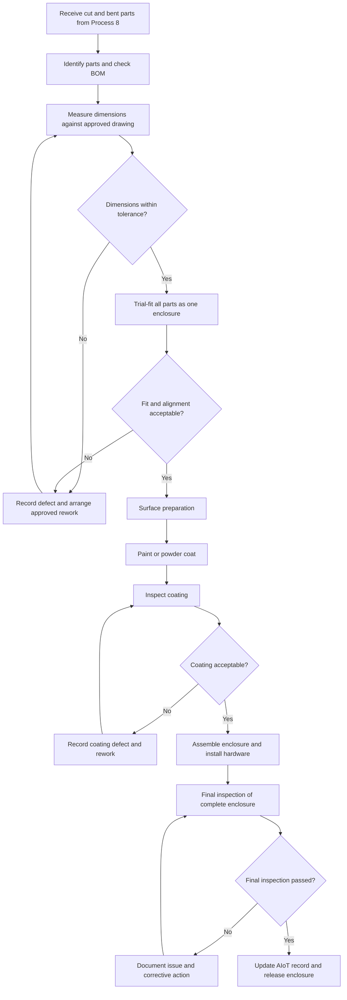
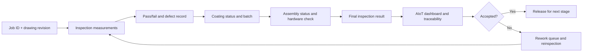

# Process 9 — Dimensional Verification, Painting and Complete Enclosure Assembly

## 1. Purpose

This process receives the cut and bent sheet-metal components from [[Process 8 — Sheet-Metal Cutting, Bending and Component Fabrication]]. It verifies their dimensions and fit, prepares and coats the parts, joins the components into **one complete enclosure**, and performs the final inspection.

The goal is to ensure the finished enclosure matches the approved design, fits together correctly, has an acceptable surface finish, and includes all required hardware and components.

> **Important:** The sequence below follows the intended workflow for this project: inspect and fit-check the fabricated parts, paint or powder-coat them, and then assemble the enclosure. In a real workshop, any welding or joining that would damage the coating may need to happen before painting. Follow the approved factory procedure.

## Visual overview

*Conceptual illustration only; the approved CAD model and manufacturing drawings remain the source of truth for dimensions and component positions.*

## 2. Inputs

- Cut and bent parts from [[Process 8 — Sheet-Metal Cutting, Bending and Component Fabrication]].
- Approved 3D CAD model and manufacturing drawings from [[Process 5 — CAD-to-Manufacturing Documentation, BOM and Quotation]].
- Validated flat-pattern and fabrication information from [[Process 6 — Sheet-Metal Flat-Pattern Development and Validation]].
- Bill of Materials (BOM), including the main body, top and bottom panels, door, base/internal mounting plate, brackets, supports, hinges, locks, handles, fasteners, seals, and other specified items.
- Approved dimensions, tolerances, fit requirements, coating specification, and joining method.
- Inspection checklist and job/order identification.

## 3. Main workflow

### Step 1 — Receive and identify fabricated parts

Receive the complete set of parts produced in Process 8. Match each part to the job number, drawing revision, part name or ID, material, and required quantity.

Check that the set includes every component needed for the enclosure. Record missing, damaged, mixed-up, or unidentified parts before continuing.

### Step 2 — Verify dimensions and part quality

Measure the parts using suitable, calibrated tools and the approved drawing. Depending on the part, checks may include:

- Length, width, and thickness.
- Hole and slot positions and diameters.
- Flange dimensions and bend angles.
- Flatness, squareness, and edge condition.
- Bracket and mounting-plate positions.
- Visible cutting or bending defects.

Compare measured values with the specified tolerances. Do not assume that a measurement is acceptable merely because it looks close; use the approved drawing and tolerance limits.

### Step 3 — Perform a trial fit of the complete enclosure

Arrange the main body panels, top and bottom panels, door, base plate, brackets, and other components in their intended positions. Check that the parts align and can form **one complete enclosure box**.

Verify, as applicable:

- Panel edges and corners align.
- Mounting holes and slots line up.
- The door fits the opening with suitable clearances.
- Hinges, locks, handles, and mounting plates can be installed in their intended positions.
- Brackets and internal supports do not interfere with other components.
- The enclosure can be joined using the specified method.

Record any interference, gap, misalignment, or fit issue. Correct the cause and repeat the check before finishing or assembly. Any rework must follow the approved drawing and workshop procedure.

### Step 4 — Prepare surfaces for painting or powder coating

Prepare the parts according to the specified finish. This may include removing burrs, cleaning oil and dirt, removing rust or contamination, and applying the required pretreatment.

Mask surfaces that must remain uncoated, such as specified electrical bonding points, threads, or precision-fit areas, when the design or finishing specification requires it. Use the approved masking and surface-preparation procedure.

### Step 5 — Apply the specified coating

Send the prepared parts through the required painting or powder-coating process. Follow the approved colour, coating type, thickness, curing, and handling requirements.

After coating, check for defects such as:

- Uneven coverage or colour.
- Runs, bubbles, pinholes, scratches, or contamination.
- Poor adhesion or damage.
- Coating on masked or functional surfaces where it is not allowed.

Allow the coating to dry or cure as required before handling and assembly. Record the coating batch or process details when traceability is required.

### Step 6 — Assemble the enclosure

Join the approved components into one complete enclosure using the method specified in the drawing or work instruction. Depending on the design, this may involve bolts, screws, rivets, approved joining hardware, or a joining method performed before coating.

Install the required items from the BOM, as applicable:

- Main body, top, and bottom.
- Door, hinges, lock, and handle.
- Base or internal mounting plate.
- Brackets and supports.
- Fasteners, seals, and other specified hardware.

Use the specified fasteners and tightening requirements. Avoid damaging the coating during assembly. If a component cannot be installed without force or unapproved modification, stop and investigate rather than forcing it into place.

### Step 7 — Perform final inspection of the complete enclosure

Inspect the assembled box against the approved drawing, BOM, and quality checklist. Checks may include:

- Overall length, width, height, and squareness.
- Panel alignment and joint quality.
- Door alignment, opening and closing, and lock operation.
- Correct installation and security of hinges, handles, brackets, and mounting plate.
- Required holes, slots, and mounting features.
- Coating condition and visible damage.
- Completeness against the BOM.
- Specified grounding/bonding, sealing, or ingress-protection checks, where applicable and only using the relevant approved test method.

Record pass/fail results and any nonconformities. A failed inspection should lead to documented correction or rework and reinspection before release.

### Step 8 — Update the AIoT job record and hand off

Update the job-tracking system with the inspection results, coating status, assembly status, quantities, defects, rework, and completion time. Link records to the job ID, enclosure ID, drawing revision, and relevant material or coating batch where available.

Once the enclosure passes the required checks, mark the process complete and hand it to the next production, storage, or dispatch stage.

## 4. Where AIoT fits

AIoT supports traceability and decision-making; it does not replace approved drawings, calibrated measurement tools, or qualified inspection.

- **Job tracking:** Shows whether parts are awaiting inspection, surface preparation, coating, assembly, or final inspection.
- **Digital inspection records:** Stores measured values, tolerance limits, pass/fail decisions, defect codes, and rework history.
- **Machine and process data:** Where suitable sensors are installed, records relevant process conditions and timestamps.
- **Camera assistance:** Can flag visible surface defects or part-presence issues. Camera-based dimensional measurement requires suitable calibration, lighting, camera placement, and a validated method.
- **Alerts:** Flags missing components, failed measurements, incomplete inspections, or overdue jobs.
- **Traceability:** Connects the finished enclosure to its job, drawing revision, component records, and finishing batch.

The system should not automatically approve a part based only on an AI prediction. Acceptance must follow the approved tolerance and inspection rules.

## 5. Example AIoT status sequence

`Parts Received → Dimensional Inspection → Trial Fit → Surface Preparation → Coating → Assembly → Final Inspection → Accepted / Rework Required`

This is a proposed tracking sequence for the project, not a claim that every workshop must use exactly these statuses.

## 6. Outputs

- Dimension and fit-check records.
- Identified and resolved fabrication discrepancies.
- Surface-preparation and coating records.
- One assembled sheet-metal enclosure with required components and hardware.
- Final inspection results and nonconformance/rework records, if any.
- Updated AIoT job status and traceability information.
- Accepted enclosure ready for the next production, storage, or dispatch stage.

## 7. Acceptance checklist

- [ ] All required parts are present and identified.
- [ ] Dimensions meet the approved drawing tolerances.
- [ ] Trial fit confirms the parts can form the intended enclosure.
- [ ] Surface preparation and coating meet the specified requirements.
- [ ] All required components and hardware are installed.
- [ ] The door and locking hardware operate correctly, where fitted.
- [ ] The assembled enclosure passes the final inspection checklist.
- [ ] Defects and rework are recorded and resolved.
- [ ] The AIoT job record is updated and the enclosure is released by the authorised person.

## 8. Relationship to the other processes

- **Previous:** [[Process 8 — Sheet-Metal Cutting, Bending and Component Fabrication]] produces the cut and bent components.
- **Design and documentation:** [[Process 5 — CAD-to-Manufacturing Documentation, BOM and Quotation]] supplies approved drawings and the BOM.
- **Flat-pattern preparation:** [[Process 6 — Sheet-Metal Flat-Pattern Development and Validation]] supplies validated part profiles.
- **Related website feature:** The quotation dashboard is a separate website feature connected to Process 5 and production records. It is not part of this physical finishing and assembly process.

## 9. Process summary

Process 9 checks the dimensions and fit of all cut and bent parts, prepares and coats the parts, joins them into one complete enclosure, performs final quality inspection, and records the results in the AIoT system. The enclosure is released only after it meets the approved requirements.

## 10. Process flowcharts

### A. Manufacturing and inspection flow

### B. AIoT data and status flow

