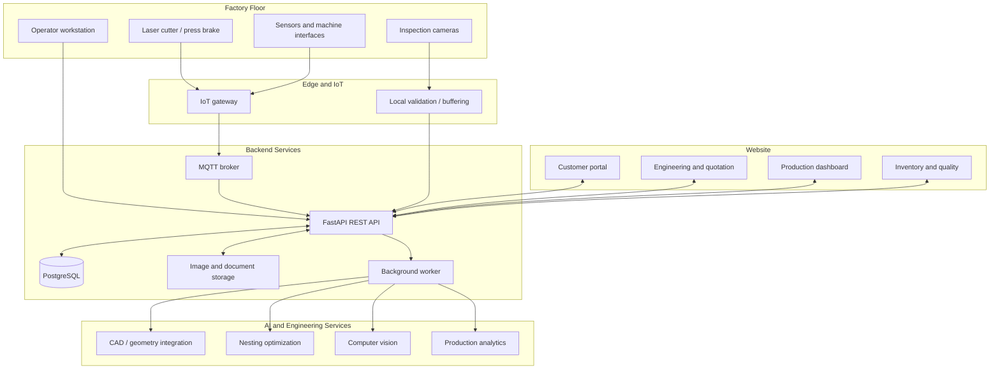
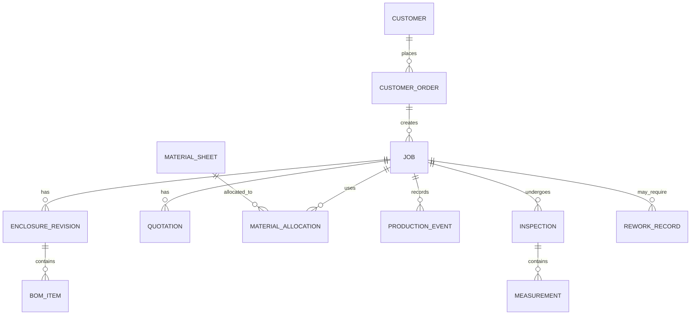
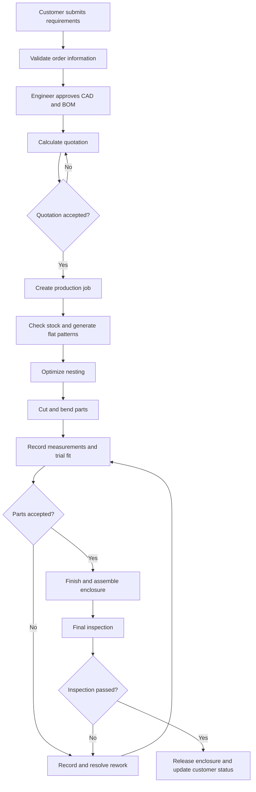

# Process 10 — AIoT System Implementation Guide

> This document describes **how to implement the AIoT system and website** for the Smart Sheet Metal Panel Fabrication project. It is an implementation guide, not another manufacturing-process description.

## 1. Project objective

Build a connected software system that links customer orders, enclosure design, BOM and quotation, material inventory, nesting, production progress, inspection, and final quality records.

The system has three major parts:

1. **Factory layer:** machines, sensors, cameras, operators, and fabricated parts.
2. **AIoT and backend layer:** data collection, messaging, business rules, AI services, and database.
3. **Website layer:** customer portal, engineering workspace, production dashboard, inventory, quality inspection, and reports.

For the first prototype, machine data can be simulated. Real factory equipment should only be connected after its interfaces, electrical requirements, safety controls, and communication methods have been confirmed.

## 2. System architecture



### Architecture responsibilities

- **Frontend:** displays pages, forms, tables, charts, status updates, and inspection results.
- **Backend API:** authenticates users, validates requests, applies workflow rules, and reads/writes data.
- **Database:** stores the official records for orders, jobs, designs, BOMs, materials, production events, and inspections.
- **MQTT broker:** carries device telemetry and machine events when IoT is enabled.
- **Background worker:** handles longer tasks such as image analysis, report creation, and nesting jobs.
- **AI/engineering services:** provide specialized analysis; they do not replace approved CAD geometry, production rules, or quality acceptance.
- **Object storage:** stores CAD files, drawings, inspection images, and reports. Store file metadata and access permissions in the database.

## 3. Recommended technology stack

| Layer | Initial choice | Purpose |
|---|---|---|
| Frontend | Angular | Customer portal and staff dashboards |
| Backend | FastAPI (Python) | APIs and AI integration |
| Database | PostgreSQL | Structured business and production data |
| IoT messaging | Mosquitto MQTT | Device events and telemetry |
| Image processing | OpenCV | Image preparation and vision pipeline |
| AI models | A task-specific, validated model | Defect assistance or other selected AI feature |
| Background tasks | Python worker service | Long-running AI and report jobs |
| File storage | Local storage for prototype; object storage later | CAD, drawings, images, reports |
| Development deployment | Docker Compose | Run services consistently |

These are recommended choices, not mandatory requirements. Start with the smallest working stack and add services when the feature requires them.

## 4. Website modules to implement

### 4.1 Authentication and roles

Create sign-in and role-based permissions for:

- Customer: manage their own orders, submit requirements, view quotations and permitted status updates.
- Engineer: manage component data, CAD revisions, BOMs, and design approvals.
- Production operator: view assigned jobs and submit stage updates.
- Quality inspector: record measurements, inspection outcomes, defects, and rework.
- Manager: view production, inventory, cost, and performance reports.
- Administrator: manage users, settings, and reference data.

Users should only see and change records permitted for their role.

### 4.2 Customer requirements and orders

The customer form should collect relevant fields such as enclosure dimensions, quantity, material, sheet thickness, mounting needs, environment, required accessories, drawing attachments, and customer-supplied components.

Validate required fields and flag missing or contradictory details for clarification. AI may extract data from a drawing or description, but an engineer must approve the specifications used for manufacturing.

### 4.3 Component library and CAD

Maintain reusable component records with stable IDs, descriptions, dimensions, material, thickness, CAD file references, revision, and approval state.

Store CAD files and generated drawings as versioned artifacts. Keep a clear link between the approved enclosure revision and the BOM, flat patterns, nesting job, and manufactured enclosure.

Do not let a language model invent precise geometry or silently approve a CAD design. Use CAD software or a geometry engine and explicit engineering rules for geometric validation.

### 4.4 BOM and quotation

The BOM should identify each required part and purchased component, quantity, material, thickness, and source.

Quotation logic should use approved rates and verified inputs for material, cutting, bending, joining, finishing, assembly, purchased components, overhead, delivery, margin, and applicable taxes. Exclude the purchase cost of customer-supplied items; include company-purchased items according to the costing rules.

Store quotation number, revision, validity, inclusions/exclusions, approval status, and lead-time assumptions. AI may explain costs or flag missing inputs, but deterministic calculations should produce the amount.

### 4.5 Material inventory and nesting

Inventory should track sheet material, grade, thickness, dimensions, usable area, location, status, and remnants. Each allocation should link the material sheet or remnant to the job.

Nesting needs validated flat patterns and compatible material/thickness constraints. Use a geometry-aware nesting engine to create feasible layouts. Compare total material cost, usable remnants, cutting time, handling, deadlines, and job compatibility; do not automatically select a remnant just because it is partially used.

### 4.6 Production tracking

Represent manufacturing progress as job events, for example:

- `JOB_RELEASED`
- `CUTTING_STARTED`
- `CUTTING_COMPLETED`
- `BENDING_COMPLETED`
- `DIMENSION_CHECK_PASSED`
- `COATING_COMPLETED`
- `ASSEMBLY_COMPLETED`
- `FINAL_INSPECTION_PASSED`
- `REWORK_REQUIRED`

These are suggested event names. Define valid transitions in backend rules. A machine-completed event must not automatically mean the parts passed quality inspection.

### 4.7 Quality inspection

Record the part or enclosure ID, drawing revision, measured value, unit, tolerance, instrument or method, inspector/device, timestamp, result, image reference, and any defect or rework record.

The backend should compare numeric measurements with approved tolerance limits. AI predictions and visual flags should be stored separately from confirmed inspection results.

### 4.8 Dashboard and reports

Display only information appropriate to the user's role. Useful widgets include:

- Active jobs and current stage.
- Jobs waiting for material or approval.
- Machine status where connected.
- Production quantity and completion time.
- Material consumption, scrap, and reusable remnants.
- Inspection pass/fail counts and rework.
- Estimated versus actual progress and cost.

The quotation dashboard is a website feature connected to the quotation module; it is not a physical fabrication stage.

## 5. Database design

Use a stable `job_id` to connect the whole job lifecycle. A possible initial schema is:



Suggested tables:

- `users`, `roles`
- `customers`, `customer_orders`, `jobs`
- `enclosure_revisions`, `components`, `bom_items`
- `quotations`, `quotation_lines`
- `material_sheets`, `material_allocations`, `nesting_runs`
- `production_events`, `machine_devices`, `device_events`
- `inspections`, `measurements`, `defects`, `rework_records`
- `file_assets`, `audit_logs`

Store status history as events rather than overwriting the only record of what happened. Add timestamps and relevant IDs so an event can be traced to its job, part, device, drawing revision, and responsible user.

## 6. API design

Example REST endpoints for the initial implementation:

| Endpoint | Purpose |
|---|---|
| `POST /api/orders` | Create a customer order |
| `GET /api/jobs/{job_id}` | Retrieve job details and current status |
| `POST /api/jobs/{job_id}/events` | Record a validated production event |
| `POST /api/jobs/{job_id}/quotations` | Create a quotation version |
| `POST /api/jobs/{job_id}/material-allocations` | Allocate material |
| `POST /api/jobs/{job_id}/inspections` | Save an inspection record |
| `POST /api/devices/events` | Receive authenticated device events |
| `POST /api/ai/inspection-jobs` | Submit an image-analysis task |
| `GET /api/dashboard/summary` | Retrieve role-filtered dashboard metrics |

These are proposed endpoint names, not existing APIs. Implement authentication, input validation, authorization, duplicate-event handling, error responses, and audit logging.

## 7. IoT implementation

### Prototype first: simulated machine data

Before connecting actual equipment, create a small simulator that sends test events for cutting, bending, and machine status. Verify that the backend stores the event and the website updates the job timeline.

Example event:

```json
{
  "device_id": "cutting-station-01",
  "job_id": "JOB-2026-001",
  "event": "CUTTING_COMPLETED",
  "timestamp": "2026-10-25T10:30:00+05:30",
  "quantity": 12
}
```

This is sample data only.

### Connect real equipment later

1. Identify each machine's available interface and approved data access method.
2. Determine whether an industrial gateway, PLC interface, external sensor, or operator entry is appropriate.
3. Authenticate the device and validate incoming data.
4. Send telemetry through MQTT or HTTPS.
5. Store raw events and normalized production events separately when useful.
6. Buffer data locally if connectivity drops and reconcile it safely when connectivity returns.
7. Test with read-only monitoring before considering any machine-control integration.

Do not connect hobby microcontrollers directly to hazardous machine circuits. Use appropriate electrical isolation, industrial interfaces, and factory-approved safety procedures. AI and the website must not bypass machine safety controls.

## 8. AI implementation plan

Implement focused capabilities one at a time.

### AI feature A — Requirement extraction

Input: customer text and uploaded documents.

Output: suggested structured fields, missing-information warnings, and confidence indicators.

Validation: an engineer confirms all manufacturing-critical values before design approval.

### AI feature B — Nesting assistance

Input: validated flat patterns, material and thickness, stock sheets, remnants, and job deadlines.

Output: feasible nesting candidates and a comparison of material use, scrap, cutting time, and estimated cost.

Use a nesting/geometry engine for actual placement. AI can forecast demand or explain options but should not invent a layout that has not passed geometric validation.

### AI feature C — Visual inspection assistance

Input: images collected under controlled lighting and a defined camera setup.

Output: candidate defects or feature-detection results linked to the relevant part or enclosure.

Validation: label representative images, test against known good and defective parts, measure false positives and false negatives, and keep a human review path. Dimensional measurement requires calibrated imaging or an appropriate measurement instrument.

### AI feature D — Production analytics

Input: historical job durations, machine events, material consumption, and inspection records.

Output: bottleneck indicators, estimated completion times, unusual patterns, and material-demand forecasts.

Do not claim predictive accuracy until the system has enough representative data and has been evaluated.

## 9. End-to-end application flow



The website and backend manage the workflow; IoT supplies machine/device events where available; AI services provide selected recommendations and inspection assistance.

## 10. Security, reliability, and auditability

- Use HTTPS and secure session/token handling.
- Apply role-based access to orders, drawings, quotations, and factory records.
- Authenticate devices separately from human users.
- Validate event payloads and handle duplicates or out-of-order messages.
- Record drawing revisions and approval history.
- Maintain database backups and protect uploaded drawings and images.
- Keep AI outputs distinct from verified measurements and accepted inspection decisions.
- Maintain an audit trail for quotations, production status changes, inspections, and rework.
- Separate business IT systems from machine-control networks where appropriate.
- Provide clear failure states; do not silently mark jobs complete when data is missing.

## 11. Implementation roadmap

### Phase 1 — Working software prototype
Build authentication, customer orders, job IDs, PostgreSQL tables, and basic Angular pages.

### Phase 2 — Design and commercial workflow
Add component library, CAD/document references, BOM, quotation calculations, approvals, and revision control.

### Phase 3 — Production and quality workflow
Add material inventory, nesting records, production events, inspections, rework, and dashboard summaries.

### Phase 4 — IoT simulation
Use simulated events to test MQTT, backend processing, event history, and website status updates.

### Phase 5 — First real IoT connection
Choose one suitable machine or sensor, confirm its interface, and connect it through an approved gateway. Begin with monitoring, not machine control.

### Phase 6 — First validated AI capability
Choose one well-defined use case, collect representative data, evaluate performance, and add human review before using it in production decisions.

### Phase 7 — Deployment and monitoring
Harden authentication, backups, logging, recovery, access controls, and operational documentation before wider use.

## 12. Definition of done

The first useful prototype is complete when:

- A customer order can be created and assigned a unique Job ID.
- Approved design/BOM and quotation versions can be linked to the job.
- Production events can be recorded manually or simulated.
- Material allocation and inspection results can be stored.
- The website displays job status from the backend database.
- An inspection failure can create a rework path without erasing history.
- The system distinguishes AI suggestions from confirmed quality decisions.
- Authorized users can see the records they need and cannot access unauthorized data.

## 13. Related project notes

- [[Process 5 — CAD-to-Manufacturing Documentation, BOM and Quotation]]
- [[Process 6 — Sheet-Metal Flat-Pattern Development and Validation]]
- [[Process 7 — Optimized Laser-Cutting Nesting]]
- [[Process 8 — Sheet-Metal Cutting, Bending and Component Fabrication]]
- [[Process 9 — Dimensional Verification, Painting and Complete Enclosure Assembly]]

## Summary

This guide defines how to implement the AIoT software and website: a frontend for users, a backend for workflow and APIs, a database for traceable records, IoT messaging for real device data, and separate AI/engineering services for specific tasks. Build and validate the software with simulated data first, then add real hardware and carefully evaluated AI capabilities.
