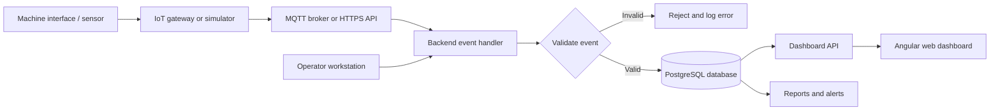
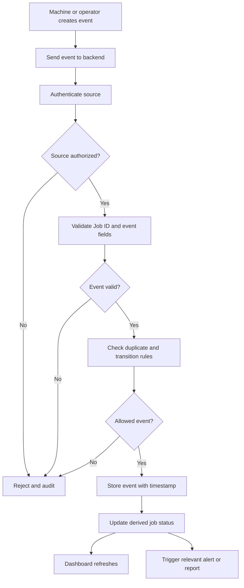

# Process 11 — IoT Job-Tracking Dashboard

## 1. Overview

Process 11 describes how to implement a website dashboard that tracks sheet-metal fabrication jobs from order release through cutting, bending, finishing, assembly, and inspection.

The dashboard combines production events received from connected equipment or IoT devices with updates entered by authorized staff. It displays the latest known job stage, event history, machine status where available, quantities, delays, and production reports.

The dashboard is a monitoring and coordination tool. A machine reporting that a task has finished does not automatically prove that the produced parts passed quality inspection.

## 2. Objectives

- Provide one view of active fabrication jobs and their current stages.
- Link production updates to the correct Job ID and approved drawing revision.
- Show machine status when reliable data is available.
- Record timestamps, quantities, delays, and operator updates.
- Display material and quality information from the shared backend.
- Keep a traceable history of job events.
- Support alerts and reports for production managers.

## 3. System architecture



### Component responsibilities

- **Machine interface or sensor:** supplies supported status signals or measurements.
- **IoT gateway or simulator:** forwards events from equipment; a simulator is useful during early development.
- **MQTT broker or HTTPS API:** transports messages to the backend.
- **Backend event handler:** authenticates the source, validates fields, checks the Job ID, handles duplicates, and applies allowed workflow transitions.
- **PostgreSQL database:** stores jobs, production events, device records, and related information.
- **Dashboard API:** returns authorized data for the web interface.
- **Angular dashboard:** displays job lists, timelines, machine status, metrics, and reports.

The first prototype can use simulated machine events and manual operator updates. Real equipment integration should be added only after its interface and safety requirements are understood.

## 4. Dashboard pages and widgets

### 4.1 Job list

Show active jobs in a searchable, filterable table.

Recommended columns:
- Job ID and customer/order reference.
- Enclosure or product description.
- Current stage and status.
- Priority and target date.
- Last update timestamp.
- Assigned work centre, if applicable.
- Action to open the job timeline.

### 4.2 Job detail and event timeline

Show the selected job's stage history, quantities, approved drawing revision, and recent updates. Each event should include its type, timestamp, source, and related quantity or measurement when applicable.

### 4.3 Machine status

Display machine state only when supported by actual data. Possible states include `Running`, `Idle`, `Fault`, `Maintenance`, and `Unknown`. Do not infer `Running` simply because a machine has not reported a fault.

### 4.4 Production progress

Show the planned and current stage for each job, such as:

`Order Approved → Material Allocated → Cutting → Bending → Inspection → Coating → Assembly → Final Inspection`

Adapt the stages to the actual workshop workflow. Some jobs may follow a different route.

### 4.5 Material and quality summary

Link the dashboard to material allocation, scrap/remnant records, inspection outcomes, and rework history. The dashboard should show whether a value is planned, reported, or confirmed.

### 4.6 Reports

Useful report examples:
- Jobs completed in a selected period.
- Jobs waiting at each stage.
- Actual versus planned completion time.
- Material used and reusable remnants recorded.
- Inspection failures and rework counts.
- Machine downtime, only when reliable machine-state data is available.

## 5. Production event workflow



### Suggested event types

- `JOB_RELEASED`
- `MATERIAL_ALLOCATED`
- `CUTTING_STARTED`
- `CUTTING_COMPLETED`
- `BENDING_STARTED`
- `BENDING_COMPLETED`
- `DIMENSION_CHECK_PASSED`
- `DIMENSION_CHECK_FAILED`
- `COATING_COMPLETED`
- `ASSEMBLY_COMPLETED`
- `FINAL_INSPECTION_PASSED`
- `REWORK_REQUIRED`

These are suggested event names. Define and test the permitted transitions in backend code. Keep the event history rather than overwriting all earlier information with the latest status.

## 6. Example IoT event

Example JSON payload from a simulated cutting station:

```json
{
  "event_id": "evt-demo-0001",
  "device_id": "cutting-station-01",
  "job_id": "JOB-2026-001",
  "event_type": "CUTTING_COMPLETED",
  "timestamp": "2026-10-25T10:30:00+05:30",
  "quantity": 12,
  "source": "simulator"
}
```

This is sample data only. In a real deployment, device identity must be authenticated and event fields validated. The server should handle repeated messages safely so a retransmitted event does not incorrectly increase produced quantities.

## 7. Website implementation

### Frontend

Recommended starting point: Angular.

Build:
- Job list and filters.
- Job detail page with timeline.
- Machine-status cards.
- Production-stage board.
- Summary charts and reports.
- Error, stale-data, loading, and empty states.

The frontend should request data from the backend API. It should not connect directly to database credentials or unrestricted machine networks.

### Backend

Recommended starting point: FastAPI.

The backend should:
- Authenticate users and authorize access by role.
- Receive operator and device events.
- Validate Job IDs, timestamps, event types, and quantities.
- Reject invalid stage transitions.
- Handle duplicate event IDs.
- Store event history and audit records.
- Provide dashboard endpoints.
- Expose freshness information so the UI can show stale device data.

### Database

Possible initial tables:
- `jobs`
- `production_events`
- `machine_devices`
- `machine_status_history`
- `material_allocations`
- `inspections`
- `users`
- `audit_logs`

Use stable identifiers and timestamps. Store event history separately from the current derived job status. Keep drawing revision and part references where the event depends on them.

## 8. Example API endpoints

| Endpoint | Purpose |
|---|---|
| `GET /api/jobs` | List jobs the user is authorized to view |
| `GET /api/jobs/{job_id}` | Retrieve one job and its current status |
| `GET /api/jobs/{job_id}/events` | Retrieve the event timeline |
| `POST /api/jobs/{job_id}/events` | Record an authorized operator event |
| `POST /api/devices/events` | Receive authenticated device events |
| `GET /api/machines/status` | Retrieve latest known machine states |
| `GET /api/dashboard/summary` | Retrieve dashboard metrics |
| `GET /api/reports/production` | Retrieve production report data |

These are proposed endpoint names, not existing APIs. Apply authentication, validation, rate limits where appropriate, audit logging, and clear error responses.

## 9. Alerts and status freshness

Possible alerts:
- A job has not changed stage within its expected window.
- A device has stopped reporting.
- A job reports a failed inspection.
- A required production event is missing.
- A job is approaching its due date.

Alerts should use explicit rules and configurable thresholds. A missing message should result in a status such as `Unknown` or `Data stale`, not a false claim that the machine is stopped or running.

## 10. Testing checklist

- [ ] A valid event appears under the correct Job ID.
- [ ] An invalid Job ID is rejected.
- [ ] Unauthorized devices cannot update production records.
- [ ] Duplicate events do not double-count quantities.
- [ ] Invalid stage transitions are blocked.
- [ ] Event history remains available after a status change.
- [ ] The dashboard indicates stale or missing device data.
- [ ] Operators can record updates if a machine has no connected interface.
- [ ] Customers cannot access other customers' jobs or internal notes.
- [ ] A failed inspection is not treated as a completed, accepted job.
- [ ] Dashboard totals match the underlying records.

## 11. Implementation roadmap

1. Create job and event tables in PostgreSQL.
2. Implement FastAPI endpoints for listing jobs and recording events.
3. Build the Angular job list and job-detail timeline.
4. Create a simulator that sends cutting and bending events.
5. Add validation, duplicate handling, permissions, and audit logs.
6. Add machine-state integration for one suitable device, if available.
7. Add reports and alerts after the underlying data is reliable.
8. Test with real operators and adjust the interface to fit workshop needs.

## 12. Inputs and outputs

**Inputs**
- Job ID and approved drawing revision.
- Operator-entered stage updates.
- Authenticated machine or IoT events.
- Quantities, timestamps, and available machine status.
- Material allocation and inspection records.

**Outputs**
- Current job-stage view.
- Production event history.
- Machine status and data-freshness indicators.
- Delay alerts and production reports.
- Traceable records for the next manufacturing stages.

## 13. Relationship to other project notes

- [[AIoT Project Index Overview and Process Summaries]]
- [[Process 8 — Sheet-Metal Cutting, Bending and Component Fabrication]]
- [[Process 9 — Dimensional Verification, Painting and Complete Enclosure Assembly]]
- [[Process 10 — AIoT System Implementation Guide]]
- [[Process 12 — Camera-Based Dimensional Inspection]]

## Summary

Process 11 implements the IoT job-tracking dashboard that connects factory events and operator updates to a shared backend and website. Start with simulated events, ensure event validation and traceability work, and then connect suitable real equipment. Display machine status only when the system has reliable supporting data.
