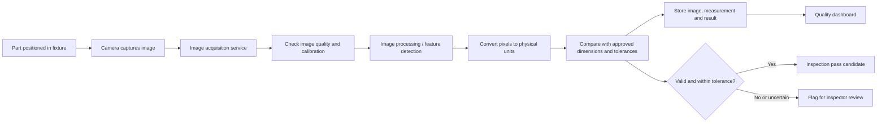
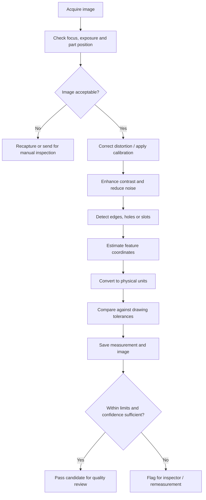

# Process 12 — Camera-Based Dimensional Inspection

## 1. Overview

Process 12 explains how to implement a camera-assisted inspection system for selected sheet-metal parts. A camera captures an image of a fabricated panel, image-processing software identifies relevant edges or features, and a validated measurement method estimates specified dimensions. The system then compares those measurements with approved drawing tolerances and records the result.

**Important:** A normal camera image does not automatically provide accurate measurements in millimetres. The camera setup must be calibrated, the part must be positioned consistently, and the measurement method must be validated against known reference measurements. For critical dimensions, use an appropriate calibrated measurement instrument or a validated machine-vision system.

## 2. Objectives

- Capture consistent images of selected sheet-metal parts.
- Identify dimensions or features suitable for camera-based measurement.
- Convert image coordinates to physical units using calibration.
- Compare measured values with approved drawing tolerances.
- Save images, measurements, results, and traceability information against the correct Job ID and drawing revision.
- Flag uncertain or failed checks for human review.

## 3. Inspection system setup

### Main components

- **Camera:** industrial camera or suitable USB camera with adequate resolution.
- **Lens:** selected for the required field of view, working distance, and measurement accuracy.
- **Rigid mounting:** prevents the camera position from changing between captures.
- **Lighting:** controlled and repeatable lighting to make edges and holes visible.
- **Fixture:** holds the panel in a known position and orientation.
- **Calibration target:** a known reference such as a suitable dot grid or checkerboard, selected for the calibration method.
- **Computer:** runs image acquisition and image-processing software.
- **Inspection application:** associates each capture with Job ID, part ID, drawing revision, and required tolerance data.

A phone camera can be useful for an early visual prototype, but it should not be assumed accurate enough for production dimensional inspection without a suitable optical setup and validation.

## 4. System architecture

## 5. Inspection workflow

### Step 1 — Select the inspection job

Load the Job ID, part ID, approved drawing revision, nominal dimensions, tolerances, and required inspection features. Do not compare the image with an unapproved or outdated drawing.

### Step 2 — Position and prepare the part

Place the part in the defined fixture. Ensure the surface is visible, the camera is fixed, and lighting is suitable. Remove temporary obstructions that prevent measurement, following workshop procedures.

### Step 3 — Capture the image

Capture the part using the approved camera settings and record the capture timestamp. Check focus, exposure, glare, shadows, and whether the whole required feature is visible. Reject or recapture poor-quality images rather than producing a misleading measurement.

### Step 4 — Calibrate the imaging setup

Use an appropriate calibration procedure to relate image coordinates to the physical part. The method depends on the camera and lens, working distance, perspective, and required accuracy.

A simple pixel-to-millimetre scale is only appropriate under suitable conditions, such as a stable, near-planar setup with minimal perspective effects. If perspective or lens distortion matters, use a suitable calibrated model and validate it across the measurement area.

### Step 5 — Detect the required features

Use image processing to identify features such as:
- Outer panel edges.
- Circular holes and their centres.
- Hole diameters where the imaging method supports reliable edge detection.
- Slots and cut-outs.
- Distances between selected feature centres or edges.

Possible tools include OpenCV thresholding, edge detection, contour analysis, circle fitting, and template matching. The correct method depends on material reflectivity, edge quality, lighting, and the feature being measured.

### Step 6 — Calculate dimensions

Convert detected image coordinates into physical measurements using the validated calibration model. Record the method and units. If the part is tilted, bent, reflective, or outside the calibrated measurement plane, the result may be unreliable and should be flagged.

### Step 7 — Compare against tolerances

For each feature, compare the measured value with the nominal value and approved tolerance.

For a nominal dimension \(N\) with symmetric tolerance \(T\), the acceptable interval is:

\[
N - T \leq M \leq N + T
\]

where \(M\) is the measured value. For asymmetric tolerances, use the separate approved lower and upper limits. Include measurement uncertainty in the inspection plan where required; do not treat a borderline result as certainly correct.

### Step 8 — Record and review

Store the original image, calibration reference or version, detected features, measured values, tolerance limits, result, timestamp, Job ID, part ID, and drawing revision. An inspector should review failed, uncertain, or low-confidence results before making the final quality decision.

## 6. Example measurement

Suppose a panel has a nominal hole diameter of **10.00 mm** with a tolerance of **±0.20 mm**.

- Lower limit: 9.80 mm
- Upper limit: 10.20 mm
- Example measured value: 10.08 mm
- Basic tolerance comparison: within the stated interval

This is an illustrative calculation only. A real inspection decision also depends on the calibration quality, measurement uncertainty, approved inspection procedure, and any required decision rule.

## 7. Example image-processing workflow

## 8. Data model and records

A camera-inspection record should include:

- `inspection_id`
- `job_id`
- `part_id`
- `drawing_revision`
- `camera_id`
- `captured_at`
- `image_asset_id`
- `calibration_version`
- `feature_name`
- `nominal_value`
- `lower_tolerance`
- `upper_tolerance`
- `measured_value`
- `unit`
- `measurement_uncertainty`, where available
- `result`
- `review_status`
- `inspector_id`, if reviewed

Store the image in file or object storage and save its reference in the database. Protect images and customer drawings with access controls.

## 9. Website integration

The quality-inspection page should allow authorized staff to:

1. Select a job and part.
2. Confirm the approved drawing revision and required dimensions.
3. Capture or upload an image.
4. Review image quality and detected features.
5. View measured values beside nominal dimensions and tolerance limits.
6. See pass-candidate, fail, or needs-review status.
7. Add comments and record the final inspector decision.
8. View earlier inspections and any rework history.

The backend should validate the job and drawing revision, preserve the original measurement record, and prevent an AI prediction from overwriting a verified measurement or authorized inspection decision.

## 10. Example API endpoints

| Endpoint | Purpose |
|---|---|
| `POST /api/inspections/camera` | Create a camera-inspection record |
| `POST /api/inspections/{inspection_id}/image` | Upload or register an image |
| `POST /api/inspections/{inspection_id}/analyze` | Queue image analysis |
| `GET /api/inspections/{inspection_id}` | Retrieve image-analysis and inspection details |
| `POST /api/inspections/{inspection_id}/review` | Save an authorized inspector review |

These are suggested endpoints, not existing APIs. Use authentication, input validation, file-size/type restrictions, audit logging, and secure image storage.

## 11. Testing and validation checklist

- [ ] Camera and lens are securely mounted.
- [ ] Lighting and part position are repeatable.
- [ ] Calibration uses a suitable reference and is versioned.
- [ ] The system is tested at different positions across the inspection area.
- [ ] Measurements are compared with a suitable calibrated reference instrument.
- [ ] Test samples include acceptable parts and known defects.
- [ ] Accuracy, repeatability, false passes, and false failures are evaluated.
- [ ] Poor-quality or out-of-calibration images are rejected.
- [ ] Measurements are linked to the correct Job ID, part ID, and drawing revision.
- [ ] Uncertain results are sent for human review.
- [ ] Original images and inspection history are retained according to the project policy.

## 12. Limitations and safety notes

- Camera-based measurement may be affected by perspective, lens distortion, glare, shadows, surface finish, vibration, and part positioning.
- A two-dimensional image may not measure depth, bend angle, or hidden geometry reliably.
- A fixed pixel scale is not a universal conversion from pixels to millimetres.
- The system should not claim production-grade accuracy until it has been validated for the specific camera, lens, fixture, part geometry, and tolerance.
- Critical dimensions should use a suitable calibrated instrument or validated metrology method.
- AI-assisted inspection should support—not silently replace—the approved quality process.

## 13. Inputs and outputs

**Inputs**
- Approved drawing and tolerance limits.
- Job ID, part ID, and drawing revision.
- Camera image and calibration information.
- Defined inspection features and reference measurements.

**Outputs**
- Stored inspection image.
- Detected feature locations and measurements.
- Tolerance comparison.
- Pass candidate, fail, or needs-review result.
- Traceable quality record and dashboard information.

## 14. Relationship to other project notes

- [[AIoT Project Index Overview and Process Summaries]]
- [[Process 9 — Dimensional Verification, Painting and Complete Enclosure Assembly]]
- [[Process 10 — AIoT System Implementation Guide]]
- [[Process 11 — IoT Job-Tracking Dashboard]]
- [[Process 13 — Computer-Vision Feature Detection and Dimension Comparison]]
- [[Process 14 — Final Fabricated Enclosure and Quality Inspection]]

## Summary

Process 12 implements the camera capture and measurement setup for selected sheet-metal features. It covers controlled image capture, calibration, feature detection, dimension comparison, traceable records, website integration, and validation. The system should flag uncertain measurements and only be used for production acceptance after its performance has been demonstrated against appropriate reference measurements.
