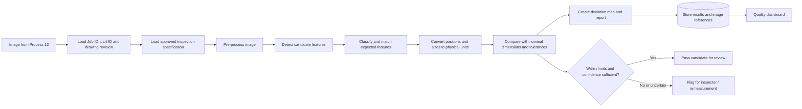
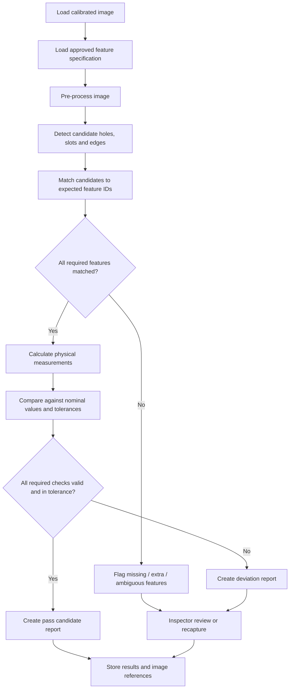

# Process 13 — Computer-Vision Feature Detection and Dimension Comparison

## 1. Overview

Process 13 explains how to implement computer-vision software that identifies selected features on a sheet-metal part and compares their measured positions or dimensions with an approved drawing or CAD-derived inspection specification.

Process 12 focuses on the camera setup, image capture, calibration, and obtaining measurements. Process 13 focuses on the **software pipeline that detects features, associates them with expected features, compares values, identifies deviations, and produces an inspection report**.

The system may detect holes, slots, cut-outs, panel edges, and other visible features. The exact capability depends on the camera setup, part presentation, lighting, calibration, feature geometry, and validated algorithm.

> **Important:** Computer vision must not assume that every detected circle is a hole or that every visible edge is a design edge. The software needs a validated method, a known part/drawing revision, and an uncertainty or review path. AI output alone should not automatically approve a part.

## 2. Objectives

- Detect relevant geometric features from a captured image.
- Match detected features to the expected features for the correct part and drawing revision.
- Calculate feature positions, sizes, and distances using validated calibration.
- Compare measurements with approved nominal dimensions and tolerances.
- Highlight missing features, extra features, and possible deviations.
- Produce traceable results for the website and quality records.
- Send uncertain or failed cases for inspection review.

## 3. Difference between Process 12 and Process 13

| Process 12 — Camera-Based Dimensional Inspection | Process 13 — Computer-Vision Feature Detection and Dimension Comparison |
|---|---|
| Defines camera, lens, lighting, fixture, and calibration setup. | Defines the algorithmic pipeline for detecting and matching features. |
| Captures a usable image and establishes the pixel-to-physical measurement relationship. | Uses the image and calibration to locate expected features and compare dimensions. |
| Checks image quality and measurement validity. | Produces feature-level deviations and a structured comparison report. |
| Provides calibrated measurements as input. | Uses those measurements to support a drawing-based inspection decision. |

## 4. System architecture

## 5. Inputs required

The software needs:

- Image captured through the defined inspection setup.
- Job ID and part ID.
- Approved drawing revision or CAD-derived inspection specification.
- Expected feature list, including feature IDs and nominal locations or sizes.
- Approved tolerance limits for each inspected feature.
- Calibration data and image-to-physical-coordinate transformation.
- Feature-detection settings or validated model version.
- Reference measurement data for validation.

Do not compare an image against an unapproved drawing or silently substitute a newer revision.

## 6. Computer-vision workflow

### Step 1 — Load the correct inspection specification

Retrieve the expected features for the selected part and approved drawing revision. For each feature, store a stable feature ID, type, nominal position or size, tolerance, and measurement method.

Examples:
- `HOLE-01`: circular hole with expected centre and diameter.
- `SLOT-02`: slot with expected centre, orientation, length, and width.
- `EDGE-01`: selected panel edge used to calculate a reference distance.
- `CUTOUT-01`: rectangular or custom cut-out with defined dimensions.

These are illustrative identifiers.

### Step 2 — Validate the image

Check that the image exists, is in focus, has suitable exposure, shows the required features, and belongs to the intended part. Confirm that the correct calibration applies.

If the image is blurred, obstructed, overexposed, or outside the validated setup, stop the automated comparison and request a recapture or manual inspection.

### Step 3 — Pre-process the image

Depending on the material and lighting, processing may include:
- Crop the region of interest.
- Correct lens distortion using calibration data.
- Normalize brightness or contrast.
- Reduce noise while preserving feature edges.
- Apply a threshold or edge filter when appropriate.

Pre-processing must be consistent with the method that was validated. Aggressive filtering can remove small features or shift measured edges.

### Step 4 — Detect candidate features

Possible approaches include:
- Edge detection and contour analysis.
- Circle detection or circle fitting for candidate holes.
- Contour geometry for slots and cut-outs.
- Line fitting for panel edges.
- Template matching for stable, known patterns.
- A trained computer-vision model when classical image processing is insufficient.

A detected feature is a candidate, not automatically a confirmed design feature. Reflective metal, burrs, shadows, scratches, and cut-edge irregularities can cause false detections.

### Step 5 — Match detected features to expected features

Associate each detected candidate with the expected feature specification using location, shape, size, orientation, and other validated criteria.

The matching logic should detect:
- Expected feature not found.
- Multiple candidates for one expected feature.
- Extra or unexpected candidate feature.
- Candidate with poor detection confidence.
- Ambiguous matching between nearby features.

Ambiguous cases should be flagged rather than matched arbitrarily.

### Step 6 — Convert image coordinates to physical coordinates

Use the calibration model from Process 12 to transform image coordinates and measurements into physical units. A simple scale factor is only valid for suitable fixed, planar conditions. Perspective, lens distortion, part tilt, and height variation may require a more complete calibration method.

If the part geometry is bent or non-planar, use a measurement approach appropriate to that surface. A single flat-plane calibration may not measure every face accurately.

### Step 7 — Compare measurements with the drawing

For a measured value \(M\), nominal value \(N\), lower limit \(L\), and upper limit \(U\), calculate deviation and tolerance status:

\[
\text{Deviation} = M - N
\]

\[
\text{Within tolerance if } L \leq M \leq U
\]

For a symmetric tolerance \(T\), the limits are \(L=N-T\) and \(U=N+T\). Use the actual specified limits when tolerances are asymmetric.

Where measurement uncertainty is significant, follow the approved inspection decision rule rather than accepting a borderline measurement without review.

### Step 8 — Create a visual deviation map

Generate an annotated image that can show:
- Detected feature outlines and centres.
- Feature IDs.
- Measured values and units.
- Expected positions or sizes.
- Deviation values.
- Missing or extra feature warnings.
- Pass, fail, or needs-review markers.

Use clear labels and keep the original unmodified image available for traceability.

### Step 9 — Save results and request review

Save feature-level results and the overall inspection state. Failed, missing, ambiguous, or low-confidence features should be sent to an authorized inspector. Preserve the original results if a later manual review changes the final decision.

## 7. Feature comparison flowchart

## 8. Example comparison table

The following is a hypothetical example to show the report format. These values are not measurements from a real part.

| Feature ID | Feature | Nominal | Measured | Tolerance limits | Example result |
|---|---|---:|---:|---|---|
| HOLE-01 | Diameter | 10.00 mm | 10.08 mm | 9.80–10.20 mm | Within limits |
| HOLE-02 | X position | 50.00 mm | 50.35 mm | 49.80–50.20 mm | Outside limits |
| SLOT-01 | Length | 30.00 mm | Not detected | 29.70–30.30 mm | Needs review |
| EDGE-01 | Reference distance | 25.00 mm | 25.05 mm | 24.80–25.20 mm | Within limits |

A missing feature should not be reported as a numeric measurement of zero. It should be represented as missing/not detected and routed for review.

## 9. Website integration

The quality page should let an authorized user:

1. Select the job, part, and approved drawing revision.
2. View the original image and calibration reference.
3. Run or view the feature-detection analysis.
4. See expected and detected features side by side.
5. Review measured values, tolerances, deviations, and uncertainty where available.
6. Open an annotated deviation map.
7. Accept, reject, or request remeasurement according to the authorized inspection procedure.
8. View the audit trail and previous inspection/rework records.

The backend should enforce permissions and preserve a record of the algorithm/model version, inspection specification version, and human review.

## 10. Suggested data structure

An inspection result can include:

- `inspection_id`
- `job_id`
- `part_id`
- `drawing_revision`
- `image_asset_id`
- `calibration_version`
- `algorithm_version`
- `inspection_spec_version`
- `feature_id`
- `feature_type`
- `expected_value`
- `measured_value`
- `unit`
- `lower_limit`
- `upper_limit`
- `deviation`
- `detection_confidence`, if supported and calibrated
- `measurement_uncertainty`, if available
- `result`
- `review_status`
- `reviewer_id`
- `created_at`

Store each feature's result separately so the report can show exactly which feature failed. Keep the original image and annotated result as separate assets.

## 11. Example API endpoints

| Endpoint | Purpose |
|---|---|
| `POST /api/vision/inspections` | Create an inspection analysis job |
| `POST /api/vision/inspections/{id}/run` | Queue feature detection and comparison |
| `GET /api/vision/inspections/{id}` | Retrieve overall status and feature results |
| `GET /api/vision/inspections/{id}/annotated-image` | Retrieve the annotated output image |
| `POST /api/vision/inspections/{id}/review` | Save an authorized review decision |

These are proposed endpoint names, not existing APIs. Use authentication, input validation, safe file handling, audit logs, and a background worker for long-running image-analysis tasks.

## 12. Validation and testing checklist

- [ ] Images are linked to the correct part and drawing revision.
- [ ] Calibration is validated across the measurement area.
- [ ] Feature detection is tested on representative good and defective samples.
- [ ] Small holes, slots, edges, burrs, glare, shadows, and reflective surfaces are included in testing.
- [ ] Feature matching handles missing, extra, and ambiguous detections.
- [ ] Measurements are compared against a suitable calibrated reference instrument.
- [ ] False-pass and false-fail rates are measured.
- [ ] Measurement repeatability is evaluated across repeated captures.
- [ ] Borderline and uncertain results are sent for human review.
- [ ] Original images, annotated images, specifications, and algorithm versions are traceable.
- [ ] A model or configuration change triggers appropriate revalidation.

## 13. Limitations and safeguards

- Computer vision cannot recover reliable physical dimensions from pixels without a valid calibration and suitable image setup.
- Detection confidence is not the same as measurement accuracy.
- A visually detected edge may be a burr, shadow, reflection, or actual cut edge.
- A 2D view may not reveal features hidden behind bends or other geometry.
- AI must not invent missing features or silently approve an ambiguous comparison.
- Critical quality decisions must follow approved inspection methods and tolerances.

## 14. Inputs and outputs

**Inputs**
- Calibrated image from Process 12.
- Approved drawing or CAD-derived inspection specification.
- Expected feature IDs, dimensions, positions, and tolerance limits.
- Job ID, part ID, drawing revision, and algorithm settings.

**Outputs**
- Detected feature locations and dimensions.
- Expected-to-detected feature matches.
- Deviations and tolerance comparisons.
- Annotated image and feature-level report.
- Pass candidate, fail, or needs-review status.
- Traceable records for the quality dashboard.

## 15. Relationship to other project notes

- [[AIoT Project Index Overview and Process Summaries]]
- [[Process 9 — Dimensional Verification, Painting and Complete Enclosure Assembly]]
- [[Process 10 — AIoT System Implementation Guide]]
- [[Process 11 — IoT Job-Tracking Dashboard]]
- [[Process 12 — Camera-Based Dimensional Inspection]]
- [[Process 14 — Final Fabricated Enclosure and Quality Inspection]]

## Summary

Process 13 implements the computer-vision pipeline that detects features on sheet-metal parts, matches them to the approved design specification, compares measured values with tolerances, and generates a traceable deviation report. It builds on Process 12's calibrated image capture and must be validated against reference measurements before being used for production acceptance.
