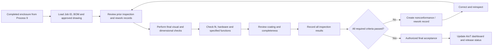
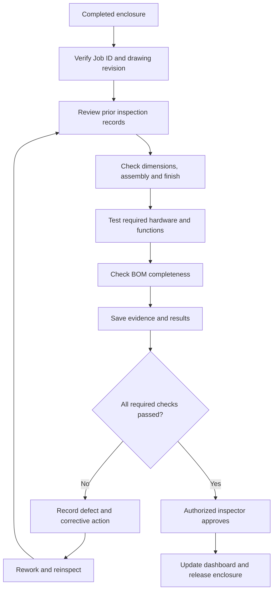

# Process 14 — Final Fabricated Enclosure and Quality Inspection

## 1. Overview

Process 14 is the final verification and release stage for the fabricated sheet-metal enclosure. It confirms that the assembled enclosure matches the approved requirements, includes the required components, has acceptable workmanship and finish, and passes the specified functional and quality checks.

Process 9 covers dimensional checks, finishing, and joining the enclosure during fabrication. Process 14 is the **final documented acceptance check of the completed enclosure** before it is released for storage, dispatch, or the next required operation.

The inspection criteria must come from the approved drawing, BOM, customer specification, and applicable workshop quality procedures. Not every enclosure requires the same tests.

## 2. Objectives

- Verify overall dimensions and important mounting features.
- Check assembly, alignment, joints, and required hardware.
- Inspect surface finish and coating condition.
- Check door, hinges, locks, handles, and seals where fitted.
- Confirm completeness against the BOM and approved specification.
- Review dimensional and camera-inspection results from Processes 12 and 13.
- Record defects, corrective action, reinspection, and final release.
- Maintain traceability through the Job ID and drawing revision.

## 3. Final inspection architecture

## 4. Inputs

- Completed enclosure from [[Process 9 — Dimensional Verification, Painting and Complete Enclosure Assembly]].
- Approved CAD model and manufacturing drawing revision.
- BOM and required hardware list.
- Customer specifications and acceptance criteria.
- Dimensional inspection records from Process 12, where applicable.
- Feature-detection and comparison report from [[Process 13 — Computer-Vision Feature Detection and Dimension Comparison]], where applicable.
- Coating, assembly, and rework records.
- Calibrated inspection tools and the approved final-inspection checklist.

## 5. Final inspection workflow

### Step 1 — Identify the enclosure and its approved revision

Scan or enter the Job ID and enclosure/part ID. Confirm the customer order, approved drawing revision, BOM, and required inspection checklist.

Do not inspect against an outdated drawing or assume that the latest file is approved for production. Record any unresolved revision mismatch and stop release until it is clarified.

### Step 2 — Review earlier inspection records

Review the dimensional checks, trial-fit results, coating checks, assembly records, and any camera-based inspection results. Confirm that failed checks have documented corrective actions and required reinspection.

Computer-vision results are supporting evidence. The inspector must follow the approved quality procedure and review any uncertain or failed automated result.

### Step 3 — Check overall dimensions and geometry

Using suitable calibrated tools and the approved drawing, verify the dimensions required by the inspection plan. These may include:

- Overall height, width, and depth.
- Panel alignment and squareness.
- Door opening and fit.
- Mounting-hole and slot positions.
- Base or internal mounting-plate position.
- Required clearances and other critical dimensions.

Record actual measurements, units, tolerance limits, tool or method, and pass/fail status. Check only the dimensions specified for the particular enclosure; do not invent tolerance values.

### Step 4 — Inspect assembly and workmanship

Inspect the complete enclosure for:

- Correct panel orientation and alignment.
- Acceptable joints, fasteners, and joining quality.
- Missing, loose, or incorrect hardware.
- Sharp burrs or edges that violate the approved safety/workmanship requirements.
- Distortion, dents, or other damage.
- Correct installation of brackets and mounting plates.

Any defect must be recorded and handled according to the approved rework procedure.

### Step 5 — Inspect coating and surface finish

Check the specified finish for coverage, colour, visible scratches, chips, bubbles, runs, contamination, or other unacceptable defects.

Where the specification requires coating-thickness, adhesion, or other coating tests, use the approved test method and record the result. A visual check alone cannot prove a coating property that requires a measurement or laboratory test.

### Step 6 — Check doors, hardware, and specified functions

Where fitted, verify that:
- The door opens and closes correctly.
- Hinges and locks operate as intended.
- Handles and fasteners are secure.
- Seals or gaskets are positioned correctly.
- Required openings, mounting points, and accessories are present.
- Electrical bonding/grounding or ingress-protection requirements are tested when specified, using the appropriate approved procedure.

Do not claim electrical, environmental, or ingress-protection compliance unless the required test was performed and passed.

### Step 7 — Verify completeness against the BOM

Compare the assembled enclosure with the approved BOM and specification. Confirm the required panels, door, mounting plate, brackets, fasteners, accessories, and any specified customer components are present.

Record missing, substituted, or damaged items. A visually complete box should not be accepted if a required component or document is missing.

### Step 8 — Record the final decision

Classify the result according to the workshop's defined status rules, for example:

- `PASS` — all required acceptance criteria passed.
- `FAIL` — one or more required criteria failed.
- `NEEDS_REVIEW` — evidence is missing, uncertain, or requires an authorized decision.

A failed or uncertain result must not be marked accepted simply to close the job. Create a nonconformance/rework record, correct the issue, and repeat the relevant inspection.

### Step 9 — Release and update the system

After an authorized inspector approves the enclosure, record the acceptance decision, inspector, timestamp, drawing revision, checklist results, and any attached evidence. Update the AIoT dashboard and release the enclosure for the next operation, storage, or dispatch.

## 6. Final quality checklist

| Inspection item | What to verify | Evidence |
|---|---|---|
| Identity and revision | Correct Job ID, enclosure ID, approved drawing revision | Job record |
| Overall dimensions | Required dimensions within specified limits | Measurement record |
| Geometry and alignment | Squareness, panel alignment, door fit | Checklist and measurements |
| Joints and fasteners | Joining quality, correct and secure hardware | Visual record/checklist |
| Surface finish | Coating appearance and any specified coating tests | Finish check and test results |
| Door and hardware | Door, hinges, lock, handle, seals where fitted | Functional check |
| BOM completeness | Required parts and accessories present | BOM checklist |
| Camera inspection | Required automated results reviewed, where used | Process 12/13 report |
| Rework | Defects corrected and reinspection completed | Nonconformance record |
| Final release | Authorized decision and timestamp recorded | Acceptance record |

The exact checklist must be tailored to the enclosure design and customer requirements.

## 7. AIoT integration

The AIoT system supports the inspection process by organizing evidence and maintaining traceability.

- **Job tracking:** shows whether the enclosure is awaiting final inspection, requires rework, or has been accepted.
- **Inspection history:** links measurements, images, results, and drawing revisions.
- **Computer-vision assistance:** provides feature detections and deviation reports from Processes 12 and 13.
- **Alerts:** flags missing required checks, unresolved failures, or incomplete documentation.
- **Traceability:** records who performed or approved each inspection and when.
- **Reporting:** summarizes pass/fail rates, defect types, rework, and completion time.

AI can highlight possible issues, but final acceptance must follow approved criteria and authorized quality procedures.

## 8. Website and database implementation

### Suggested website screen

The final-inspection page should show:
1. Job ID, enclosure ID, customer/order reference, and drawing revision.
2. Checklist items and required tolerance values.
3. Actual measurements and supporting inspection reports.
4. Coating, assembly, and BOM completeness status.
5. Defect records, corrective actions, and reinspection history.
6. Inspector comments, attached images, and final approval controls.
7. Release status and timestamp.

### Suggested database records

Possible tables include:
- `final_inspections`
- `inspection_checklist_items`
- `inspection_measurements`
- `nonconformances`
- `corrective_actions`
- `reinspection_records`
- `acceptance_records`
- `file_assets`
- `audit_logs`

A final-inspection record should reference the Job ID, enclosure ID, approved drawing revision, inspector, timestamp, checklist version, overall result, and supporting evidence.

## 9. Suggested API endpoints

| Endpoint | Purpose |
|---|---|
| `POST /api/jobs/{job_id}/final-inspections` | Create a final-inspection record |
| `GET /api/final-inspections/{inspection_id}` | Retrieve checklist and inspection details |
| `POST /api/final-inspections/{inspection_id}/checklist` | Save checklist results |
| `POST /api/final-inspections/{inspection_id}/nonconformances` | Record a defect or failed requirement |
| `POST /api/final-inspections/{inspection_id}/approve` | Record authorized acceptance |
| `POST /api/final-inspections/{inspection_id}/release` | Update release status after acceptance |

These are proposed endpoint names, not existing APIs. The backend must verify permissions and ensure that acceptance or release cannot bypass required failed or missing checks.

## 10. Example final-inspection flow

## 11. Testing checklist

- [ ] The final-inspection record references the correct Job ID and drawing revision.
- [ ] Required checklist items cannot be silently skipped.
- [ ] Measurements are validated against the approved limits.
- [ ] Failed checks create a defect or nonconformance record.
- [ ] Rework and reinspection history is retained.
- [ ] Automated vision results remain distinguishable from human-confirmed decisions.
- [ ] Only authorized users can approve and release the enclosure.
- [ ] Missing documents or required tests prevent release where the workflow requires them.
- [ ] The dashboard reflects the recorded final status.
- [ ] Audit history captures the inspector, decision, and timestamp.

## 12. Outputs

- Completed final-inspection checklist.
- Verified dimensional, visual, functional, and completeness results as applicable.
- Linked camera/vision reports where used.
- Defect, corrective-action, and reinspection records where required.
- Authorized final acceptance or a documented failure/review status.
- Updated AIoT job history and release status.
- Enclosure ready for storage, dispatch, or the next specified operation once accepted.

## 13. Relationship to other project notes

- [[AIoT Project Index Overview and Process Summaries]]
- [[Process 9 — Dimensional Verification, Painting and Complete Enclosure Assembly]]
- [[Process 10 — AIoT System Implementation Guide]]
- [[Process 11 — IoT Job-Tracking Dashboard]]
- [[Process 12 — Camera-Based Dimensional Inspection]]
- [[Process 13 — Computer-Vision Feature Detection and Dimension Comparison]]

## Summary

Process 14 is the final documented quality gate for the completed enclosure. It verifies the required dimensions, workmanship, finish, hardware, functions, and BOM completeness; reviews earlier inspection evidence; records defects and rework; and updates the AIoT system only after the authorized acceptance decision.
