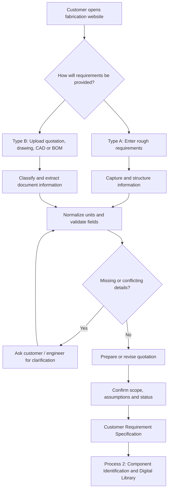

# Process 1 — Customer Requirement Collection

> [!abstract] Purpose
> Collect customer requirements through the website, validate the information, clarify missing details, and create one structured **Customer Requirement Specification**. Customers can enter rough requirements or upload existing documents. Both paths lead to the same requirement record before Process 2.

## 1. Position in the project

**Input:** Customer enquiry or existing customer documents.

**Output:** Customer Requirement Specification, source documents, validation status, and preliminary or revised quotation information.

**Next:** [[Process 2 — Component Identification, Measurement and Digital Library]]

## 2. Process overview

## 3. Customer input paths

### Type A — Customer enters rough requirements

This path is for a customer who knows what they need but does not have a complete engineering drawing.

#### Website form fields

| Information group | Fields to collect |
|---|---|
| Customer and order | Customer/company name, contact details, job description, quantity, delivery requirement |
| Enclosure dimensions | Width, height, depth, units, mounting style, door arrangement, required openings |
| Material | Material grade, thickness for each panel, surface finish, customer-supplied stock if applicable |
| Components | Switches, circuit breakers, terminal blocks, relays, controllers, quantities and model numbers |
| Mounting and wiring | Mounting holes, cable entries, wiring ducts, rails, grounding, clearances and access needs |
| Fabrication scope | Cutting, bending, welding/riveting, assembly, coating and other requested operations |
| Supporting files | Optional photographs, sketches, component datasheets, CAD models and reference drawings |

#### Example input form

![[Rough customer requirements.png]]

*Figure 1. Example website form for enclosure dimensions, material, panel thicknesses, quantity, components and mounting requirements.*

The example form may show values such as 400 mm width, 310 mm height and 200 mm depth. These are **illustrative values only**, not a confirmed customer order. A required field left blank must be marked pending or clarified, not guessed.

#### Type A validation steps

1. Check required fields and units.
2. Convert dimensions to a consistent unit, such as millimetres, while preserving original input.
3. Identify missing component models, mounting details, clearances or manufacturing requirements.
4. Ask follow-up questions for important missing information.
5. Save a structured draft requirement record.
6. Prepare a preliminary quotation using maintained workshop rates when enough information exists.
7. Show assumptions, exclusions and unresolved details.
8. Save customer corrections and quotation approval status.

A quotation based on incomplete requirements must be labelled **preliminary** and must not be treated as manufacturing approval.

### Type B — Customer uploads existing documents

This path is for customers who already have a quotation, drawing, CAD model, BOM or other specification.

#### Supported document types

| Document | Information to capture |
|---|---|
| Existing quotation | Item descriptions, quantity, quoted prices, delivery terms and commercial scope |
| Dimensioned engineering drawing | Dimensions, views, holes, cut-outs, panel geometry, finish and drawing revision |
| CAD file | Model geometry, dimensions and features supported by the selected CAD parser |
| BOM or spreadsheet | Part numbers, descriptions, materials and quantities |
| Photograph or scanned document | Visible features and readable text; dimensions are not exact unless suitable scale/calibration is available |

#### Example customer drawing

![[Existing quotation.png]]

*Figure 2. Example customer-supplied enclosure drawing with multiple views, dimension labels, a base plate, holes and cut-outs.*

Visible annotations in the example may include a grey box finish, an orange base plate, and dimensions such as 600 mm, 1,030 mm, 680 mm and 170 mm. These are transcribed from the example image only, not a complete verified specification. All required dimensions, materials, thicknesses, quantities, tolerances and revisions must be reviewed before manufacturing release.

#### Type B document workflow

1. **Upload:** accept the available quotation, drawing, CAD file or BOM.
2. **Classify:** identify which document types were supplied.
3. **Extract:** use OCR/text extraction for readable documents and suitable parsers for CAD or spreadsheets.
4. **Organize:** put extracted information into structured fields and retain source files and page/view references.
5. **Cross-check:** compare dimensions, quantities, material details and revisions across documents.
6. **Flag issues:** identify unreadable values, missing specifications and conflicts.
7. **Clarify:** ask the customer or responsible engineer to resolve important uncertainties.
8. **Estimate:** prepare or revise the workshop's quotation using confirmed scope and current pricing inputs.
9. **Confirm:** save the approved requirement specification and quotation status.

An existing quotation and a technical drawing serve different purposes. A quotation may contain another supplier's commercial terms; a drawing defines technical geometry. Calculate the workshop's own price using its own approved rates and commercial policy.

## 4. Common validation for both paths

Both paths must produce the same structured specification.

### Information to verify

- Overall enclosure width, height and depth.
- Material grade and thickness for each panel.
- Production quantity.
- Component types, quantities and verified dimensions.
- Hole positions, cut-outs, mounting details and cable entries.
- Door, hinge, latch and access requirements.
- Surface finish and colour.
- Required manufacturing operations.
- Tolerances and drawing revision.
- Delivery requirements and quotation scope.

### Requirement status labels

| Status | Meaning |
|---|---|
| `CUSTOMER_PROVIDED` | Entered by the customer or present in a supplied document |
| `EXTRACTED` | Read from a source file but not yet verified |
| `VERIFIED` | Checked against an authoritative source or confirmed by an authorized person |
| `PENDING` | Missing, ambiguous, unreadable or conflicting |
| `APPROVED` | Accepted by the responsible customer or engineer for the stated purpose |

AI may assist with document classification, text extraction and identifying missing fields. It must not invent dimensions, silently resolve conflicting values, or certify that a design is safe to manufacture.

## 5. Preliminary quotation

When sufficient information is available, the system may prepare a preliminary estimate using maintained workshop and supplier rates. Depending on the job, costs may include:

- Material and estimated sheet consumption.
- Nesting and expected scrap.
- Laser cutting.
- Bending and forming.
- Welding, riveting or assembly.
- Surface finishing.
- Labour, setup, inspection, packaging and other applicable charges.

Missing rates or uncertain quantities should be displayed as assumptions or unresolved inputs, not invented values.

A quotation record should include the Job ID, drawing revision, scope, quantity, itemized estimate, assumptions, exclusions, validity and approval status.

## 6. Output of Process 1

| Output | Description |
|---|---|
| Job identity | Unique Job ID and customer reference |
| Input method | Rough-requirement form or uploaded documents |
| Enclosure specification | Dimensions, material, panel thicknesses and finish |
| Component specification | Component list, quantities, model references and data status |
| Source documents | Original files, extracted values and drawing revisions |
| Validation record | Missing fields, discrepancies, clarifications and approvals |
| Quotation | Preliminary or revised estimate, assumptions and customer status |
| Handoff status | Ready for Process 2 or awaiting clarification |

## 7. Handoff to Process 2

When the required information is sufficiently complete, pass the Customer Requirement Specification to [[Process 2 — Component Identification, Measurement and Digital Library]].

Process 2 verifies dimensions and mounting details of switches, circuit breakers, terminal blocks and other components using manufacturer CAD models, datasheets or verified physical measurements. This geometry supports later internal arrangement and enclosure CAD design.

A preliminary quotation can exist before all engineering details are finalized. Manufacturing drawings and cutting jobs must not be released until the required dimensions, material details, component fit, manufacturing rules and approvals have been verified.

## 8. Obsidian image setup

The embeds above use these filenames:

- `Rough customer requirements.png`
- `Existing quotation.png`

Place the images in the same folder as this note or update the embed paths to match their actual location in your vault. If the images are not present, Obsidian will show unresolved embeds.

## Summary

Process 1 provides two ways to start a fabrication request: enter rough requirements or upload existing documents. The system captures and validates information, flags missing or conflicting details, manages preliminary quotation information, and produces one traceable Customer Requirement Specification for Process 2.
