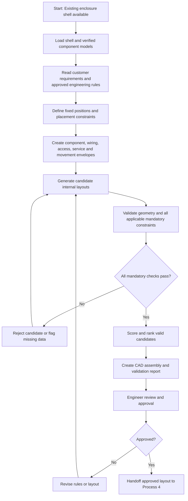

# Process 3 — AI-Assisted Internal Component Arrangement

> [!abstract] Process purpose
> Arrange the customer's electrical components **inside an existing enclosure shell** so that the layout is mechanically valid, electrically appropriate, practical to wire, easy to inspect and maintain, and suitable for fabrication. The system generates and checks layout candidates, then presents a recommended arrangement for engineer approval. The approved arrangement becomes the input to **Process 4 — Final 3D CAD Enclosure Design**.

## 1. Where Process 3 fits in the overall workflow

Process 3 begins after customer requirements have been reviewed and the component information has been collected or verified.

- **Process 1 — Customer Requirement Collection:** establishes what the customer needs and captures any supplied drawings, specifications, and constraints.
- **Process 2 — Component Identification, Measurement and Digital Library:** identifies each component and provides verified dimensions, mounting details, CAD models, and source/verification status.
- **Process 3 — AI-Assisted Internal Component Arrangement:** positions the components inside the existing shell, checks clearances and practical access, and selects a valid layout.
- **Process 4 — Final 3D CAD Enclosure Design:** develops or updates the final enclosure and panel CAD based on the approved arrangement.

### Two input situations

1. **Customer provides rough requirements:** the system may need to identify components, resolve missing details, obtain verified CAD models, and clarify how the components should be used before arrangement can be trusted.
2. **Customer provides a complete drawing/specification and verified component details:** import or reference the supplied data, check it for consistency, and proceed to layout. Do not force the customer to repeat dimensions or component details already present and verified.

## 2. What “AI-Assisted Internal Component Arrangement” means

The enclosure shell already exists or has been defined. The task is **not simply to put components into empty space**. It is to arrange them so people can install, connect, operate, inspect, and replace them safely and practically.

The system considers:

- The internal usable volume and mounting plate.
- The exact size and mounting footprint of each component.
- Required orientation and terminal/connector access.
- Hand, screwdriver, spanner, and other tool access.
- Wiring ducts, cable-entry positions, cable bend paths, and routing space.
- Separation and ventilation needs stated by manufacturers, applicable standards, or approved engineering rules.
- Door, hinge, lock, flange, and other moving/mechanical parts.
- Installation sequence, fastening access, inspection, and future maintenance.
- Customer-specific requirements and manufacturing constraints.

The output is a **proposed internal layout**, backed by geometric checks and engineering rules—not just an AI-generated picture.

### Example

Suppose the customer needs three switches, two circuit breakers, terminal blocks, and wiring ducts inside an existing control enclosure.

- Switches must align with their intended panel or door cut-outs.
- Breakers need a suitable mounting position and room to access their terminals.
- Terminal blocks need conductor-entry and screwdriver access.
- Wiring ducts must connect the relevant components without blocking terminals or service access.
- Components must not collide with the enclosure, door, hinges, cable entries, or each other.
- The layout must leave practical room for installation and future replacement.

A compact layout is not automatically a good layout. A slightly less compact arrangement may be better if it significantly improves wiring, access, cooling, or maintenance.

## 3. Inputs required before arranging components

| Input | What the system needs | Why it matters |
|---|---|---|
| Enclosure shell | Internal width, height and depth; mounting plate; door; hinges; lock; flanges; bends; cable-entry regions | Defines the usable space and the geometry that must not be obstructed |
| Component models | Verified 3D CAD models or dimensioned models for each component | Enables reliable fit and collision checks |
| Component metadata | Part number, dimensions, mounting footprint, weight if relevant, terminal locations, permitted orientations | Defines how each part can be installed and connected |
| Customer requirements | Required components, quantities, access preferences, operating conditions, and any fixed positions | Keeps the layout aligned with the intended use |
| Wiring information | Cable-entry locations, terminal relationships, wire/duct needs, and routing constraints where known | Prevents a physically fitting layout from becoming impractical to wire |
| Engineering rules | Manufacturer instructions, applicable standards, project rules, required separation and access envelopes | Provides authoritative limits for validation |
| Manufacturing constraints | Available mounting hardware, rail/duct sizes, fabrication limitations, and assembly sequence | Helps ensure the layout can actually be built |
| Verification status | Source, revision, and whether each model/dimension is confirmed | Stops unverified geometry from being treated as final |

**Important:** if a component model or critical dimension is unknown, mark it as **unverified** and resolve it before final approval. Do not let the optimizer treat a rough placeholder as an exact part.

## 4. Types of clearance — explained

“Clearance” is not one universal gap. Different clearances protect different functions. The system should represent them as separate rules or 3D envelopes, because passing one type of check does not prove that the layout is usable.

> [!warning] Do not invent a universal clearance number
> The required value depends on the actual component, voltage/current and thermal conditions where relevant, manufacturer instructions, applicable standards, enclosure design, tools, and service task. Use verified requirements and engineer-approved rules. If a required value is unknown, flag it for review instead of guessing.

### 4.1 Physical / geometric clearance

**Meaning:** space that prevents components from intersecting one another or the enclosure structure.

Check for:
- Component-to-component collisions.
- Component-to-door, hinge, lock, flange, bend, or mounting-plate conflicts.
- Protrusions that extend into an unusable region.
- Required gaps between parts where the CAD model or mounting method demands them.

**How to check:** use the CAD geometry to test for solid intersections and minimum distances. A collision-free result is necessary, but it is not sufficient: the parts may still be difficult to wire or service.

### 4.2 Hand and tool access clearance

**Meaning:** free space needed for a person to reach a control or fastener and use the required tool.

Check for:
- Fingers or hands reaching switches, handles, and terminals.
- A screwdriver or other tool approaching terminal screws and mounting fasteners.
- Space to tighten or loosen a connection without hitting a neighbouring component.
- Access to reset, operate, or isolate controls as intended.

**Example:** a breaker may fit beside a wiring duct, yet the duct may block the screwdriver angle needed to tighten its terminal. Geometric fit passes; tool access fails.

**How to check:** define a task-specific access envelope or tool approach volume around the relevant operating and fastening points. Validate the approach direction and usable space, not just the distance between component bodies.

### 4.3 Wiring and cable-routing clearance

**Meaning:** space needed for wires, cables, ducts, connectors, and practical routing between components and cable-entry points.

Check for:
- Duct width and height, including covers and access to open them.
- Space to enter and leave terminals.
- Cable paths that do not cross blocked areas or obstruct service access.
- Manufacturer-specified cable bend radius and connector space.
- Cable-entry and gland access.
- Separation or routing requirements specified by the design rules.

**Example:** placing two devices close together may save panel area, but leave no room for a wire duct or the required cable bend. The arrangement should be rejected or revised.

**How to check:** reserve routing corridors and duct envelopes, identify connections that need to be made, and check that a plausible path exists. A shortest-distance path is not automatically a valid wire route.

### 4.4 Maintenance and component-removal clearance

**Meaning:** space to inspect, clean, test, disconnect, unfasten, and replace a component later.

Check for:
- A removable part having a viable extraction direction.
- Access to screws, clips, rail releases, and connectors.
- Enough room to remove a device without dismantling unrelated components, where practicable.
- Access to labels, terminals, and inspection points.
- Space for service tasks identified by the customer or manufacturer.

**Example:** a power supply may be installed without collision, but if a neighbouring component prevents its mounting clips from being released, replacement will be difficult.

**How to check:** model a service/removal envelope or define the required removal direction for components that need maintenance. Check the space along that path.

### 4.5 Electrical separation clearance

**Meaning:** required separation between electrical parts, conductors, or circuits to meet the applicable electrical design requirements.

This must be distinguished from ordinary physical spacing. Electrical separation can depend on factors such as working voltage, insulation system, pollution conditions, overvoltage category, material properties, and the applicable standard. **Clearance through air** and **creepage distance along an insulating surface** are different engineering concepts and must not be treated as interchangeable.

Check for:
- Required air clearances and surface creepage distances where applicable.
- Separation between circuit groups where required.
- Manufacturer-specified spacing around terminals or exposed conductive parts.
- Required barriers, insulation, and protective covers.

**How to check:** use the relevant standard, manufacturer documentation, and engineer-approved electrical rules for the actual design. A generic AI model should not independently decide the regulatory requirement. Electrical compliance requires qualified engineering review.

### 4.6 Thermal and ventilation clearance

**Meaning:** space needed to manage heat and allow airflow or cooling around components.

Check for:
- Manufacturer-specified free space around heat-generating devices.
- Ventilation openings and airflow paths.
- Heat-sensitive devices placed too close to heat sources.
- Ducts or other parts blocking vents.
- Enclosure conditions and thermal assumptions relevant to the design.

**Example:** a drive or power supply may fit physically, but a nearby component can block its ventilation path or violate the manufacturer’s installation instructions.

**How to check:** apply documented thermal spacing rules and ventilation envelopes. Where the project requires it, carry out a thermal calculation or simulation; a basic collision check cannot prove that temperatures will remain acceptable.

### 4.7 Door, hinge, and mechanical-movement clearance

**Meaning:** free space required for parts that move or for components mounted on a moving door.

Check for:
- The full door swing and the swept volume of hinges and handles.
- Door-mounted devices and their rear projections.
- Interference with internal components when the door opens or closes.
- Locks, brackets, cables, and flexible wiring across the door interface.
- Access required to open the door and remove panels.

**How to check:** use the CAD assembly to evaluate the movement/swept envelope, not only the door’s closed position.

### 4.8 Installation and assembly clearance

**Meaning:** room needed to put the components into the enclosure and fasten them during manufacturing or assembly.

Check for:
- The direction a component must enter the enclosure.
- Access to mounting screws, nuts, clips, and rails.
- Whether a tool can reach the fasteners after neighbouring components are installed.
- The planned assembly sequence and any components that must be installed first.

**Example:** a part may fit into the final location in CAD but be impossible to install after the surrounding devices and ducts are fixed.

**How to check:** define installation approach and fastening envelopes, then test the planned assembly sequence.

### 4.9 Functional and operating clearance

**Meaning:** space needed for the component to perform its intended job, including user operation and required movement.

Check for:
- Switch and handle travel.
- Connector mating/unmating space.
- Moving levers, latches, covers, and removable cartridges.
- Required visibility of labels or indicators.
- Access to controls that the customer must operate.

This can overlap with hand/tool access, but it is useful to keep it separate when the component itself needs room to move or function.

### 4.10 Clearance summary

| Clearance type | Main question | Typical validation |
|---|---|---|
| Physical/geometric | Do solids or structural parts collide? | CAD collision and distance checks |
| Hand/tool access | Can a person reach and operate/tighten it? | Access/tool envelopes and task review |
| Wiring/cable routing | Can conductors and ducts be routed properly? | Routing corridors, duct envelopes, bend-radius rules |
| Maintenance/removal | Can it be inspected or replaced? | Service and extraction envelopes |
| Electrical separation | Are required electrical separations satisfied? | Rules from applicable standards/manufacturer data plus engineering review |
| Thermal/ventilation | Can heat escape and airflow remain adequate? | Manufacturer spacing rules and, where needed, thermal analysis |
| Door/mechanical movement | Do moving parts have a clear path? | CAD motion and swept-volume checks |
| Installation/assembly | Can the part be installed and fastened in sequence? | Assembly approach and tool-access checks |
| Functional/operating | Can the part move and perform its intended function? | Operating envelopes and task review |

These checks should be recorded independently. A layout is considered valid only when all applicable mandatory checks pass or have an explicitly documented engineering disposition.

## 5. How the AI-assisted arrangement system works

### Step 1 — Load and verify the existing enclosure shell

Import the existing enclosure into the CAD environment, such as SOLIDWORKS. Identify:
- The internal usable volume.
- Mounting plate or DIN-rail regions.
- Door, hinges, lock, flanges, bends, and structural obstructions.
- Cable entry, gland plate, ventilation, and reserved areas.
- Any regions that must remain empty.

The usable volume is not always the same as the enclosure’s outer dimensions. Sheet thickness, bends, mounting features, door projections, and other structures reduce or divide the available space.

### Step 2 — Load component models from Process 2

For each component, load its verified 3D model and metadata. Record:
- Part identity and quantity.
- Dimensions and mounting footprint.
- Permitted mounting orientations.
- Terminal, connector, and operating-point locations.
- Required service, wiring, and thermal envelopes.
- Data source, revision, and verification status.

Reuse an approved CAD model or manufacturer model when available. Do not manually measure a part if a suitable, verified model or datasheet already provides the required information. If the model is only approximate, label it and do not treat the resulting fit check as final.

### Step 3 — Convert requirements into explicit rules

The system translates the customer’s requirements and engineering rules into constraints. Separate them into:

**Hard constraints — must pass**
- No prohibited collisions.
- Components remain inside permitted mounting regions.
- Mounting interfaces are compatible.
- Required electrical separation is respected according to approved rules.
- Required door movement, wiring access, and other mandatory envelopes are not blocked.
- Component orientation and manufacturer installation instructions are satisfied.

**Soft preferences — optimize where possible**
- Shorter or simpler wiring routes.
- Better grouping of related devices.
- More convenient maintenance access.
- Better use of panel space.
- Simpler assembly and a cleaner layout.
- Reduced interference between wiring ducts and service areas.

A soft preference must never override a hard safety or compliance constraint.

### Step 4 — Define placement and access envelopes

For each component, create or define the relevant geometry:
- Component body and mounting envelope.
- Terminal/tool access envelope.
- Wiring and duct envelope.
- Service/removal envelope.
- Thermal/ventilation envelope.
- Operating or movement envelope, where needed.

Not every component needs every envelope. The system should apply the envelopes relevant to its function and documentation. Use manufacturer data and approved engineering rules rather than inventing generic dimensions.

### Step 5 — Identify fixed and flexible positions

Some items have fixed or highly constrained locations, such as:
- Switches that must line up with existing door cut-outs.
- Components whose position is specified on the customer drawing.
- Devices constrained by cable entry, mounting rails, or a dedicated plate.
- Components that must stay near a particular interface.

Other components may have multiple valid positions. The optimizer should move only those parts that are permitted to move and must preserve customer-specified fixed positions unless a change is approved.

### Step 6 — Generate candidate layouts

The system generates multiple possible arrangements rather than trusting the first placement.

Candidate generation can use:
- Rule-based placement for fixed interfaces and mounting rails.
- Constraint programming or mathematical optimization.
- Heuristics, genetic algorithms, or simulated annealing for larger search spaces.
- AI/LLM assistance to interpret requirements, classify component relationships, suggest grouping strategies, and explain candidate layouts.

The particular optimization method depends on project complexity. AI assistance does not itself guarantee geometric accuracy; candidate placements must be evaluated by the geometry and rule-checking system.

### Step 7 — Validate every candidate

For each candidate, run applicable checks:
1. Solid collision and enclosure-boundary checks.
2. Mounting and orientation checks.
3. Door, hinge, lock, and mechanical-motion checks.
4. Hand/tool access checks.
5. Wiring-duct, cable-entry, and routing-feasibility checks.
6. Maintenance and component-removal checks.
7. Electrical-separation checks based on approved rules.
8. Thermal/ventilation checks based on documented requirements.
9. Installation and assembly-sequence checks.
10. Customer-specific restrictions.

Reject candidates that fail mandatory constraints. If a constraint cannot be checked because its input is missing, mark the result **unverified** and request review; do not silently label it as passed.

### Step 8 — Score and rank valid layouts

Only layouts that pass the mandatory checks should be ranked. Possible objectives include:
- Effective use of usable panel space.
- Practical, feasible wiring paths.
- Good hand/tool access.
- Serviceability and component replacement.
- Logical grouping of related circuits or functions.
- Clear duct and cable-entry organization.
- Ease of installation and assembly.
- Compliance with customer preferences.

A weighted score may help compare valid candidates, but the weights must be configurable and approved. Do not combine safety requirements into a score that allows a dangerous candidate to win because it is compact.

### Step 9 — Create a CAD assembly and review outputs

Send the selected candidate to the CAD environment, such as SOLIDWORKS, and create or update the assembly with:
- Component placement and orientation.
- Mounting references.
- Wiring duct and reserved routing space.
- Clearance/access envelopes where useful.
- Collision and rule-check results.
- A list of unresolved items and assumptions.
- A revision identifier for traceability.

The system should present the best valid candidate and, when useful, a small set of alternative valid layouts with their trade-offs. It should not present a visually attractive but unchecked arrangement as an engineering-approved design.

### Step 10 — Engineer approval and handoff

A qualified engineer reviews the proposed arrangement, especially electrical separation, thermal assumptions, service access, manufacturer requirements, and any unresolved constraints.

Record:
- Approved layout and revision.
- Any engineer-approved exceptions or changes.
- Unresolved items that block release.
- Who approved the design and when, if required by the project’s quality process.

Only after approval should the arrangement be handed to **Process 4 — Final 3D CAD Enclosure Design**.

## 6. What AI does versus what CAD and optimization do

| System part | Responsibility | What it must not claim |
|---|---|---|
| AI / language model | Interpret customer wording, organize requirements, suggest functional groups, explain layout trade-offs, identify missing information | It must not independently certify safety, compliance, or exact geometric fit |
| Optimization engine | Explore placement alternatives and rank candidates against defined constraints/objectives | It must not trade away hard constraints to improve a score |
| CAD geometry engine (e.g. SOLIDWORKS tools/API) | Check actual model geometry, collisions, distances, mounting references, and supported motion checks | A collision-free model alone does not prove wiring, electrical, thermal, or service suitability |
| Rule-validation layer | Apply approved manufacturer, customer, and engineering rules | It must not guess a required value when the rule or input is missing |
| Engineer | Review assumptions, resolve exceptions, approve the arrangement | AI approval is not a replacement for qualified engineering sign-off |

## 7. Example layout decision

Assume the shell is fixed and the required components are three switches, two circuit breakers, terminal blocks, and wiring ducts.

1. The system loads the shell, door cut-outs, mounting plate, and verified component models.
2. Switch positions are constrained to align with the existing cut-outs.
3. Circuit breakers are placed in compatible mounting positions with access envelopes around their terminals and operating handles.
4. Terminal blocks are placed where incoming/outgoing wires can reach them and a screwdriver can approach the terminals.
5. Wiring ducts are routed between functional groups and the cable-entry region.
6. The system checks collisions, cable routes, access envelopes, removal directions, door movement, and applicable electrical/thermal rules.
7. Candidate A may be compact but fail screwdriver access. Candidate B may use slightly more space but provide valid access and routing.
8. Candidate A is rejected because a mandatory access check fails. Candidate B can be ranked among the remaining valid candidates.
9. The selected layout is sent to SOLIDWORKS for assembly review and engineer approval.

This example illustrates the method only. Actual placement and clearance values must come from the real components, shell, documentation, applicable standards, and approved design rules.

## 8. How IIoT supports this process

IIoT data can improve the arrangement workflow, but it does not replace CAD validation.

Possible uses:
- **Inventory status:** show which components, rails, ducts, and mounting accessories are available.
- **Production context:** identify fabrication or assembly constraints relevant to the job.
- **Historical quality data:** highlight recurring issues such as difficult wiring, blocked access, or rework from similar approved designs.
- **Machine/workshop status:** help schedule the downstream manufacturing steps after design approval.
- **Traceability:** link the approved layout revision to the job record and later inspection results.

Historical data should inform recommendations only when it is relevant and reliable. A past layout is not automatically correct for a different enclosure or component set.

## 9. Outputs of Process 3

At the end of Process 3, the system should produce:

- A proposed internal component layout.
- A SOLIDWORKS assembly or compatible CAD layout file/reference.
- Component positions, orientations, and mounting references.
- Applicable clearance/access-envelope definitions.
- Collision and constraint-validation results.
- Wiring/duct routing feasibility notes.
- A ranked list of valid alternatives, if alternatives were generated.
- A record of missing information, assumptions, and failed checks.
- Engineer review/approval status and layout revision.
- A handoff package for Process 4.

## 10. Success criteria

Process 3 is successful when:
- Every component has a sufficiently verified model for the intended design stage.
- Fixed positions and customer requirements are preserved.
- No prohibited geometric collisions remain.
- Applicable access, wiring, maintenance, electrical, thermal, movement, and assembly checks are passed or explicitly held for review.
- Candidate ranking occurs only after mandatory checks.
- Unverified assumptions are visible.
- The engineer can inspect and approve the proposed arrangement.
- The approved revision is traceable and ready for Process 4.

## 11. Reference images

The following are **external image URLs**. They are embedded using standard Markdown image syntax, so Obsidian can display them inline when the host permits remote image loading. They are visual references only; they do not define exact component positions or required clearances for this project.

### Reference 1 — Electrical panel with internal devices

### Reference 2 — Internal component layout

### Reference 3 — Component spacing and access

### Reference 4 — Internal wiring and routing

### Reference 5 — Electrical enclosure arrangement

### Reference 6 — Component placement example

> [!note] If an image does not render
> The image host may restrict external embedding or the URL may expire. Open the image URL in a browser to check it. This note intentionally does not download or package image files; the images remain external.

## 12. Process 3 flowchart

## 13. Link to the next process

**Next:** [[Process_4_Final_3D_CAD_Enclosure_Design]]

Related notes:
- [[Process_1_Customer_Requirement_Collection]]
- [[Process_2_Component_Measurement_and_Digital_Library]]

---

**Engineering note:** This document describes the proposed process and workflow. Actual electrical, thermal, mechanical, and regulatory requirements must be verified for the specific enclosure and components by qualified personnel before fabrication or use.
