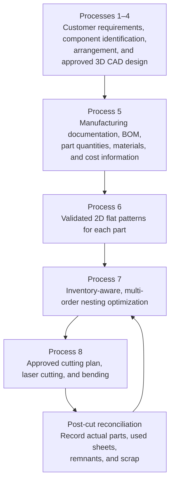

# Process 7 — Optimized Laser-Cutting Nesting

> [!abstract] Purpose
> Optimize sheet-metal cutting across the workshop's production workload—not just one box or one sheet. Compare full sheets, partially used sheets, reusable remnants, current customer orders, and confirmed future jobs to generate feasible cutting layouts that reduce total cost and material waste while respecting manufacturing constraints and delivery deadlines.

## 1. Overview

The workshop manufactures electrical sheet-metal enclosures and related components. Customer orders may include enclosure bodies, doors, top and bottom panels, mounting plates, brackets, and other sheet-metal parts. Different parts may require different materials or thicknesses.

The system must determine:

- Which approved parts should be cut together.
- Which available sheet or remnant should supply each part.
- How parts should be arranged on each sheet.
- Whether compatible parts from multiple orders should share a cutting layout.
- Which leftovers should be preserved for future jobs.
- Which plan has the lowest feasible overall cost.
- How actual cutting results should update inventory for the next optimization cycle.

**Core principle:** optimize the workshop's production workload and material inventory, rather than optimizing only one enclosure or one sheet at a time.

## 2. How Process 7 connects to earlier and later processes

- **Process 5** provides part IDs, quantities, material specifications, thicknesses, and cost information. Its quotation logic remains the primary quotation process; Process 7 supplies more realistic material-use and cutting-cost estimates when available.
- **Process 6** creates and validates the unfolded 2D profile of each sheet-metal part.
- **Process 7** arranges multiple validated profiles across compatible sheets and decides which sheets to use.
- **Process 8** receives the approved nesting package for manufacturing.
- **Post-cut reconciliation** updates inventory so the next optimization uses the real remaining stock.

Process 7 is not the same as Process 6: Process 6 validates individual flat patterns; Process 7 arranges multiple parts across stock sheets. It is also not a replacement for Process 5's customer quotation calculation.

## 3. Inputs required by the optimizer

### 3.1 Part and customer-order data

Each part should be linked to its customer order and approved drawing revision.

| Field | Example / description |
|---|---|
| Part ID | `DOOR-001` |
| Customer order | `ORDER-102` |
| Part type | Enclosure door |
| Flat-pattern dimensions | Example only: 420 × 310 mm |
| Quantity required | Example only: 5 |
| Material grade | Verified specification |
| Thickness | Example only: 1.2 mm |
| Due date | Required delivery date |
| Drawing revision | Approved revision |
| Priority | Normal, urgent, or policy-defined |

These example values are illustrative only and are not confirmed specifications for a real job.

The system must distinguish an enclosure from its individual components. A single enclosure may contain a body, door, top panel, bottom panel, mounting plate, and brackets. Parts with different thicknesses or material grades generally need different compatible stock groups.

### 3.2 Sheet and remnant inventory

Maintain a record for every full sheet and reusable remnant.

- Unique sheet or remnant ID.
- Material grade and thickness.
- Original stock dimensions.
- Current usable geometry, including cut-outs and notches.
- Stock cost and purchase history.
- Reserved or unreserved status.
- Workshop storage location.
- Condition, damage, and inspection status.
- Full-sheet or remnant classification.
- Date and job from which a remnant originated, when known.

**Important:** a remnant's bounding dimensions are not enough. A nominal 300 × 200 mm remnant may contain openings, damaged edges, or narrow regions that prevent a part from fitting. The optimizer needs a reliable geometric representation of the actual usable material.

### 3.3 Manufacturing and machine constraints

The optimizer must use approved values for:

- Laser kerf (material removed by the cut).
- Minimum spacing between cutting profiles.
- Required sheet-edge margins.
- Permitted part rotations and orientations.
- Grain, brushing, or surface-direction requirements.
- Lead-in and lead-out requirements.
- Machine-bed size and material limits.
- Cutting speed, setup, and handling requirements.
- Part stability and minimum-feature rules.
- Any machine- or material-specific cutting restrictions.

A layout is not feasible merely because its parts fit inside a rectangle. It must satisfy all applicable cutting and manufacturing constraints.

### 3.4 Current and future demand

Keep demand in separate categories:

1. **Current confirmed jobs:** orders ready or scheduled for production.
2. **Confirmed future jobs:** orders with later production or delivery dates.
3. **Forecast demand:** estimates based on reliable historical data, if available.
4. **Reserved stock:** material intentionally held for a specific job.
5. **Reusable remnants:** verified leftover pieces available for compatible work.

Do not treat a forecast as a confirmed order. Forecasts can inform planning, but must not silently override real orders or trigger speculative production without an approved policy.

## 4. End-to-end workflow

### Step 1 — Collect eligible flat patterns and requirements

Load approved flat-pattern files from Process 6, together with part IDs, required quantities, material specifications, drawing revisions, customer orders, and due dates.

Reject or flag missing, unapproved, incompatible, or outdated inputs. Do not use a superseded drawing revision without authorization.

### Step 2 — Group parts by compatible material and thickness

Build compatible nesting groups using material grade, thickness, finish, grain/orientation requirements, and other relevant specifications.

Illustrative groups:

| Group | Material | Thickness |
|---|---|---:|
| A | Mild steel | 1.0 mm |
| B | Mild steel | 1.2 mm |
| C | Mild steel | 1.6 mm |
| D | Stainless steel | 1.2 mm |

These groups are examples only. Actual grouping must follow the workshop's material specifications and manufacturing rules. Parts that are geometrically similar cannot be combined if their material requirements are incompatible.

### Step 3 — Analyze partially used sheets

For a partially cut sheet, determine its current usable geometry and check:

- Whether each required part fits in a usable region.
- Whether allowed rotations make a fit possible.
- Whether old cut-outs interfere with the proposed profile.
- Whether kerf, spacing, edge margins, and machine constraints are satisfied.
- Whether the leftover is more valuable for a different current or future part.

A small remnant may be ideal for brackets but useless for a large enclosure door. The optimizer should reason about shape and fit, not just remaining area.

### Step 4 — Analyze full sheets

For each compatible full sheet, test possible arrangements of eligible parts. Consider how many required parts can be produced, whether multiple sheets are necessary, and what reusable material remains afterward.

Large parts may be placed first as a useful heuristic, with smaller parts placed into suitable regions. However, no single placement heuristic is always best; the nesting engine should compare candidate layouts.

### Step 5 — Generate candidate production plans

Generate multiple feasible alternatives rather than selecting a sheet using a simple rule.

| Candidate | Strategy | Main trade-off |
|---|---|---|
| A | Remnant-first | Reuses existing material, but may leave awkward remaining regions |
| B | Full-sheet layout | Offers continuous material, but may require a new stock purchase |
| C | Multi-order nesting | Combines compatible parts from several orders, subject to deadlines and constraints |
| D | Future-aware reservation | Preserves a useful remnant for a confirmed upcoming job when this lowers overall cost |

The optimizer may also split requirements across several sheets. It should not force all parts onto one sheet if doing so increases cost, violates constraints, or causes unacceptable delays.

### Step 6 — Evaluate the whole-workshop plan

For each candidate plan, calculate or estimate:

- New material purchases.
- Material assigned from existing stock and remnants.
- Cutting time and machine setup.
- Handling and movement.
- Expected scrap and unusable waste.
- Reusable remaining material.
- Job due dates and rescheduling impact.
- Effects on confirmed future orders.
- Any policy-approved value for preserving useful remnants.

Use verified workshop rates and approved business rules. Avoid double-counting material costs—for example, charging the original full-sheet purchase cost again every time a remnant is reused.

### Step 7 — Select the best feasible plan

Choose the plan that minimizes the approved cost objective while meeting all hard constraints. A low cost score must never compensate for an incompatible material, invalid geometry, machine limitation, or missed mandatory requirement.

The result should explain why a plan was selected and show the important trade-offs against alternatives.

### Step 8 — Produce and validate the nesting package

For every selected sheet, generate:

- A nesting diagram with sheet boundaries and labeled parts.
- Sheet/remnant ID, material grade, and thickness.
- Part IDs, quantities, rotations, and orientation.
- Required spacing, kerf, and edge margins.
- Estimated utilization, scrap, and remaining usable geometry.
- Machine-compatible cutting data exported through the appropriate CAM workflow.
- Links to customer orders, approved drawings, and revisions.

The CAM output must be checked against the machine's requirements. A diagram or AI-generated image is not a substitute for validated machine toolpaths.

### Step 9 — Obtain approval and hand off to production

Present the proposed plan to an authorized operator or production planner. After approval, hand the validated nesting package to Process 8. Keep the selected plan and its revision traceable.

### Step 10 — Reconcile actual cutting results

After cutting:

1. Record which sheets and remnants were actually used.
2. Associate produced parts with their IDs and customer orders.
3. Record rejected, damaged, missing, or reworked parts.
4. Capture or measure the actual remaining sheet geometry.
5. Classify each remainder as reusable, reserved, or scrap.
6. Update stock, job progress, and relevant cost records.
7. Re-run optimization when new orders, inventory changes, or machine constraints warrant it.

Never assume the planned remnant shape matches the actual remnant if the cutting operation differed from the approved plan.

## 5. Future-aware optimization

This is the key feature beyond ordinary single-job nesting.

Imagine today's job needs several large enclosure panels, while a confirmed job due next week needs many small brackets. The optimizer should evaluate whether:

- The brackets can be cut from a remnant that would otherwise be discarded.
- Using a remnant today would prevent a more economical future use.
- Compatible parts from multiple orders can share a layout.
- Preserving a larger, more versatile remnant is more valuable than maximizing today's utilization.
- Cutting now would create a material shortage or deadline conflict for another confirmed order.

### Two planning horizons

**Short-term optimization**

Select the best nesting plan for the current production batch using available inventory and current requirements.

**Long-term optimization**

Plan material allocation and cutting batches across multiple upcoming jobs, considering due dates, inventory, replenishment lead times, and reliable demand forecasts.

A practical approach is a **rolling planning horizon**: plan upcoming work, execute the approved current batch, update the actual inventory, and recalculate as orders or stock change.

Do not reserve every remnant indefinitely for hypothetical orders. The expected future benefit must justify storage, handling, and material-management costs.

## 6. Roles of AI, computer vision, nesting, and IIoT

These components have different responsibilities.

### AI assistant and forecasting

Can help interpret order descriptions, classify parts, explain candidate plans, and forecast demand when sufficient reliable historical data exists.

AI must not invent material specifications, bend data, dimensions, machine constraints, or unverified costs. Predictions should be labeled as estimates.

### Computer vision

Can help identify sheets, visible cut-outs, boundaries, and possible remnant geometry. Reliable dimensional measurement requires suitable camera calibration, a known scale or measurement reference, and validation. A photograph by itself may not establish accurate production dimensions.

### Geometry-aware nesting engine

Performs precise geometric placement and feasibility calculations: part positioning, allowed rotations, collision checking, spacing, sheet allocation, and layout optimization.

Use a validated nesting/CAM engine or a geometry-aware optimization algorithm. A general-purpose language model should not be responsible for calculating production-grade cutting geometry by itself.

### Inventory and IIoT tracking

Records sheet consumption, part production, machine activity, job progress, and actual remnant status. It helps keep the next optimization run synchronized with the workshop's real inventory.

### Human approval

A responsible operator or production planner reviews and approves the cutting plan before machine execution. Automated production should follow the workshop's validated safety and authorization procedures.

## 7. Optimization objective and metrics

A simplified objective is:

\[
\begin{aligned}
\text{Total Cost} ={}&
\text{New Material Cost}\\
&+\text{Cutting and Setup Cost}\\
&+\text{Handling Cost}\\
&+\text{Scrap and Waste Cost}\\
&+\text{Delay or Rescheduling Cost}
\end{aligned}
\]

The real model should use verified rates and approved policies. Future-remnant value can be included when supported by a defensible estimate, but avoid counting it both as a current saving and a second future saving.

### Material utilization

A basic utilization metric is:

\[
\text{Utilization} =
\frac{\text{Total area of required part profiles}}
{\text{Total area of stock sheets used}}
\times 100\%
\]

For a multi-sheet plan, use the total area of stock sheets allocated to that plan in the denominator.

Utilization is useful but insufficient by itself. A plan with higher utilization can still cost more due to additional setups, longer cutting paths, handling, or delays.

Report these separately:

- Profile-area utilization.
- Kerf and other unavoidable losses.
- Reusable leftover material.
- Unusable scrap.
- New material purchased.
- Cutting time and setup estimates.
- Total estimated manufacturing cost.

Only verified, usable remnants should count as available inventory.

## 8. Recommended website dashboard

Create an **AI Sheet-Nesting Optimizer** dashboard with these sections:

1. **Sheet inventory:** full sheets, partial sheets, remnant IDs, material grades, thicknesses, locations, and usable geometry.
2. **Production queue:** current and upcoming jobs, quantities, due dates, priorities, and approval status.
3. **Compatibility groups:** parts grouped by material, thickness, and relevant cutting requirements.
4. **Candidate plans:** side-by-side alternatives with selected sheets, cutting diagrams, estimated costs, and trade-offs.
5. **Future-demand planning:** confirmed upcoming work, optional forecasts, reserved stock, and expected remnant use.
6. **Nesting results:** per-sheet layout, part labels, orientation, utilization, scrap, and remaining material.
7. **Machine handoff:** approval status, validated CAM output, file revision, and production status.
8. **Post-cut reconciliation:** actual sheet usage, produced parts, rejects, reusable remnants, and scrap.
9. **Traceability:** links from each cut part to its customer order, drawing revision, stock sheet, and cutting plan.

The dashboard should distinguish measured or verified values from AI predictions and estimates. Operators should be able to compare plans and approve the chosen layout before cutting.

## 9. Illustrative multi-order example

Suppose the workshop has:

- Sheet 1: a partially used sheet.
- Sheet 2: a full sheet.
- Order A: one electrical enclosure.
- Order B: five doors.
- Order C: ten mounting plates.
- Order D: twenty brackets required for a confirmed future delivery.

The optimizer checks the approved flat patterns and separates parts by compatible material and thickness. It tests whether some small parts fit on Sheet 1, whether large panels require Sheet 2, and whether compatible parts from multiple orders can share a layout.

It also evaluates whether a leftover region should be preserved for Order D. It then compares material purchases, cutting time, setup, scrap, and deadlines.

The final choice might use both sheets, preserve one sheet, or use a different combination. **No particular outcome can be claimed without actual dimensions, part geometries, stock costs, and manufacturing constraints.**

## 10. Outputs of Process 7

The process should produce:

- Approved nesting plan for each selected sheet.
- Selected full sheets and remnants.
- Part allocation by sheet and customer order.
- Machine-compatible cutting files after CAM validation.
- Estimated material utilization, scrap, and reusable leftovers.
- Estimated material and cutting costs for the quotation workflow.
- Updated inventory/remnant records after actual cutting.
- Traceability records for stock, parts, jobs, and drawing revisions.
- A comparison of alternatives and an explanation of the selected plan.

## 11. Image placeholders for Obsidian

Replace each placeholder with a locally saved image. No external image URLs are required.

- ``
- ``
- ``
- ``
- ``
- ``

Suggested image topics: a partially used metal sheet with cut-outs, a full sheet with multiple labeled profiles, a multi-order nesting diagram, a nesting software dashboard, a laser cutter, and a remnant inventory interface.

## 12. Related Obsidian notes

Link these notes to keep the project knowledge graph connected:

- [[Process 1 - Customer Requirement Collection]]
- [[Process 2 - Component Identification and Digital Library]]
- [[Process 3 - AI-Assisted Internal Component Arrangement]]
- [[Process 4 - Final 3D CAD Enclosure Design]]
- [[Process 5 - CAD-to-Manufacturing Documentation, BOM and Quotation]]
- [[Process 6 - Sheet-Metal Flat-Pattern Development and Validation]]
- [[Process 8 - Cutting and Bending]]
- [[AIoT System Architecture]]
- [[IoT Job-Tracking Dashboard]]
- [[Camera-Based Dimensional Inspection]]
- [[Computer-Vision Feature Detection and Dimension Comparison]]

These wiki links are intended as Obsidian note connections; create or rename the related notes to match your actual vault filenames.

## 13. Final process definition

**Process 7 — Optimized Laser-Cutting Nesting** is an inventory-aware, multi-order, and future-aware manufacturing optimization process. It uses validated sheet-metal flat patterns, current stock sheets, partially used sheets, reusable remnants, current customer orders, and confirmed future production requirements to generate feasible cutting layouts. It compares alternative sheet allocations and nesting arrangements to reduce total material and manufacturing costs, minimize waste, preserve valuable remnants, and meet production deadlines. AI assists with order interpretation, forecasting, and recommendations; a geometry-aware nesting engine calculates feasible layouts; and the inventory/IIoT system records actual material consumption and updates stock for subsequent jobs.

**The central goal is to optimize the workshop's production workload and material inventory—not merely one box or one sheet at a time.**
