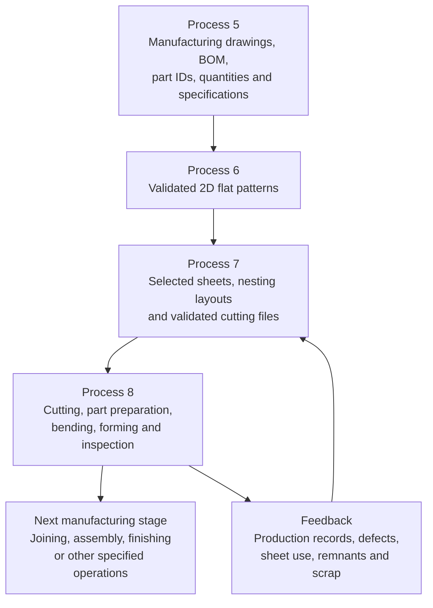

# Process 8 — Sheet-Metal Cutting, Bending and Component Fabrication

> [!abstract] Purpose
> Convert the approved nesting plans from [[Process 7 - Optimized Laser-Cutting Nesting]] into the complete set of physical sheet-metal components required for an electrical enclosure. Cut and form the main body, top and bottom panels, door, base or mounting plate, brackets, supports, and other specified parts. Track production, inspect the components, and update material inventory before handing accepted parts to the next manufacturing stage.

## 1. Overview

Process 8 is the physical manufacturing stage of the AIoT-Based Smart Sheet Metal Panel Fabrication System. It manufactures all required components according to the approved CAD design, BOM, flat patterns, material specifications, dimensions, and production requirements.

The process covers:

1. Production preparation.
2. Cutting all required sheet-metal components.
3. Separating, identifying, deburring, and preparing cut parts.
4. Bending and forming components according to their designs.
5. Inspecting fabricated parts.
6. Recording production progress and actual outcomes.
7. Updating sheet, scrap, and remnant inventory.
8. Handing accepted components to the next manufacturing operation.

**Core principle:** manufacture and track the entire set of required components—not only the main enclosure body.

## 2. Connection to the other processes

- **Process 5** provides manufacturing drawings, BOM items, part IDs, quantities, material and thickness specifications, and cost information.
- **Process 6** creates and validates each individual part's unfolded 2D flat pattern.
- **Process 7** selects compatible sheets and remnants, arranges multiple parts into nesting layouts, and prepares the cutting package.
- **Process 8** manufactures, identifies, forms, and inspects the physical parts.
- The next process depends on the real workshop workflow and may include joining, assembly, finishing, hardware installation, or other operations.
- Actual material use and remnant data return to Process 7 for future optimization.

Process 8 performs the manufacturing work. It does not replace flat-pattern validation from Process 6 or nesting optimization from Process 7.

## 3. Components manufactured

The approved CAD model and BOM determine the exact components and operations. Typical enclosure components include:

### 3.1 Main box body

Cut the approved flat blank for the main body. Depending on the design, it may include the rear panel, side sections, and flanges intended to be bent. Some designs use a single folded blank; others use separate panels that are joined later.

Required holes, slots, cut-outs, reliefs, and mounting features must match the approved manufacturing data.

### 3.2 Top and bottom panels

Cut the top and bottom panels if they are separate components in the design. Features may include fixing holes, cable-entry openings, ventilation slots, and tabs. Bend their edges only where the approved design requires it.

### 3.3 Door panel

Cut the door profile and specified features such as hinge holes, lock or handle openings, indicator or display cut-outs, ventilation slots, and mounting holes. Bend or reinforce the door edges if required by its design.

Cutting prepares the required geometry; it does not install the hinges, handles, locks, or electrical devices.

### 3.4 Base or mounting plate

Cut the plate to its approved size and produce its specified holes or slots. The hole pattern must match the approved internal component layout. The plate may remain flat or require forming, depending on the design.

### 3.5 Other components

Cut and form all other components listed in the BOM, as applicable:

- Mounting brackets and supports.
- Reinforcement plates.
- Mounting tabs.
- Cable supports.
- Other customer-specific sheet-metal parts.

The BOM and approved drawings—not a generic component list—are the authority for the actual parts and quantities.

## 4. Step-by-step manufacturing workflow

### Step 1 — Production preparation

Before cutting begins, verify:

- Customer order and job ID.
- Approved drawing and revision.
- Material grade, finish, and thickness.
- Correct stock sheet or remnant from Process 7.
- Required quantities and part IDs.
- Approved nesting layout and cutting-program revision.
- Machine compatibility, tooling, safety, and operational readiness.
- Required inspection criteria and work instructions.

For example, a door may require 1.2 mm steel while the body uses 1.0 mm and the mounting plate uses 1.6 mm. These are illustrative values only; actual specifications must come from the approved BOM and design.

Flag incorrect material, missing information, or outdated drawings before production. Do not proceed by guessing missing specifications.

### Step 2 — Cut all required components

Use the validated CAM/machine program to cut the required profiles from the sheets selected in Process 7.

Cutting may create:

- External part boundaries.
- Mounting holes and slots.
- Cable-entry openings.
- Ventilation cut-outs.
- Door handle, lock, or hinge features.
- Bracket and support profiles.
- Other features specified in the approved drawings.

The nesting plan may contain parts for several customer orders. Preserve part identity and order traceability so similar-looking components do not become mixed.

**Manufacturing rule:** use validated machine-compatible cutting data. An AI-generated picture is not a substitute for an approved cutting program or toolpath.

### Step 3 — Separate, identify, and prepare parts

After cutting, remove and separate the components according to the workshop's safe operating procedures.

Link each part to:

- Customer order and job ID.
- Product or enclosure ID.
- Part ID and drawing revision.
- Material and thickness.
- Required and produced quantities.
- Current operation and status.

A barcode, QR code, label, or job-linked digital record can help maintain traceability.

Deburr and prepare edges as required. Inspect for sharp edges, dross, burrs, visible damage, and distortion. Protect surfaces that could be scratched before finishing.

### Step 4 — Perform initial cut-part inspection

Before bending, check that:

- Required quantities have been cut.
- The profile matches the approved flat pattern.
- Required holes and cut-outs are present.
- Parts are not visibly damaged or excessively distorted.
- Part identification is readable and correct.
- The part is ready for its next operation.

Record missing, damaged, or defective parts. Determine whether they require rework, replacement cutting, or engineering review according to workshop policy.

### Step 5 — Bend and form components

Use the approved work instructions and suitable press-brake tooling to form parts that require bends.

**Main body:** form the sides, flanges, and other designed features. Follow the approved bend sequence to prevent tooling interference and incorrect geometry.

**Top and bottom panels:** bend edge flanges, returns, or other features where required. Leave panels flat if that is their specified design.

**Door:** form the edges or reinforcement flanges needed for stiffness and fit, while preserving the specified hinge, lock, and handle feature locations.

**Base or mounting plate:** keep flat or form as required by the approved design.

**Brackets and supports:** apply the individual bend angles and dimensions specified in their drawings.

Some enclosure bodies are formed from one blank; others are assembled from separate panels. Follow the actual CAD design and manufacturing plan.

### Bending accuracy controls

Bending depends on:

- Material grade and thickness.
- Bend angle and inside radius.
- Punch and die selection.
- Bend sequence.
- Springback compensation.
- Tooling and machine limits.
- Required dimensional tolerances.

Use verified bend settings and engineering-approved instructions. Do not invent bend parameters from an AI prediction.

### Step 6 — Inspect the fabricated components

After bending, compare the components with their approved drawings and inspection criteria.

| Component | Example inspection checks |
|---|---|
| Main body | Overall dimensions, bend angles, flange positions, squareness |
| Top panel | Dimensions, required bends, fit with body |
| Bottom panel | Dimensions, mounting features, fit with body |
| Door | Dimensions, flange angles, hinge and lock feature positions |
| Mounting plate | Dimensions, hole positions, flatness or formed geometry |
| Brackets and supports | Bend angle, flange dimensions, hole positions |

Use appropriate measuring tools, angle gauges, fixtures, templates, or validated inspection equipment. A part can be cut correctly but still fail because of an incorrect bend angle or flange length.

Record each part or batch as accepted, rework required, rejected, or awaiting inspection, according to the workshop's quality procedures.

### Step 7 — Track production status

Maintain a live job record for each part or production batch. Example statuses include:

- Pending.
- Ready for cutting.
- Cutting in progress.
- Cut complete.
- Preparation/deburring.
- Ready for bending.
- Bending in progress.
- Forming complete.
- Inspection pending.
- Accepted.
- Rework required.
- Rejected.
- Ready for the next process.

Statuses must be updated from machine events, operator scans, or verified manual entries. A scheduled operation should not automatically count as completed.

### Step 8 — Update material inventory and costs

Record what actually happened during manufacturing:

- Sheets and remnants consumed.
- Parts produced and their quantities.
- Actual remaining material geometry, when verified.
- Reusable remnants and their locations.
- Unusable scrap.
- Defective or reworked parts.
- Actual cutting and bending time, where available.

Return verified remnant information to [[Process 7 - Optimized Laser-Cutting Nesting]] so future jobs can reuse suitable material.

Keep estimated and actual costs distinct. Process 5 remains the primary quotation process; Process 8 supplies actual production data that can support costing analysis and approved quotation updates.

### Step 9 — Handoff to the next manufacturing operation

Before releasing components, check that:

- Required components and quantities are accounted for.
- Required inspections have passed or exceptions are formally recorded.
- Parts are grouped by enclosure and customer order.
- Part identities and drawing revisions remain traceable.
- Defects, missing components, and rework are addressed or flagged.
- The next operation has the required parts and records.

Accepted components can proceed to joining, assembly, finishing, hardware installation, electrical-component installation, or another operation specified by the workshop's production plan. These are separate operations unless the real workflow explicitly includes them in Process 8.

## 5. AIoT system integration

### AI assistant

AI can help interpret production instructions, highlight missing information, explain approved work instructions, analyze recurring defects, and compare planned with actual performance.

AI must not invent material specifications, dimensions, bend parameters, machine settings, or unverified costs.

### IoT and machine data

Where supported by machine controllers or installed sensors, capture:

- Machine state and alarms.
- Job start and completion.
- Operation and cycle times.
- Machine interruptions.
- Production counts and job progress.

Not every machine exposes all these data. The implementation depends on the available controller interfaces, sensors, and connectivity.

### Computer vision

Computer vision can assist with part identification and visual defect detection. Reliable dimensional acceptance requires appropriate calibration, measurement methods, controlled conditions, and validation. Detailed camera-based dimensional comparison is developed in the later inspection processes.

### Production database

Connect these records:

- Customer order and product ID.
- Part ID and approved drawing revision.
- BOM item and required quantity.
- Source sheet or remnant ID.
- Machine and operation.
- Production timestamps and quantities.
- Inspection results and defects.
- Rework, scrap, and remnant records.

This traceability allows the workshop to determine which sheet produced a part, which order it belongs to, and what happened during manufacturing.

## 6. Example production tracker

The following is an illustrative example, not live workshop data.

| Component | Required quantity | Example status |
|---|---:|---|
| Main body | 1 | Cut and bent; inspection pending |
| Top panel | 1 | Cut; bend if required by design |
| Bottom panel | 1 | In production |
| Door | 1 | Cut and bent; inspection pending |
| Base/mounting plate | 1 | Cut; feature inspection pending |
| Brackets and supports | As specified | Pending or in production |

The actual quantity and status must come from the approved BOM and recorded manufacturing events.

The system should identify missing parts before the enclosure moves to assembly. A complete body does not mean the order is ready if the door, mounting plate, or required brackets are still missing.

## 7. Inputs and outputs

### Inputs

- Approved CAD design and manufacturing drawings.
- BOM, part IDs, quantities, materials, and thicknesses.
- Validated flat patterns from Process 6.
- Selected sheets, nesting layouts, and cutting files from Process 7.
- Approved machine programs, tooling requirements, and work instructions.
- Inspection criteria and customer/order requirements.

### Outputs

- Cut main body, door, top and bottom panels.
- Cut base or mounting plates and all other specified components.
- Bent and formed parts where required.
- Part identification and production-tracking records.
- Inspection results, defect records, and rework status.
- Actual sheet consumption, scrap, and verified remnant records.
- Production time and cost data where available.
- Accepted components ready for the next manufacturing operation.

## 8. Safety and quality controls

- Follow machine-specific safety procedures and authorized operating practices.
- Verify machine programs, material, tooling, and job identity before production.
- Use suitable handling and personal protective equipment for sharp, heavy, or hot parts.
- Do not bypass machine safeguards or approved operating procedures.
- Use verified engineering settings for cutting and bending.
- Keep defective or unverified parts from being recorded as accepted.
- Maintain traceability through rework and replacement operations.
- Require appropriate human authorization before releasing parts or changing controlled production settings.

## 9. Image placeholders for Obsidian

Save suitable images locally and replace these placeholders when building the note. No external image URLs or downloaded images are included.

- ``
- ``
- ``
- ``
- ``
- ``

Suggested image topics: laser cutting, separated flat components, press-brake bending, formed brackets, dimensional inspection, and a production-tracking interface.

## 10. Related Obsidian notes

- [[Process 1 - Customer Requirement Collection]]
- [[Process 2 - Component Identification and Digital Library]]
- [[Process 3 - AI-Assisted Internal Component Arrangement]]
- [[Process 4 - Final 3D CAD Enclosure Design]]
- [[Process 5 - CAD-to-Manufacturing Documentation, BOM and Quotation]]
- [[Process 6 - Sheet-Metal Flat-Pattern Development and Validation]]
- [[Process 7 - Optimized Laser-Cutting Nesting]]
- [[Process 9 - Automated Fabrication Quotation Dashboard]]
- [[AIoT System Architecture]]
- [[IoT Job-Tracking Dashboard]]
- [[Camera-Based Dimensional Inspection]]
- [[Computer-Vision Feature Detection and Dimension Comparison]]

These wiki links are intended as Obsidian connections. Create or rename related notes to match the filenames in your vault.

## 11. Final process definition

**Process 8 — Sheet-Metal Cutting, Bending and Component Fabrication** converts approved and optimized cutting plans into the physical components required for an electrical enclosure. It covers production preparation, cutting all required parts, part identification and deburring, bending and forming, inspection, production tracking, and inventory reconciliation. The AIoT system links every component to its customer order, approved design, source sheet, and manufacturing status, while recording actual production outcomes for traceability, cost analysis, and future cutting optimization.

**The central objective is to ensure that every required component—not just the main box body—is manufactured correctly, tracked accurately, inspected, and ready for the next stage of production.**
