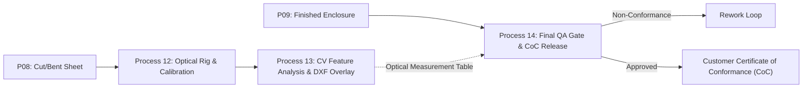

# Domain 3: Quality Inspection & Metrology

The **Quality Inspection & Metrology** domain establishes the hardware standards, calibration protocols, computer-vision algorithms, and final acceptance criteria ensuring fabricated sheet-metal enclosures strictly adhere to approved engineering drawings and customer specifications.

---

## 1. Domain Workflow Architecture

---

## 2. Authoritative Process Reports (Processes 12 to 14)

- **[Process 12: Camera-Based Dimensional Inspection](processes/process-12-camera-dimensional-inspection.md)**
  - Gantry hardware mounting, telecentric optics, diffuse LED backlighting, and sub-pixel calibration.
- **[Process 13: Computer-Vision Feature Detection and Dimension Comparison](processes/process-13-computer-vision-analysis.md)**
  - Canny edge detection, ICP coordinate registration, nominal DXF overlay, and tolerance calculation.
- **[Process 14: Final Fabricated Enclosure and Quality Inspection](processes/process-14-final-quality-inspection.md)**
  - The 6 mandatory QA gates (dimensions, workmanship, coating, mechanics, earth bonding, BOM audit) and release authorization.

---

## 3. Specialized Metrology Reference Standards

- **[Inspection Criteria & Tolerance Standards](inspection-criteria.md)**
  - ISO 2768-m tolerance tables, surface defect classification, and coating thickness standards.
- **[Inspection Data Flow & Review Gates](inspection-data-flow.md)**
  - Detailed pipeline mapping image acquisition, telecentric correction, edge detection, CAD comparison, and CoC signing.
