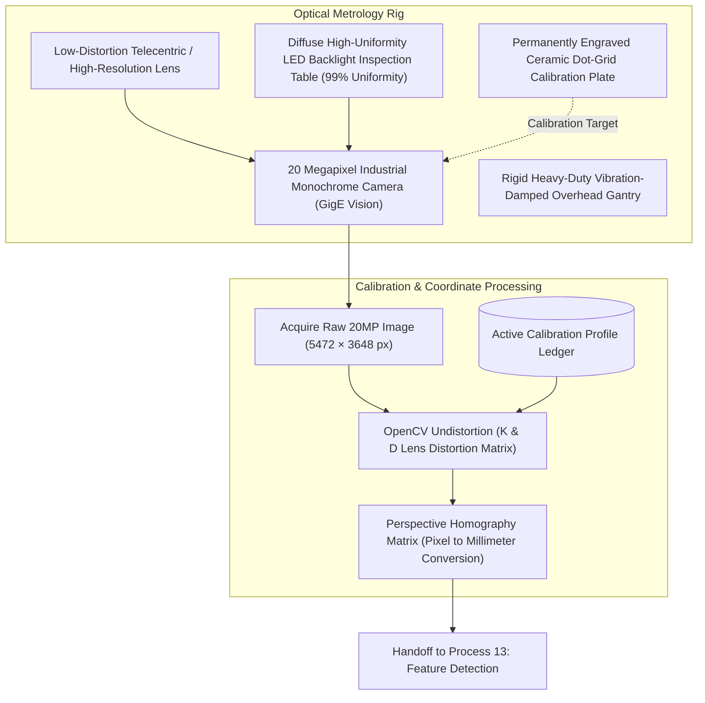

# Process 12: Camera-Based Dimensional Inspection

Process 12 governs the physical optical metrology rig, camera sensor hardware, lighting enclosures, telecentric optics, and geometric calibration routines used to capture dimensionally accurate, perspective-free images of fabricated sheet-metal parts.

---

## 1. Visual Inspection Setup Reference

*Figure 12.1: Optical inspection station featuring rigid aluminum extrusion gantry, high-resolution top-down camera, diffuse LED backlight table, and fiducial calibration grid.*

---

## 2. Optical Metrology Hardware Architecture

Optical measurement in sheet-metal manufacturing requires sub-millimeter precision ($\pm 0.1\text{ mm}$ over an $800 \times 600\text{ mm}$ field of view). Standard wide-angle lenses introduce barrel distortion and perspective error (parallax), where objects closer to the lens appear larger.

---

## 3. Telecentric Imaging & Optical Principles

1. **Orthographic Projection**: Telecentric lenses have entrance pupils at infinity, collecting only light rays parallel to the optical axis. This ensures that a part resting on the table or elevated by a 1.5 mm burr exhibits identical magnification across its height.
2. **Diffuse Backlighting**: Illuminating the sheet-metal blank from below produces crisp, high-contrast silhouette edges, completely eliminating surface glare, oil sheen, and mill-scale reflections that confuse edge-detection algorithms.
3. **Sub-Pixel Spatial Resolution**:
   - Field of View (FOV): $1000\text{ mm} \times 750\text{ mm}$
   - Sensor Resolution: $5472 \times 3648$ pixels (20 Megapixels)
   - Optical Pixel Pitch: $\approx 0.183\text{ mm per pixel}$
   - With OpenCV sub-pixel edge interpolation (`cv2.cornerSubPix` / Zernike moments), feature boundaries are resolved to **0.02 mm** ($\approx 1/10\text{th}$ pixel).

---

## 4. Calibration Workflow

Before analyzing production parts, the system must execute the validated calibration cycle:
1. **Target Positioning**: Place the precision chrome-on-glass or ceramic dot-grid calibration plate on the backlit staging table.
2. **Intrinsics Estimation**: Detect grid centroids using `cv2.findCirclesGrid`; solve for camera intrinsic matrix $K$ and radial distortion coefficients $k_1, k_2, p_1, p_2$:
   $$\begin{bmatrix} x' \\ y' \\ 1 \end{bmatrix} = \mathbf{K} \begin{bmatrix} r_{11} & r_{12} & t_1 \\ r_{21} & r_{22} & t_2 \\ r_{31} & r_{32} & t_3 \end{bmatrix} \begin{bmatrix} X_w \\ Y_w \\ 1 \end{bmatrix}$$
3. **Homography Mapping**: Compute the planar transformation matrix $\mathbf{H}$ mapping undistorted pixel coordinates $(u, v)$ to world coordinates $(X_{mm}, Y_{mm})$.
4. **Validation Check**: Verify that residual reprojection error is $< 0.15\text{ pixels}$. Store the calibration timestamp and identifier `CALIB-2026-Q4-01`.

---

## 5. Process Handoff

Process 12 outputs an undistorted, perspective-corrected 20MP image bound to an active calibration profile. This validated frame is consumed by [Process 13: Computer-Vision Feature Detection and Dimension Comparison](process-13-computer-vision-analysis.md) for automated nominal CAD comparison.
