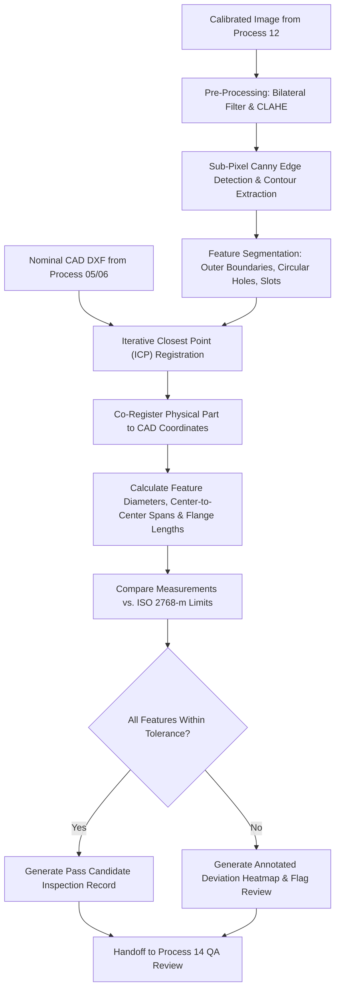

# Process 13: Computer-Vision Feature Detection and Dimension Comparison

Process 13 provides the software intelligence and metrology comparison engine that receives calibrated optical frames from [Process 12](process-12-camera-dimensional-inspection.md), detects part geometry, aligns physical features with nominal CAD drawings, and computes exact dimensional deviations.

---

## 1. Visual Metrology Dashboard Reference

*Figure 13.1: Industrial computer-vision inspection dashboard showing live part contour tracing, hole center alignment, green/amber/red tolerance indicators, and deviation charts.*

---

## 2. Core Differences: Process 12 vs. Process 13

| Dimension | Process 12: Optical Metrology Rig | Process 13: Feature Extraction & Comparison Engine |
|---|---|---|
| **Domain Scope** | Hardware & Optical Acquisition | Software Algorithms & Analytical Metrology |
| **Primary Concern** | Rigidity, telecentric optics, diffuse backlighting, calibration grids | Canny edge filtering, contour hierarchy, DXF alignment, tolerance delta math |
| **Key Output** | Undistorted, metric-calibrated 20MP grayscale frame | Detailed tabular discrepancy report and visual deviation heatmap |

---

## 3. Algorithmic Feature Detection Pipeline

---

## 4. Geometric Alignment & ICP Registration

To accurately measure cutouts and flange distances without requiring micrometer-perfect mechanical clamping:
1. **Rough Alignment**: The outer bounding polygon of the cut sheet is extracted via `cv2.findContours`. Principal Component Analysis (PCA) determines part orientation angle $\theta$.
2. **Iterative Closest Point (ICP)**: A rigid 2D transformation matrix $[\mathbf{R} \mid \mathbf{t}]$ is iteratively refined, minimizing the root-mean-square distance between physical detected edge points and nominal CAD DXF polyline vertices:
   $$E(\mathbf{R}, \mathbf{t}) = \sum_{i=1}^{N} \left\| \mathbf{R} \mathbf{p}_i + \mathbf{t} - \mathbf{q}_i \right\|^2$$
3. **Feature Correlation**: Once registered, each detected circular contour is paired with its corresponding nominal CAD hole ID (`HOLE_DIA_M4_01`, `HOLE_DIA_M4_02`).

---

## 5. Mathematical Tolerance & Deviation Calculation

For each feature $k$:
$$\Delta = M_k - N_k$$
where $M_k$ is the optical sub-pixel measurement and $N_k$ is the nominal CAD dimension.
- **Pass State**: $L_k \le M_k \le U_k$ (where $L_k$ and $U_k$ are the approved tolerance bounds).
- **Flagged State**: $M_k < L_k$ or $M_k > U_k$.

### Example Automated Output Table (Job #JOB-2026-0042)
| Feature ID | Nominal Dimension | Measured Value | Lower Limit | Upper Limit | Deviation ($\Delta$) | Status |
|---|---|---|---|---|---|---|
| `OUTER_LENGTH` | 796.00 mm | 796.18 mm | 795.50 mm | 796.50 mm | +0.18 mm | **PASS** |
| `OUTER_WIDTH` | 596.00 mm | 596.12 mm | 595.50 mm | 596.50 mm | +0.12 mm | **PASS** |
| `HOLE_HINGE_1` | 4.20 mm | 4.24 mm | 4.05 mm | 4.35 mm | +0.04 mm | **PASS** |
| `HOLE_HINGE_2` | 4.20 mm | 4.22 mm | 4.05 mm | 4.35 mm | +0.02 mm | **PASS** |
| `PITCH_HINGES` | 650.00 mm | 650.62 mm | 649.50 mm | 650.50 mm | **+0.62 mm** | OUT OF TOLERANCE |

---

## 6. Process Handoff to Process 14

The structured deviation table, annotated vector overlay, and raw image are bundled into an immutable JSON payload and routed to [Process 14: Final Fabricated Enclosure and Quality Inspection](process-14-final-quality-inspection.md).
