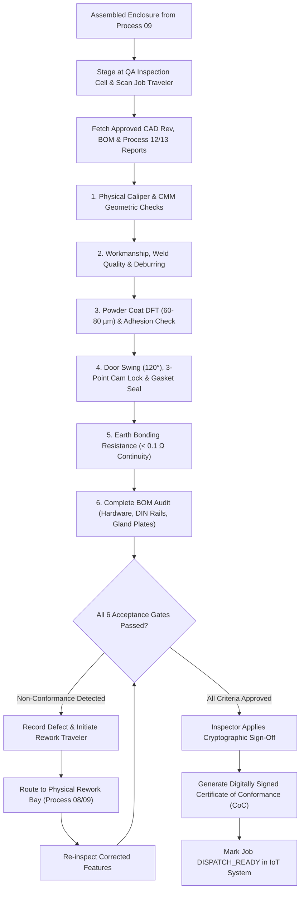

# Process 14: Final Fabricated Enclosure and Quality Inspection

Process 14 is the authoritative engineering quality gate and final release authority for the completed electrical enclosure. It validates physical dimensions, paint quality, door operation, environmental sealing, and completeness against the approved Bill of Materials (BOM) before authorized customer dispatch.

---

## 1. Visual Quality Release Reference

*Figure 14.1: Final quality inspection station showing complete powder-coated electrical enclosure passing dimensional verification and receiving inspector release certification.*

---

## 2. Final Quality Assurance Architecture

---

## 3. The Six Mandatory Quality Acceptance Gates

An enclosure cannot be released to the customer unless all six inspection gates receive explicit sign-off from a qualified QA inspector:

### Gate 1: Overall Physical Dimensions & Squareness
- Overall Height, Width, Depth verified against drawing using calibrated vernier height gauge ($L \le 1000\text{ mm} \implies \pm 0.5\text{ mm}$).
- Diagonal difference across opposite corners: $|D_1 - D_2| \le 1.0\text{ mm}$.
- Review and confirmation of optical metrology data from [Process 13](process-13-computer-vision-analysis.md).

### Gate 2: Sheet-Metal Workmanship & Deburring
- Complete absence of sharp handling burrs, dross, laser spatter, or pinch points along all exposed edges.
- Corner weld seams ground flat, smooth, and crack-free.

### Gate 3: Powder Coating Finish & Adhesion
- Dry Film Thickness (DFT) measured with electromagnetic gauge across 10 random points: must fall strictly within $70 \pm 10\ \mu\text{m}$.
- Cross-hatch adhesion test on coupon sample conforming to **ISO 2409 Class 0** (no flaking).
- Zero visible runs, pinholes, blisters, or bare corners.

### Gate 4: Mechanical Operation & Environmental Sealing
- Front door opens smoothly through minimum 120° arc without binding against hinges or enclosure flanges.
- 3-point cam locking handle rotates with positive latching feel and pulls door tight against the gasket.
- Perimeter door foam gasket verified 100% continuous without tears, gaps, or compression set.

### Gate 5: Electrical Earth Bonding Continuity
- Earth bonding verification: Measure resistance between door earthing stud, chassis main earth bar, and gland plates using low-resistance milliohm meter ($I = 10\text{ A}$ test current).
- **Mandatory Threshold**: Electrical continuity resistance must be **$< 0.1\ \Omega$**.

### Gate 6: BOM Completeness & Documentation Audit
- Physical audit verifying all items listed in the manufacturing BOM are present, correctly secured, and torque-checked:
  - Internal galvanized mounting plate installed with lock washers.
  - Gland cover plates installed with nitrile sealing gaskets.
  - Required quantity of DIN rails and wire ducts securely installed.

---

## 4. Non-Conformance & Rework Governance

> [!CAUTION]
> **Strict Defect Policy**:
> If any feature fails acceptance, the enclosure is immediately moved to the quarantine area and assigned a non-conformance ticket (`NCR-2026-XXXX`). Rework actions are tracked as distinct operations and cannot overwrite earlier failure logs. The enclosure must undergo full re-inspection through Gates 1 to 6.

---

## 5. Certificate of Conformance (CoC) Issuance

Upon successful completion of Gates 1 to 6, the system generates a tamper-evident, cryptographically signed Certificate of Conformance (CoC):
- Binds `job_id`, customer name, product serial number, approved drawing revision, and inspector ID.
- Embeds summary measurement tables and optical metrology inspection charts.
- Updates the central database to `disposition = 'RELEASED'`, transitioning the job on the [IoT Job-Tracking Dashboard](../../digital-systems/processes/process-11-job-tracking-dashboard.md) to `DISPATCH_READY`.
